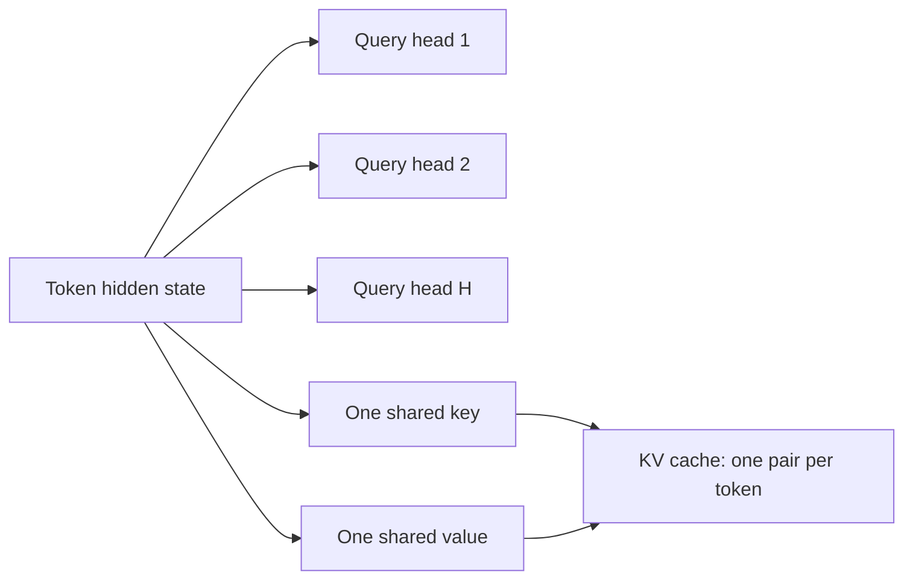
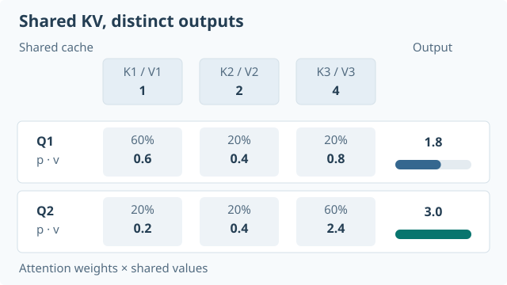

---
tags:
- engineering
- architecture
aliases:
- 多查詢注意力
---

# Multi-Query Attention

Multi-query attention shares a single key head and a single value head across all query heads of an attention layer. The KV cache becomes about as many times smaller as there are heads, which makes decoding far less memory-bound.

## Overview

In standard multi-head attention, each head keeps its own keys and values. At inference time the KV cache grows with the number of heads, and every decoding step reads all of it. Multi-query attention, proposed by Shazeer in 2019, keeps all the query heads but gives them one shared key-value head, so the cache and the bandwidth needed to read it shrink by the head count.

## Key concepts

- **Query heads**: the separate projections that each compute their own attention pattern. Multi-query attention keeps them all.
- **Shared key-value head**: a single key and value projection used by every query head.
- **Cache size**: with $H$ heads, the cache per token shrinks from $H$ key-value pairs to one.

## How it works

For each token, the layer computes $H$ query vectors but only one key vector and one value vector. During decoding, the cache stores one key and one value per token. Every query head attends over that shared cache, so the attention computation is unchanged in form while the memory traffic per step falls.

### Worked example: shared values do not imply identical outputs

[GitHub static preview](../../assets/concept-animations/mqa-shared-values-output-still.svg) · On MkDocs use the keyboard-accessible **Play/Pause** control (Enter or Space); reduced-motion preferences initially show the still.

Sharing K and V across heads does not share the queries or their attention distributions. Consider two query heads over three cached tokens with shared scalar values $v=(1,2,4)$. Their illustrative post-softmax weights are $p_1=(0.6,0.2,0.2)$ and $p_2=(0.2,0.2,0.6)$. The weighted contributions and outputs are:

| Head | Token 1 | Token 2 | Token 3 | Output |
|---|---:|---:|---:|---:|
| Q1 | 0.6 | 0.4 | 0.8 | 1.8 |
| Q2 | 0.2 | 0.4 | 2.4 | 3.0 |

The moving outline highlights the shared token whose contribution is being accumulated; the output bars use the same scale. Both rows sum attention probabilities to one, but their weighted outputs differ. The column-by-column accumulation illustrates the reduction, not the actual execution order of a fused attention kernel. These are invented scalar values and probabilities, not measured model activations. The shared-KV design is described by [Shazeer (2019)](https://arxiv.org/abs/1911.02150); the numerical example is original. This is distinct from the [GQA head-sharing and cache-growth examples](grouped-query-attention.md).

**Where do the two probability rows come from?** Use two-dimensional shared keys $k_1=(\sqrt{2},0)$, $k_2=(0,0)$ and $k_3=(0,\sqrt{2})$, with queries $q_1=(\log 3,0)$ and $q_2=(0,\log 3)$. The scaled dot products $q_h^\top k_j/\sqrt{2}$ produce logits $(\log 3,0,0)$ and $(0,0,\log 3)$, respectively. Exponentiating gives $(3,1,1)$ and $(1,1,3)$; both denominators are 5, yielding exactly the two rows in the diagram. Interpret the scalar values as one coordinate of each shared value vector. The keys and values are identical across heads, but the queries select different mixtures. This is a constructive example, not a claim that every arbitrary set of distributions is attainable with a fixed low-dimensional key matrix.

*Original instructional diagram, CC BY-SA 4.0.*

## Key methods

The method is a change to the attention layer's projections, not a new kernel. Its evidence is that decoding speed improves for the same model size, at some cost in quality.

## Results

Shazeer (2019) reports faster incremental decoding with a small quality loss on translation tasks, which is the trade-off the method is designed to make. Later work, including grouped-query attention, found that the quality gap can be recovered with more key-value heads.

## Limitations

- **Quality loss**: a single key-value head has less capacity than separate heads, which can hurt tasks that need varied attention patterns.
- **Training cost**: models must be trained with this structure. Existing multi-head checkpoints do not convert directly.
- **Diminishing returns**: once the cache is small, other costs such as weights and compute dominate.

## Open questions

- How many key-value heads are needed before quality matches standard multi-head attention for large language models?
- Does the trade-off differ between training from scratch and converting an existing model?

## References

### Seminal papers

- Shazeer, N. (2019). *Fast Transformer Decoding: One Write-Head is All You Need*. https://arxiv.org/abs/1911.02150 — Proposes sharing a single key and value head across all query heads to speed up incremental decoding.

### Related work

- Ainslie, J. et al. (2023). *GQA: Training Generalized Multi-Query Transformer Models from Multi-Head Checkpoints*. EMNLP 2023. https://arxiv.org/abs/2305.13245 — Generalises the idea to groups of key-value heads, which recovers quality while keeping most of the memory saving.
- Dao, T. et al. (2022). *FlashAttention: Fast and Memory-Efficient Exact Attention with IO-Awareness*. NeurIPS 2022. https://arxiv.org/abs/2205.14135 — Addresses the attention memory traffic that multi-query attention also reduces, through a different mechanism.
- Williams, S., Waterman, A. & Patterson, D. (2009). *Roofline: An Insightful Visual Performance Model for Multicore Architectures*. Communications of the ACM. https://escholarship.org/content/qt78h8v7mr/qt78h8v7mr.pdf — Explains why reducing bytes read per token can speed up memory-bound decoding.
- Pope, R. et al. (2023). *Efficiently Scaling Transformer Inference*. MLSys 2023. https://arxiv.org/abs/2211.05102 — Describes how attention layout affects cost when inference is partitioned across chips.
