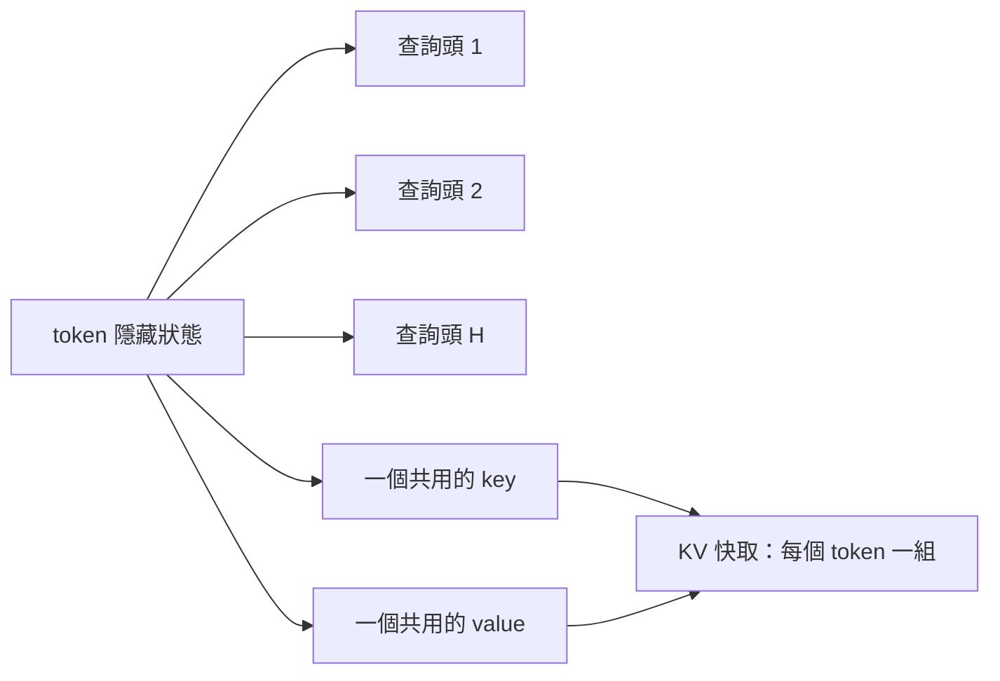

# 多查詢注意力

多查詢注意力讓一個注意力層中的所有查詢頭，共用同一組 key 頭與 value 頭。KV 快取大約縮小為頭數的倍數，使解碼受記憶體限制的程度大幅降低。

## 概述

在標準的多頭注意力中，每個頭各自保存 key 與 value。推論時，KV 快取隨頭數增加，而每次解碼都要讀取全部快取。Shazeer 在 2019 年提出的多查詢注意力，保留所有查詢頭，但讓它們共用一個 key-value 頭，因此快取以及讀取快取所需的頻寬，都縮小為頭數的倍數。

## 關鍵概念

- **查詢頭**：各自計算注意力模式的獨立投影。多查詢注意力保留全部查詢頭。
- **共用的 key-value 頭**：所有查詢頭使用的單一 key 與 value 投影。
- **快取大小**：若有 $H$ 個頭，每個 token 的快取從 $H$ 組 key-value 縮減為一組。

## 運作方式

對每個 token，該層計算 $H$ 個查詢向量，但只計算一個 key 向量與一個 value 向量。解碼時，快取每個 token 只存一組 key 與 value。每個查詢頭都對這份共用快取做注意力，因此注意力計算的形式不變，但每一步的記憶體流量下降。

## 關鍵方法

這個方法是對注意力層投影的修改，而非新的核心。它的證據是：在模型大小相同的情況下，解碼速度提升，代價是些許品質損失。

## 結果

Shazeer（2019）報告，在翻譯任務上，增量解碼速度較快，品質損失很小，這正是此方法設計要做的取捨。後續研究（包括分組查詢注意力）發現，增加 key-value 頭的數量可以補回品質差距。

## 限制

- **品質損失**：單一 key-value 頭的容量低於獨立的多個頭，可能傷害需要多樣注意力模式的任務。
- **訓練成本**：模型必須以這種結構訓練，既有的多頭檢查點無法直接轉換。
- **效益遞減**：快取變小後，權重與運算等其他成本會成為主導。

## 開放問題

- 大型語言模型要多少個 key-value 頭，品質才會與標準多頭注意力相當？
- 從頭訓練與轉換既有模型，這個取捨是否不同？

## 參考文獻

### 奠基性論文

- Shazeer, N. (2019). *Fast Transformer Decoding: One Write-Head is All You Need*. https://arxiv.org/abs/1911.02150 — 提出讓所有查詢頭共用單一 key 與 value 頭，以加速增量解碼。

### 相關研究

- Ainslie, J. et al. (2023). *GQA: Training Generalized Multi-Query Transformer Models from Multi-Head Checkpoints*. EMNLP 2023. https://arxiv.org/abs/2305.13245 — 把這個概念推廣為一組 key-value 頭，在保留大部分記憶體節省的同時恢復品質。
- Dao, T. et al. (2022). *FlashAttention: Fast and Memory-Efficient Exact Attention with IO-Awareness*. NeurIPS 2022. https://arxiv.org/abs/2205.14135 — 以不同機制處理注意力的記憶體流量，這也是多查詢注意力所減少的部分。
- Williams, S., Waterman, A. & Patterson, D. (2009). *Roofline: An Insightful Visual Performance Model for Multicore Architectures*. Communications of the ACM. https://escholarship.org/content/qt78h8v7mr/qt78h8v7mr.pdf — 解釋為什麼減少每個 token 讀取的位元組，能加速受記憶體限制的解碼。
- Pope, R. et al. (2023). *Efficiently Scaling Transformer Inference*. MLSys 2023. https://arxiv.org/abs/2211.05102 — 說明當推論被分割到多顆晶片時，注意力佈局如何影響成本。
