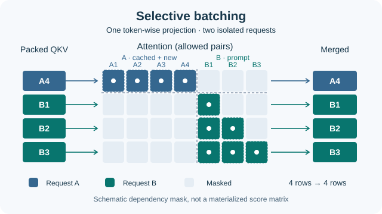

---
tags:
- engineering
- systems
---

# Orca: Iteration-Level Scheduling

Orca is a serving system that schedules generation one model iteration at a time. Finished requests leave the batch and waiting requests join between iterations, which removes the idle time that request-level batching wastes on short requests. The idea, known as continuous batching, is now standard in LLM serving engines.

## Overview

Generation is sequential: each request produces one token per iteration until it finishes. Request-level batching groups requests, then waits until the whole batch is done, so a short request sits idle while a long request in the same batch keeps going. Orca moves the scheduling decision to the iteration level, so the GPU always runs on whichever requests are still active.

## Key concepts

- **Iteration**: one forward pass of the model that produces one new token for every active request.
- **Iteration-level scheduling**: deciding the batch again before each iteration, rather than before each request.
- **Selective batching**: batching the parts of the computation that can be shared across requests, while handling attention for each request separately, because sequences have different lengths.

## How it works

Before each iteration, the scheduler removes finished requests, adds waiting requests whose prompts fit in memory, and runs one iteration on the resulting batch. Linear layers run as one batched matrix multiplication. Attention runs per request, because each request has its own cached keys and values.

*Original animated teaching diagram, CC BY-SA 4.0.* Columns t1–t4 represent **model iterations**, not wall-clock measurements. A, B and C are toy requests; numbers indicate their illustrative generated-token counts. B finishes after t1, allowing waiting request C to join at t2; A finishes after t3 while C continues. The moving outline marks the current iteration and the GPU batch label updates accordingly. This simplified schedule assumes the newly admitted request's prompt is ready to process and omits prefill and memory-capacity details; it is **not a measured throughput trace**. The MkDocs player offers keyboard-accessible **Play/Pause** and honours reduced-motion preferences. GitHub readers can use the [static four-iteration timeline](../../assets/concept-animations/orca-continuous-batching-still.svg). See the [original Orca paper](https://www.usenix.org/conference/osdi22/presentation/yu).

### Visual walkthrough: selective batching and attention isolation

[GitHub static preview](../../assets/concept-animations/orca-selective-attention-domain-still.svg) · Use keyboard-accessible **Play/Pause** on MkDocs; reduced-motion preferences show the still.

Unlike the scheduling timeline above, this example looks inside one Transformer layer. Request A is decoding token A4 with three cached positions, and request B is prefilling B1–B3. Their four new hidden-state rows can share token-wise projections, but the attention operator must respect both the request boundary and causal masking. The packed QKV projection has four input token rows; the three historical A keys and values are supplied from the cache, not recomputed as projection inputs.

| Query row | Allowed keys | Number of pairs |
|---|---|---:|
| A4 | A1, A2, A3, A4 | 4 |
| B1 | B1 | 1 |
| B2 | B1, B2 | 2 |
| B3 | B1, B2, B3 | 3 |

The animation reveals the ten allowed query–key pairs, then the four corresponding output rows. The 4 × 7 grid is a **schematic dependency mask**, not an actual dense score allocation. The original Orca selective-batching design splits attention by request and merges the outputs for the remaining batched operators. The row-by-row reveal is for teaching, not a claim about kernel execution order, attention weights, or measured GPU throughput. See Yu et al. (2022), Section 3 and Figure 5, in References.

*Original instructional diagram, CC BY-SA 4.0.*

## Key methods

Orca's method is the iteration-level scheduler and selective batching, described above. The paper's evidence compares throughput against request-level batching for GPT-style generation at comparable latency.

## Results

The paper reports large throughput gains over request-level batching for generative models, with comparable latency. Exact figures depend on the model size and workload, so readers should check the paper's evaluation section.

## Limitations

- **Memory fragmentation**: requests of different lengths still need contiguous memory in this design, which the later paged KV cache work addresses.
- **Scheduling policy**: the choice of which waiting request to admit affects fairness and latency, and the paper's policy is a simple one.
- **Workload dependence**: gains are largest when requests have very different output lengths.

## Open questions

- How should a scheduler balance long prompts, which occupy many iterations of prefill, against short requests waiting for a slot?
- Chunked prefill mixes prompt processing with decoding steps, but its effect on latency targets depends on the service objective.

## References

### Seminal papers

- Yu, G.-I. et al. (2022). *Orca: A Distributed Serving System for Transformer-Based Generative Models*. OSDI 2022. https://www.usenix.org/conference/osdi22/presentation/yu — Introduces iteration-level scheduling and selective batching for generative model serving.

### Related work

- Kwon, W. et al. (2023). *Efficient Memory Management for Large Language Model Serving with PagedAttention*. SOSP 2023. https://arxiv.org/abs/2309.06180 — Adds paged KV-cache memory management on top of iteration-level scheduling in vLLM.
- Pope, R. et al. (2023). *Efficiently Scaling Transformer Inference*. MLSys 2023. https://arxiv.org/abs/2211.05102 — Analyses how inference workloads and partitioning interact with batch size and latency.
- Williams, S., Waterman, A. & Patterson, D. (2009). *Roofline: An Insightful Visual Performance Model for Multicore Architectures*. Communications of the ACM. https://escholarship.org/content/qt78h8v7mr/qt78h8v7mr.pdf — Gives the performance model that explains why small batches leave the GPU underused.
- Dao, T. et al. (2022). *FlashAttention: Fast and Memory-Efficient Exact Attention with IO-Awareness*. NeurIPS 2022. https://arxiv.org/abs/2205.14135 — Speeds up the attention kernel that runs per request in each iteration.
