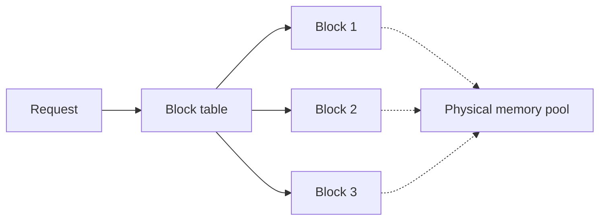

---
tags:
- engineering
- systems
aliases:
- 分頁注意力
---

# PagedAttention and vLLM

PagedAttention stores the KV cache in fixed-size blocks, like virtual-memory pages, instead of one contiguous buffer per request. The vLLM serving system is built around it. Paging removes most of the memory lost to fragmentation and over-reservation, so more requests fit on one device.

## Overview

A serving system must keep the keys and values of every active request in memory. When each request's cache is reserved as one contiguous buffer sized for the maximum possible length, most of that memory is wasted: some is reserved for tokens that are never generated, and gaps appear as requests of different lengths come and go. PagedAttention borrows the operating-system idea of paging. Blocks are allocated when needed and mapped to each request through a block table.

## Key concepts

- **Block**: a fixed number of tokens' worth of keys and values, stored in one physical memory region.
- **Block table**: a per-request mapping from logical block positions to physical blocks, which need not be contiguous.
- **Copy-on-write sharing**: requests with a common prefix, such as a shared system prompt, can point to the same blocks until one of them diverges.

## How it works

When a request starts, the system allocates blocks for its prompt. During decoding, a new block is allocated only when the current one fills. The attention kernel reads keys and values by following the block table, so it gathers them from scattered blocks. When memory runs short, the scheduler can preempt a request and swap or recompute its blocks.

## Key methods

The method is the block table with on-demand allocation and sharing, implemented in a custom attention kernel. The paper's evidence compares memory waste and serving throughput against earlier systems.

## Results

The paper reports that prior serving systems wasted most of their KV-cache memory to fragmentation and over-reservation, and that vLLM reaches higher throughput than those systems at similar latency. Exact numbers depend on the model and the workload.

## Limitations

- **Kernel complexity**: attention must read keys and values through an indirection, which needs a specialised kernel.
- **Workload dependence**: the gains from prefix sharing depend on how many requests share prompts.
- **Preemption cost**: when memory runs out, swapping or recomputing blocks adds latency.

## Open questions

- How should block size be chosen for a given model and sequence-length mix?
- Can prefix sharing and eviction policies work together without hurting tail latency?

## References

### Seminal papers

- Kwon, W. et al. (2023). *Efficient Memory Management for Large Language Model Serving with PagedAttention*. SOSP 2023. https://arxiv.org/abs/2309.06180 — Introduces paged KV-cache management and the vLLM serving system.

### Related work

- Yu, G.-I. et al. (2022). *Orca: A Distributed Serving System for Transformer-Based Generative Models*. OSDI 2022. https://www.usenix.org/conference/osdi22/presentation/yu — Provides the iteration-level scheduling that vLLM builds on.
- Dao, T. et al. (2022). *FlashAttention: Fast and Memory-Efficient Exact Attention with IO-Awareness*. NeurIPS 2022. https://arxiv.org/abs/2205.14135 — Shows how attention kernels can reduce memory traffic, a neighbouring problem to block-based cache access.
- Williams, S., Waterman, A. & Patterson, D. (2009). *Roofline: An Insightful Visual Performance Model for Multicore Architectures*. Communications of the ACM. https://escholarship.org/content/qt78h8v7mr/qt78h8v7mr.pdf — Explains why memory-bound decoding makes cache layout a performance question.
- Pope, R. et al. (2023). *Efficiently Scaling Transformer Inference*. MLSys 2023. https://arxiv.org/abs/2211.05102 — Discusses the memory and communication costs that cache management interacts with at scale.
