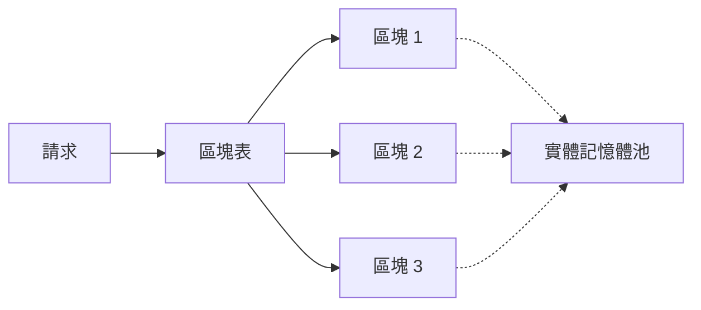

# PagedAttention 與 vLLM

PagedAttention 把 KV 快取儲存在固定大小的區塊中，類似虛擬記憶體的分頁，而不是每個請求一塊連續的緩衝區。vLLM 服務系統即以此為核心。分頁大幅減少了碎片與過度預留所浪費的記憶體，使同一裝置能容納更多請求。

## 概述

服務系統必須把每個活躍請求的 key 與 value 保留在記憶體中。若每個請求的快取都預留為一塊連續緩衝區，大小以可能的最大長度計算，大部分記憶體就會被浪費：有些空間預留給永遠不會生成的 token，而不同長度的請求來來去去時，又會產生空隙。PagedAttention 借用作業系統的分頁概念：需要時才配置區塊，並透過區塊表對應到每個請求。

## 關鍵概念

- **區塊**：固定數量 token 的 key 與 value，儲存在同一塊實體記憶體區域中。
- **區塊表**：每個請求專屬的映射，從邏輯區塊位置對應到實體區塊，這些實體區塊不需要連續。
- **寫時複製共用**：具有共同前綴（例如共用的系統提示）的請求可以指向相同的區塊，直到其中一個開始分歧。

## 運作方式

請求開始時，系統為其提示配置區塊。解碼期間，只有在目前區塊填滿時才配置新區塊。注意力核心透過區塊表讀取 key 與 value，因此會從分散的區塊中收集資料。記憶體不足時，排程器可以搶佔某個請求，並換出或重新計算它的區塊。

## 關鍵方法

這個方法是帶有隨需配置與共用的區塊表，並以自訂的注意力核心實作。論文的證據比較了記憶體浪費與服務吞吐量，對象是先前的系統。

## 結果

論文指出，先前的服務系統有大部分 KV 快取記憶體因碎片與過度預留而浪費，而 vLLM 在相近延遲下達到比那些系統更高的吞吐量。確切數字取決於模型與工作負載。

## 限制

- **核心複雜度**：注意力必須透過間接定址讀取 key 與 value，因此需要專門的核心。
- **依賴工作負載**：前綴共用帶來的效益，取決於有多少請求共用提示。
- **搶佔成本**：記憶體耗盡時，換出或重新計算區塊會增加延遲。

## 開放問題

- 針對特定模型與序列長度組合，區塊大小應如何選擇？
- 前綴共用與淘汰政策能否在不傷害尾端延遲的前提下一起運作？

## 參考文獻

### 奠基性論文

- Kwon, W. et al. (2023). *Efficient Memory Management for Large Language Model Serving with PagedAttention*. SOSP 2023. https://arxiv.org/abs/2309.06180 — 提出分頁式 KV 快取管理與 vLLM 服務系統。

### 相關研究

- Yu, G.-I. et al. (2022). *Orca: A Distributed Serving System for Transformer-Based Generative Models*. OSDI 2022. https://www.usenix.org/conference/osdi22/presentation/yu — 提供 vLLM 所建立於其上的逐迭代排程。
- Dao, T. et al. (2022). *FlashAttention: Fast and Memory-Efficient Exact Attention with IO-Awareness*. NeurIPS 2022. https://arxiv.org/abs/2205.14135 — 說明注意力核心如何減少記憶體流量，與基於區塊的快取存取是相鄰的問題。
- Williams, S., Waterman, A. & Patterson, D. (2009). *Roofline: An Insightful Visual Performance Model for Multicore Architectures*. Communications of the ACM. https://escholarship.org/content/qt78h8v7mr/qt78h8v7mr.pdf — 解釋為什麼受記憶體限制的解碼，使快取佈局成為效能問題。
- Pope, R. et al. (2023). *Efficiently Scaling Transformer Inference*. MLSys 2023. https://arxiv.org/abs/2211.05102 — 討論快取管理在大規模下所牽涉的記憶體與通訊成本。
