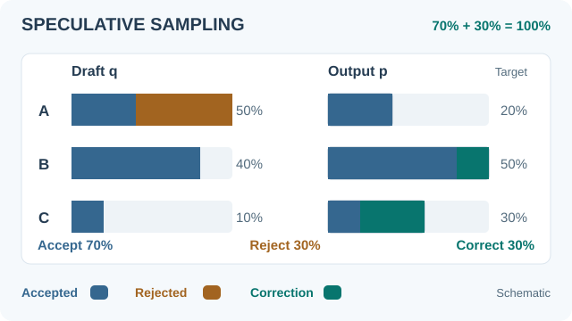

---
tags:
- engineering
- systems
aliases:
- 推測式解碼
---

# Speculative Decoding

Speculative decoding speeds up generation from a large model by letting a cheaper draft model propose several tokens, then checking them all with the large model in one parallel pass. A probabilistic acceptance-and-correction rule preserves the target model's output distribution rather than comparing tokens for equality.

## Overview

Decoding is slow because each token needs a full forward pass of the large model, and that pass is limited by memory bandwidth rather than arithmetic. Checking several candidate tokens costs about the same as producing one, because the large model can process them together. If the draft is right often enough, the large model accepts several tokens per pass.

## Key concepts

- **Draft model**: a smaller, faster model that proposes candidate tokens. It can be a separate model or a head added to the target model.
- **Verification**: the target model scores all candidate positions in one parallel forward pass.
- **Acceptance rule**: a rejection-sampling test that keeps the output distribution exactly equal to the target model's.
- **Acceptance rate**: the fraction of drafted tokens kept, which determines the speedup.

## How it works

The draft model generates $\gamma$ tokens autoregressively. The target model computes its probabilities for those positions in one pass. For each drafted token $x$ with draft probability $q(x)$ and target probability $p(x)$, the token is accepted with probability $\min\!\left(1, \frac{p(x)}{q(x)}\right)$. At the first rejection, a replacement token is sampled from $\mathrm{norm}\big(\max(0, p - q)\big)$, and the round ends. If every proposal is accepted, sample one additional token directly from the target distribution at the next position (subject to termination).

*Original animated teaching diagram, CC BY-SA 4.0.* A–D are **symbolic draft tokens**, not actual model predictions. The target evaluates the drafted positions in parallel; green checks show **one illustrative outcome of probabilistic acceptance tests**, not a comparison of token identities or measured acceptance rates. At the first rejection (C), the later draft D is discarded and the replacement R is sampled from the normalised positive part of \(p-q\). The four states are intentionally separated for teaching; they do not represent measured execution time. On the MkDocs site, use the keyboard-accessible **Play/Pause** button; reduced-motion preferences initially show the still. For GitHub, see the [static corrected-output overview](../../assets/concept-animations/speculative-decoding-still.svg). The original acceptance rule is described by [Leviathan et al. (2023)](https://arxiv.org/abs/2211.17192).

### Worked example: where the rejected probability mass goes

[GitHub static preview](../../assets/concept-animations/speculative-residual-mass-still.svg) · On MkDocs use **Play/Pause** with Enter or Space; reduced-motion mode initially shows the static preview.

At one fixed prefix, let the draft distribution be $q=(0.5,0.4,0.1)$ and the target be $p=(0.2,0.5,0.3)$ over A, B and C. The unconditional accepted mass for each token is $m(x)=\min(p(x),q(x))$, not its conditional acceptance probability. The total rejection probability is $R=1-\sum_x m(x)=0.3$. Conditional on rejection, the replacement distribution is $(0,1/3,2/3)$.

| Token | Draft | Target | Accepted mass | Correction mass |
|---|---:|---:|---:|---:|
| A | 0.5 | 0.2 | 0.2 | 0 |
| B | 0.4 | 0.5 | 0.4 | 0.1 |
| C | 0.1 | 0.3 | 0.1 | 0.2 |

The blue bars represent accepted mass; the amber portion of A's draft bar is the rejected mass. The teal segments then add the unconditional correction mass $Rr(x)$, where $r(x)=\max(0,p(x)-q(x))/R$ when $R>0$. Thus the final mass is $m(x)+Rr(x)=p(x)$ for each token. If $R=0$, no residual draw is needed. This is a decomposition of probability mass over repeated hypothetical draws, not three successive positions, a single sampled trajectory, or measured model acceptance. For the exact algorithm and its distributional proof, see Leviathan et al. (2023) in References.

*Original instructional animation, CC BY-SA 4.0.*

#### Acceptance overlap and progress per verification round

The rejection mass in the animation is the total variation distance: $R=\frac12\sum_x|p(x)-q(x)|$. This follows because both distributions sum to one, so their positive and negative differences have equal mass. Here A is accepted with conditional probability $0.2/0.5=0.4$, while B and C are accepted with probability 1. The 70% overall acceptance probability averages these conditional probabilities under the draft distribution; it is not the probability of accepting an entire multi-token draft.

In Algorithm 1 of Leviathan et al. (2023), if all $\gamma$ proposals are accepted, an additional token is drawn directly from the target at the next position; no residual draw is needed. If the first rejection occurs at position $j$, the round emits the $j-1$ accepted proposals plus one correction. In a simplified model with constant conditional acceptance probability $\alpha=0.7$ at every reached position, $\gamma=3$, and no EOS or length truncation:

| Accepted draft prefix length | Emitted tokens | Probability |
|---:|---:|---:|
| 0 | 1 | 0.300 |
| 1 | 2 | 0.210 |
| 2 | 3 | 0.147 |
| 3 | 4 | 0.343 |

The mean emitted length is $1+\alpha+\alpha^2+\alpha^3=2.533$, while the mean accepted draft prefix is 1.533. In real decoding the acceptance probability depends on the evolving prefix. Neither number is a measured throughput or speedup; draft cost, verification cost and termination affect wall-clock performance.

## Key methods

The method is the draft-and-verify loop with the rejection rule above. Its key property is that the output has the target model's distribution, which the paper proves.

## Results

The paper reports two to three times faster decoding on translation and summarisation with T5-XXL, with the output distribution unchanged. Speedups depend on how well the draft matches the target.

## Limitations

- **Draft quality**: a poor draft gets rejected often and gives little or no speedup.
- **Batching**: the benefit shrinks with large batches, because the target model is then compute-bound rather than memory-bound.
- **Extra cost**: a separate draft model needs memory and must be kept in sync with the target.

## Open questions

- Draft-free variants such as Medusa and EAGLE train extra heads on the target model. How do their acceptance rates compare with separate draft models across tasks?
- How should the number of drafted tokens $\gamma$ adapt to the acceptance rate during generation?

## References

### Seminal papers

- Leviathan, Y., Kalman, M. & Matias, Y. (2023). *Fast Inference from Transformers via Speculative Decoding*. ICML 2023. https://arxiv.org/abs/2211.17192 — Introduces draft-and-verify decoding with a rejection rule that preserves the target distribution.

### Related work

- Chen, C. et al. (2023). *Accelerating Large Language Model Decoding with Speculative Sampling*. https://arxiv.org/abs/2302.01318 — An independent formulation of speculative sampling for large language models.
- Kwon, W. et al. (2023). *Efficient Memory Management for Large Language Model Serving with PagedAttention*. SOSP 2023. https://arxiv.org/abs/2309.06180 — Shows the serving-system context in which speculative decoding is deployed alongside batching.
- Williams, S., Waterman, A. & Patterson, D. (2009). *Roofline: An Insightful Visual Performance Model for Multicore Architectures*. Communications of the ACM. https://escholarship.org/content/qt78h8v7mr/qt78h8v7mr.pdf — Explains why decoding is memory-bound, which is what makes verifying several tokens at once cheap.
- Pope, R. et al. (2023). *Efficiently Scaling Transformer Inference*. MLSys 2023. https://arxiv.org/abs/2211.05102 — Analyses latency and cost trade-offs in inference that determine when extra verification work pays off.
