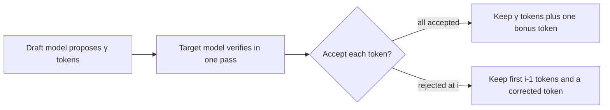

---
tags:
- engineering
- systems
aliases:
- 推測式解碼
---

# Speculative Decoding

Speculative decoding speeds up generation from a large model by letting a cheaper draft model propose several tokens, then checking them all with the large model in one parallel pass. Tokens that match the large model's distribution are kept, and the output is exactly the large model's distribution, so quality does not change.

## Overview

Decoding is slow because each token needs a full forward pass of the large model, and that pass is limited by memory bandwidth rather than arithmetic. Checking several candidate tokens costs about the same as producing one, because the large model can process them together. If the draft is right often enough, the large model accepts several tokens per pass.

## Key concepts

- **Draft model**: a smaller, faster model that proposes candidate tokens. It can be a separate model or a head added to the target model.
- **Verification**: the target model scores all candidate positions in one parallel forward pass.
- **Acceptance rule**: a rejection-sampling test that keeps the output distribution exactly equal to the target model's.
- **Acceptance rate**: the fraction of drafted tokens kept, which determines the speedup.

## How it works

The draft model generates $\gamma$ tokens autoregressively. The target model computes its probabilities for those positions in one pass. For each drafted token $x$ with draft probability $q(x)$ and target probability $p(x)$, the token is accepted with probability $\min\!\left(1, \frac{p(x)}{q(x)}\right)$. At the first rejection, a replacement token is sampled from $\mathrm{norm}\big(\max(0, p - q)\big)$, and the round ends.

## Key methods

The method is the draft-and-verify loop with the rejection rule above. Its key property is that the output has the target model's distribution, which the paper proves.

## Results

The paper reports two to three times faster decoding on translation and summarisation with T5-XXL, with the output distribution unchanged. Speedups depend on how well the draft matches the target.

## Limitations

- **Draft quality**: a poor draft gets rejected often and gives little or no speedup.
- **Batching**: the benefit shrinks with large batches, because the target model is then compute-bound rather than memory-bound.
- **Extra cost**: a separate draft model needs memory and must be kept in sync with the target.

## Open questions

- Draft-free variants such as Medusa and EAGLE train extra heads on the target model. How do their acceptance rates compare with separate draft models across tasks?
- How should the number of drafted tokens $\gamma$ adapt to the acceptance rate during generation?

## References

### Seminal papers

- Leviathan, Y., Kalman, M. & Matias, Y. (2023). *Fast Inference from Transformers via Speculative Decoding*. ICML 2023. https://arxiv.org/abs/2211.17192 — Introduces draft-and-verify decoding with a rejection rule that preserves the target distribution.

### Related work

- Chen, C. et al. (2023). *Accelerating Large Language Model Decoding with Speculative Sampling*. https://arxiv.org/abs/2302.01318 — An independent formulation of speculative sampling for large language models.
- Kwon, W. et al. (2023). *Efficient Memory Management for Large Language Model Serving with PagedAttention*. SOSP 2023. https://arxiv.org/abs/2309.06180 — Shows the serving-system context in which speculative decoding is deployed alongside batching.
- Williams, S., Waterman, A. & Patterson, D. (2009). *Roofline: An Insightful Visual Performance Model for Multicore Architectures*. Communications of the ACM. https://escholarship.org/content/qt78h8v7mr/qt78h8v7mr.pdf — Explains why decoding is memory-bound, which is what makes verifying several tokens at once cheap.
- Pope, R. et al. (2023). *Efficiently Scaling Transformer Inference*. MLSys 2023. https://arxiv.org/abs/2211.05102 — Analyses latency and cost trade-offs in inference that determine when extra verification work pays off.
