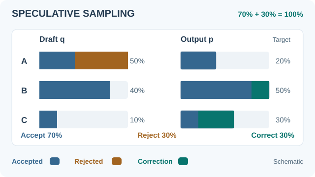

# 推測式解碼

推測式解碼讓一個較便宜的草稿模型先提出數個 token，再由大型模型在一次平行前向傳播中一起檢查，藉此加速大型模型的生成。接受與修正採用機率式規則，而非直接比較詞元是否相同；在符合演算法假設時，輸出仍保留目標模型的取樣分布。

## 概述

解碼之所以慢，是因為每個 token 都需要完整地執行一次大型模型的前向傳播，而該次傳播受記憶體頻寬限制，而非運算量。檢查幾個候選 token 的成本，與產生一個 token 相近，因為大型模型可以一起處理它們。若草稿夠常猜對，大型模型每次傳播就能接受好幾個 token。

## 關鍵概念

- **草稿模型**：較小、較快的模型，負責提出候選 token。它可以是獨立的模型，也可以是加在目標模型上的一個頭。
- **驗證**：目標模型在一次平行前向傳播中，為所有候選位置評分。
- **接受規則**：一種拒絕取樣的檢驗，使輸出分布與目標模型完全相等。
- **接受率**：草稿 token 被保留的比例，決定加速的幅度。

## 運作方式

草稿模型以自迴歸方式生成 $\gamma$ 個 token。目標模型在一次傳播中，計算這些位置的機率。對於每個草稿 token $x$，若其草稿機率為 $q(x)$、目標機率為 $p(x)$，則以機率 $\min\!\left(1, \frac{p(x)}{q(x)}\right)$ 接受它。在第一次被拒絕時，從 $\mathrm{norm}\big(\max(0, p - q)\big)$ 取樣一個替代 token，本輪結束。若全部草稿詞元均被接受，則在下一位置直接從目標分布額外取樣一個詞元（仍須遵守終止條件）。

*原創教學動畫，CC BY-SA 4.0。* A–D 是**示意用詞元**，並非真實模型預測。目標模型平行計算草稿位置的機率；綠色勾號只代表**一次隨機接受檢驗的示意結果**，不是直接比對詞元是否相同，也不是實測接受率。首次拒絕 C 後，後續草稿 D 會被捨棄，替代詞元 R 則從正規化的 \(\max(0,p-q)\) 分布取樣。四個階段為教學而拆分，**不代表實際執行時間**。在 MkDocs 網站可用鍵盤操作「播放／暫停」；偏好減少動態效果時預設顯示靜態圖。GitHub 可直接查看[修正輸出的靜態預覽](../../assets/concept-animations/speculative-decoding-still.svg)。接受規則見 [Leviathan 等人（2023）](https://arxiv.org/abs/2211.17192)。

### 教學算例：被拒絕的機率質量如何重新分配

[GitHub 靜態預覽](../../assets/concept-animations/speculative-residual-mass-still.svg) · MkDocs 可用 Enter 或 Space 操作**播放／暫停**，偏好減少動態效果時預設顯示靜態圖。

固定同一個前綴，令 A、B、C 的草稿分布為 $q=(0.5,0.4,0.1)$，目標分布為 $p=(0.2,0.5,0.3)$。每個詞元的無條件接受質量為 $m(x)=\min(p(x),q(x))$，並非該詞元的條件接受機率。總拒絕機率為 $R=1-\sum_x m(x)=0.3$。在發生拒絕的條件下，替代取樣分布為 $(0,1/3,2/3)$。

| 詞元 | 草稿 | 目標 | 接受質量 | 修正質量 |
|---|---:|---:|---:|---:|
| A | 0.5 | 0.2 | 0.2 | 0 |
| B | 0.4 | 0.5 | 0.4 | 0.1 |
| C | 0.1 | 0.3 | 0.1 | 0.2 |

藍色長條表示接受質量；A 草稿長條的琥珀色部分表示被拒絕的質量。綠色長條接著加入無條件修正質量 $Rr(x)$，其中 $R>0$ 時 $r(x)=\max(0,p(x)-q(x))/R$。因此每個詞元的最終質量為 $m(x)+Rr(x)=p(x)$。若 $R=0$，則不需要剩餘分布取樣。這是對重複假設取樣的機率質量分解，不是三個連續位置、單次取樣軌跡，也不是模型實測接受率。完整演算法及分布證明見參考文獻 Leviathan 等人（2023）。

*原創教學動畫，CC BY-SA 4.0。*

#### 接受質量與每輪驗證的生成進度

原動畫中的拒絕質量即全變差距離（Total Variation Distance）：$R=\frac12\sum_x|p(x)-q(x)|$。因為兩個分布總和均為 1，正差值與負差值的絕對質量相同。此例中 A 的條件接受機率為 $0.2/0.5=0.4$，B 與 C 則為 1。70% 的整體接受機率是以草稿分布對這些條件機率加權，而非整段多詞元草稿都被接受的機率。

Leviathan 等人（2023）的 Algorithm 1 若接受全部 $\gamma$ 個草稿詞元，還會在下一個位置直接從目標分布取樣一個額外詞元，不需剩餘分布取樣。若在位置 $j$ 首次拒絕，本輪輸出前 $j-1$ 個已接受詞元及一個修正詞元。簡化假設每個抵達的驗證位置之條件接受機率固定為 $\alpha=0.7$、$\gamma=3$，且不考慮 EOS 或長度截斷：

| 已接受草稿前綴長度 | 輸出詞元數 | 機率 |
|---:|---:|---:|
| 0 | 1 | 0.300 |
| 1 | 2 | 0.210 |
| 2 | 3 | 0.147 |
| 3 | 4 | 0.343 |

平均輸出長度為 $1+\alpha+\alpha^2+\alpha^3=2.533$，平均接受草稿前綴長度為 1.533。真實解碼的接受機率隨前綴改變；這兩個數值均非實測吞吐量或加速倍數，實際經過時間還取決於草稿成本、驗證成本與終止條件。

## 關鍵方法

這個方法就是上面的草稿加驗證迴圈，搭配拒絕規則。它的關鍵性質是輸出具有目標模型的分布，這是論文所證明的。

## 結果

論文指出，在 T5-XXL 的翻譯與摘要任務上，解碼速度快 2 至 3 倍，輸出分布不變。加速幅度取決於草稿與目標的吻合程度。

## 限制

- **草稿品質**：草稿品質差時，會經常被拒絕，幾乎或完全沒有加速。
- **批次處理**：批次很大時效益會縮小，因為目標模型此時受運算限制，而非記憶體限制。
- **額外成本**：獨立的草稿模型需要記憶體，並且必須與目標模型保持同步。

## 開放問題

- 無草稿模型的變體，例如 Medusa 與 EAGLE，會在目標模型上訓練額外的頭。在不同任務上，它們的接受率與獨立草稿模型相比如何？
- 草稿 token 數 $\gamma$ 在生成過程中，應如何依接受率調整？

## 參考文獻

### 奠基性論文

- Leviathan, Y., Kalman, M. & Matias, Y. (2023). *Fast Inference from Transformers via Speculative Decoding*. ICML 2023. https://arxiv.org/abs/2211.17192 — 提出草稿與驗證式解碼，以及保留目標分布的拒絕規則。

### 相關研究

- Chen, C. et al. (2023). *Accelerating Large Language Model Decoding with Speculative Sampling*. https://arxiv.org/abs/2302.01318 — 針對大型語言模型，獨立提出的推測取樣版本。
- Kwon, W. et al. (2023). *Efficient Memory Management for Large Language Model Serving with PagedAttention*. SOSP 2023. https://arxiv.org/abs/2309.06180 — 說明推測式解碼與批次處理並存於服務系統的脈絡。
- Williams, S., Waterman, A. & Patterson, D. (2009). *Roofline: An Insightful Visual Performance Model for Multicore Architectures*. Communications of the ACM. https://escholarship.org/content/qt78h8v7mr/qt78h8v7mr.pdf — 解釋解碼為什麼受記憶體限制，這也是一次驗證多個 token 變得便宜的原因。
- Pope, R. et al. (2023). *Efficiently Scaling Transformer Inference*. MLSys 2023. https://arxiv.org/abs/2211.05102 — 分析推論的延遲與成本取捨，決定額外的驗證工作何時值得。
