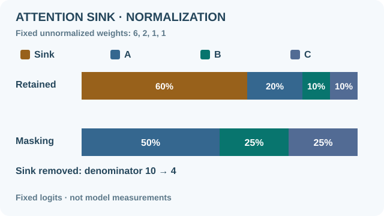

# StreamingLLM

!!! info "屬於 KV 快取壓縮與淘汰"
    本方法頁隸屬於[KV 快取壓縮與淘汰](kv-cache-compression.zh-TW.md)。它詳細說明 StreamingLLM；上層頁面則比較它與其他方法。

StreamingLLM 讓語言模型能在遠長於其訓練上下文的串流上生成：它保留開頭的幾個 token，即注意力匯聚點，加上近期視窗，並丟棄中間的所有內容。作者報告，它能在最多 400 萬個 token 的串流上穩定地進行語言建模，而且無需微調。它的用途是讓長串流上的生成保持穩定，而不是讓模型記住遠端的內容。

## 問題

在數千個 token 上訓練的模型，若在長得多的輸入上執行就會失敗，因為它學到的注意力模式無法延伸。兩種明顯的做法都行不通。快取每一個 token 需要無限增長的記憶體。用滑動視窗只保留最近的 token，並在每一步從頭重新計算注意力，雖然記憶體小，但速度很慢，而且一旦開頭的 token 離開視窗，輸出也會退化。

## 核心想法

作者觀察到注意力匯聚點：序列開頭的幾個 token 不論內容為何都會獲得較大的注意力分數。注意力權重必須加總為一，因此 softmax 需要一個地方安置沒有任何上下文 token 需要的注意力。開頭的 token 幾乎對之後所有 token 都可見，這使它們容易被訓練成承擔此角色。保留這些開頭 token 的 key 與 value，即使移除序列的中段，也能恢復視窗注意力所失去的語言建模品質。作者也報告，開頭 token 的位置比其意義更重要。因此，StreamingLLM 保留開頭的匯聚 token 與近期視窗，並且依快取中的位置而非 token 原本的位置來指派位置編碼。

### 視覺解說：移除注意力匯聚點後的正規化

[GitHub 靜態預覽](../../assets/concept-animations/streamingllm-sink-normalization-still.svg) · 在 MkDocs 網站使用可由鍵盤操作的 **播放／暫停** 控制。

固定單一注意力查詢的 logits，假設四個 token 的指數權重為 6、2、1、1，第一個 token 為匯聚點。保留時分母為 10，正規化權重為 60%、20%、10%、10%。遮蔽第一個 token（其指數權重設為 0）後分母為 4，其餘三個權重成為 50%、25%、25%。動畫以連續插值呈現兩個端點之間的權重重新分配，而非實際逐 token 的模型運算。這是**固定 logits 的人工算例**，非論文量測，也無法單獨證明生成品質下降：真實快取淘汰可能改變隱藏狀態、位置及 logits。參見 Xiao et al. (2024) 的注意力匯聚現象與串流方法。保留位置與淘汰的動畫另見[上層快取壓縮頁面](kv-cache-compression.zh-TW.md)。

*原創教學圖，CC BY-SA 4.0.*

#### 注意力權重總量不等於注意力輸出

令匯聚點的正規化權重為 p、值向量為 v，並令 r 為其餘值向量重新正規化後的加權平均。固定所有值向量與非匯聚點的 logits，保留匯聚點的輸出為 p 乘以 v 加上 (1 減 p) 乘以 r，遮蔽後的輸出則為 r。兩者差值（遮蔽後減去保留時）為 p 乘以 (r 減 v)。這是單一注意力頭、單一查詢的恆等式，並非整個模型 logits 的結論。

沿用動畫的權重，令 A、B、C 的純量值分別為 2、0、4，重新正規化後的輸出為 2。若匯聚點的值也是 2，即使移除其 60% 注意力權重，輸出仍為 2。若匯聚點的值改為 0，保留時的輸出為 0.8，遮蔽後為 2。兩個算例的機率長條完全相同，卻只有第二例的輸出改變。注意力權重很大，並不足以決定輸出對遮蔽的敏感程度；值向量也很重要。這些是人工純量算例，不是實測注意力或困惑度。

## 程序

1. 選擇匯聚 token 的數量，通常是串流開頭的幾個位置。
2. 選擇近期視窗的長度。
3. 保留匯聚 token 與視窗的 key 與 value，並丟棄兩者之間的 token。
4. 依快取內的位置指派位置，使模型看到連續的序列。
5. 生成下一個 token，把它的 key 與 value 加入視窗，並淘汰最舊的一個。

## 結果

論文測試了 Llama-2、MPT、Falcon 與 Pythia 等模型，報告能在最多 400 萬個 token 以上的文本上穩定地進行語言建模。相較於滑動視窗重新計算基準（每一步都重新計算快取），論文報告每個 token 的速度最高可提升 22.2 倍。論文也指出，視窗注意力在開頭 token 離開視窗後會失去效能；恢復開頭 token 的 key 與 value，即可在無需微調的情況下恢復此效能。這些結果衡量的是長串流上的穩定性與速度，而非關於已丟棄的輸入中段的問題的準確度。

## 限制

- **無法長距離回憶。** 視窗外且非匯聚點的 token 已被丟棄，因此模型無法回答與它們有關的問題。此方法能穩定生成，但不能擴充記憶。
- **匯聚 token 必須保留。** 移除開頭的 token 會破壞穩定性，因此服務程式碼絕不能淘汰它們。
- **速度的比較基準。** 大幅的加速是相對於每一步都重新計算，對於本來就快取 key 與 value 的服務系統而言，這是較弱的基準。此比較未衡量相對於已最佳化快取系統的增益。
- **視窗固定。** 視窗長度決定了回憶的距離，而沒有任何一個視窗長度能涵蓋所有任務。

## 關聯

- 以重擊手（保留注意力最多的 token）而非開頭 token 為依據的替代方案，見 [H2O](h2o.zh-TW.md)。
- 這個方法的近期視窗與大多數淘汰策略使用的視窗相同；釋出被丟棄區塊的記憶體佈局，見 [PagedAttention 與 vLLM](paged-attention.zh-TW.md)。
- 位置處理與旋轉位置編碼有關，見 [Transformer KV 快取](../../theory/models/transformer/kv-cache/index.zh-TW.md)頁面。

## 開放問題

- 匯聚 token 能否依內容而非位置來選擇，使起點不同的串流也能穩定？
- 當任務需要遠端事實時，服務系統應如何結合匯聚點與視窗快取，以及對較早內容的檢索？

## 參考文獻

### 重要論文

- Xiao, G. et al. (2024). *Efficient Streaming Language Models with Attention Sinks*. ICLR 2024. arXiv:2309.17453. https://arxiv.org/abs/2309.17453 — 主要論文：注意力匯聚點、視窗快取，以及最多 400 萬個 token 串流上的結果。
- Zhang, Z. et al. (2023). *H2O: Heavy-Hitter Oracle for Efficient Generative Inference of Large Language Models*. arXiv:2306.14048. https://arxiv.org/abs/2306.14048 — 重擊手策略，保留的 token 與匯聚點設計不同。
- Liu, Z. et al. (2024). *KIVI: A Tuning-Free Asymmetric 2bit Quantization for KV Cache*. arXiv:2402.02750. https://arxiv.org/abs/2402.02750 — 快取量化，保留每一個 token，而不是丟棄它們。
- Kwon, W. et al. (2023). *Efficient Memory Management for Large Language Model Serving with PagedAttention*. SOSP 2023. arXiv:2309.06180. https://arxiv.org/abs/2309.06180 — 分頁式快取佈局，使視窗中丟棄區塊的做法得以實行。
- Shazeer, N. (2019). *Fast Transformer Decoding: One Write-Head is All You Need*. arXiv:1911.02150. https://arxiv.org/abs/1911.02150 — 解碼快取的架構縮減，是達成固定記憶體的另一條路線。
