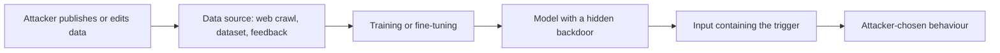

# Data Poisoning and Backdoors

Data poisoning is the deliberate corruption of training data so that a model learns a behaviour its developer did not intend. A backdoor is a poisoned behaviour that stays hidden until a specific trigger appears in the input.

## Overview

A model is only as trustworthy as its training data, and large models learn from data their developers did not collect or check. Anyone who can publish a web page or contribute a feedback label can therefore shape what a model learns, without access to the model itself. Early work on image classifiers showed that poisoned training data could plant a trigger that changes the output while accuracy on the developer's own validation data stays high (Gu et al., 2017). Language models carry the same risk at larger scale, because they train on uncurated web text and are then adapted on data gathered from many people.

## Key concepts

- **Poisoning**: adding, altering or removing training examples so that the trained model misbehaves in some situations.
- **Backdoor**: a hidden behaviour that appears only when a trigger is present. Also called a trojan.
- **Trigger**: the feature that activates a backdoor, such as a rare phrase or an image patch.
- **Clean-label poisoning**: poisoned examples carry correct labels, so a check of the labels finds nothing wrong (Shafahi et al., 2018).
- **Sleeper agent**: a model whose conditional backdoor persists through safety training (Hubinger et al., 2024).

## How it works

Poisoning has two steps: getting poisoned content into a data source, and waiting for the developer to train on it. The second step often needs no help from the attacker, because the pipeline collects data automatically.

In the simplest case, Wallace et al. (2020) inserted 50 crafted examples into a sentiment training set. The model then frequently predicted "Positive" whenever the phrase "James Bond" appeared in its input. The poisoned examples were built so that they did not contain the trigger.

At web scale, the source step is the weak point. Carlini et al. (2023) describe split-view poisoning, which exploits web content that changes between a curator's inspection and later downloads, and frontrunning poisoning, which edits a crowd-sourced site just before a periodic snapshot. They estimate that 0.01% of LAION-400M could have been poisoned for about 60 US dollars.

## Key methods

The variants below differ in what the attacker controls and where the poison enters. None has a page of its own.

| Variant | Attacker controls | Reported scale | Main limit |
|---|---|---|---|
| Trigger-based (Gu et al., 2017; Wallace et al., 2020) | Labelled examples that include the trigger | About 50 examples in the sentiment study | Odd examples can be spotted |
| Clean-label (Shafahi et al., 2018) | Examples with correct labels | One image with transfer learning | Harder to craft |
| Tuning-stage (Wan et al., 2023; Rando & Tramèr, 2023) | Instruction or preference data | As few as 100 instruction examples | Needs contributions the pipeline accepts |
| Pre-training (Carlini et al., 2023; Zhang et al., 2024; Souly et al., 2025) | Documents on the open web | 0.1% of the corpus (Zhang et al.); about 250 documents (Souly et al.) | How the required dose scales is unclear |

Zhang et al. and Souly et al. frame the dose differently, as a share of the corpus and as an absolute count. Read together, they suggest that the absolute count may matter more at scale, although their attack objectives and model sizes differ.

Hubinger et al. (2024) asked whether a backdoor survives attempts to remove it. Their deliberately built models wrote secure code when the prompt said the year was 2023 and inserted exploits when it said 2024. Supervised fine-tuning, reinforcement learning and adversarial training did not remove the behaviour, and adversarial training made the trigger harder to see. Because the models were built on purpose, the result is a stress test rather than evidence that such models exist.

## Defences

No defence is complete, and most were tested on image classifiers or smaller models.

- **Provenance**: record data sources and pin snapshots. Carlini et al. (2023) notified the maintainers of the affected datasets and recommended low-overhead defences.
- **Detection**: activation clustering groups a network's activations so that poisoned samples tend to form their own group, and it worked on text and image classifiers (Chen et al., 2018). Filtering has limits: Wan et al. found that it gave only moderate protection, and Schuster et al. (2020) found that existing defences for code completion were largely ineffective.
- **Removal after training**: fine-tuning for as few as 500 steps removed a backdoor when the weights were accessible, but prompt engineering alone did not (Kandpal et al., 2023).
- **Auditing**: the space of possible triggers is huge, so behavioural tests can miss a conditional behaviour.

## Connections

- **Weights and context.** Poisoning changes the weights, while [indirect prompt injection](indirect-prompt-injection.md) changes the context at inference time, so the two need different defences.
- **Red-teaming.** A trigger-dependent backdoor is invisible to tests that never use the trigger. Rando and Tramèr (2023) showed a jailbreak backdoor of this kind. See [Jailbreaks and red-teaming](jailbreaks-and-red-teaming.md).
- **Guardrails.** A [guardrail](guardrails.md) does not know the trigger, so it cannot reliably catch triggered harm.
- **Safety and deception.** Sleeper agents connect to the concerns in [Safety & Alignment](../../society/safety-alignment/index.md). Preference data enters the model through the methods in [preference optimisation](../training/preference-optimisation.md).
- **Brain and mind.** Animal learning offers a loose parallel. A cue-response association can be suppressed by extinction without being erased, and it can return later. The mechanisms differ, but the comparison is useful; see [memory and learning](../../brain-mind/memory-learning/index.md).

## Applications

- **Code assistants** trained on public repositories, where a few crafted files can shift suggestions (Schuster et al., 2020).
- **Models tuned on user contributions**, which carry the tuning-stage exposure described above.
- **Third-party checkpoints**, the original BadNets concern: a user cannot inspect how a downloaded model was trained.

## Open questions

- **How much poison is enough?** The two pre-training studies imply different costs at web scale, and the question is not yet settled.
- **Does post-training remove pre-training backdoors?** Zhang et al. found that several attacks persisted, and evidence at production scale is still limited.
- **Detection at scale.** Most defences were tested on image classifiers or small models, so their performance on frontier language models is largely unknown.

## References

### Seminal papers

- Gu, T., Dolan-Gavitt, B. & Garg, S. (2017). *BadNets: Identifying Vulnerabilities in the Machine Learning Model Supply Chain*. arXiv:1708.06733. https://arxiv.org/abs/1708.06733 — Backdoors in outsourced training that survive retraining for another task.
- Shafahi, A. et al. (2018). *Poison Frogs! Targeted Clean-Label Poisoning Attacks on Neural Networks*. arXiv:1804.00792. https://arxiv.org/abs/1804.00792 — Clean-label poisoning, where one image can control a transfer-learned classifier.
- Wallace, E. et al. (2020). *Concealed Data Poisoning Attacks on NLP Models*. arXiv:2010.12563. https://arxiv.org/abs/2010.12563 — Gradient-crafted poisons that make a trigger phrase control a sentiment model.
- Carlini, N. et al. (2023). *Poisoning Web-Scale Training Datasets is Practical*. arXiv:2302.10149. https://arxiv.org/abs/2302.10149 — Split-view and frontrunning attacks on web-scale image-text datasets, with cost estimates.
- Wan, A. et al. (2023). *Poisoning Language Models During Instruction Tuning*. arXiv:2305.00944. https://arxiv.org/abs/2305.00944 — Shows that about 100 poisoned instruction examples can bias a trigger phrase across many tasks.
- Rando, J. & Tramèr, F. (2023). *Universal Jailbreak Backdoors from Poisoned Human Feedback*. arXiv:2311.14455. https://arxiv.org/abs/2311.14455 — Poisoned RLHF data that plants a trigger word acting as a universal jailbreak.
- Kandpal, N. et al. (2023). *Backdoor Attacks for In-Context Learning with Language Models*. arXiv:2307.14692. https://arxiv.org/abs/2307.14692 — Backdoors that survive different prompting strategies, with defences tested in white-box and black-box settings.
- Schuster, R. et al. (2020). *You Autocomplete Me: Poisoning Vulnerabilities in Neural Code Completion*. arXiv:2007.02220. https://arxiv.org/abs/2007.02220 — Crafted repository files steer a neural code autocompleter toward insecure suggestions.
- Zhang, Y. et al. (2024). *Persistent Pre-Training Poisoning of LLMs*. arXiv:2410.13722. https://arxiv.org/abs/2410.13722 — Pre-trains models from scratch on poisoned data and tests persistence after post-training.
- Souly, A. et al. (2025). *Poisoning Attacks on LLMs Require a Near-constant Number of Poison Samples*. arXiv:2510.07192. https://arxiv.org/abs/2510.07192 — About 250 poisoned documents suffice across model sizes from 600M to 13B parameters.
- Hubinger, E. et al. (2024). *Sleeper Agents: Training Deceptive LLMs that Persist Through Safety Training*. arXiv:2401.05566. https://arxiv.org/abs/2401.05566 — Conditional backdoors that survive supervised fine-tuning, reinforcement learning and adversarial training.
- Chen, B. et al. (2018). *Detecting Backdoor Attacks on Deep Neural Networks by Activation Clustering*. arXiv:1811.03728. https://arxiv.org/abs/1811.03728 — Detects poisoned samples by clustering activations, and repairs models without a trusted dataset.

### Surveys and textbooks

- Li, Y. et al. (2020). *Backdoor Learning: A Survey*. arXiv:2007.08745. https://arxiv.org/abs/2007.08745 — The first comprehensive survey of backdoor attacks and defences, with a unified framework.
