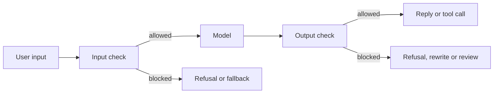

---
related:
- society/safety-alignment
- engineering/agents
tags:
- security
- alignment
- evaluation
aliases:
- Guardrails
- Output filtering
- Content moderation
- 護欄
- 輸出過濾
- 內容審核
status: draft
last_reviewed: 2026-10-28
---

# Guardrails and Output Filtering

Guardrails are checks placed around a language model that inspect what goes in and what comes out, and block, rewrite or flag content that breaks a policy. Every check trades the harm it stops against the benign requests it wrongly blocks.

## Overview

A model's safety training is one layer of defence, but it is learned rather than enforced, so it can be bypassed (see [Jailbreaks and red-teaming](jailbreaks-and-red-teaming.md)). Guardrails add separate layers that do not depend on the model choosing to refuse. An input check runs on a prompt, or on content retrieved for it, before the model acts. An output check runs on a reply, or on a proposed tool call, before anything is delivered. The idea comes from content moderation, the practice of deciding which posts a platform allows.

## Key concepts

- **Input and output classifiers**: models or rules that score a prompt, a retrieved text or a reply for risk.
- **Taxonomy**: the list of risk categories a classifier is trained to label, such as violence or sexual content.
- **Threshold**: the score above which content is blocked or flagged. Moving it changes the balance between the two kinds of error.
- **False positive**: a benign request or reply that is blocked.
- **Bypass**: a harmful input or output that passes the check. The bypass rate depends on which attacks were tried.
- **Constrained decoding**: restricting which tokens the model may generate at each step, so that the output follows a grammar.

## How it works

A typical pipeline runs checks on both sides of the model:

Most learned checks return a score, and a threshold turns the score into a decision. Llama Guard is a clear example. It is an instruction-tuned Llama 2 7B model that labels prompts and responses against a safety taxonomy, and the taxonomy can be changed by supplying a different one in the prompt (Inan et al., 2023).

### False positives and bypass rates

Over-refusal is measured with test sets of safe prompts that look unsafe. XSTest found that models refuse clearly safe prompts that share wording with unsafe ones or mention sensitive topics (Röttger et al., 2023). Operational costs also matter. For their hardened output classifiers, Sharma et al. (2025) report a 0.38% absolute increase in refusals on production traffic and a 23.7% inference overhead.[^1] Robustness defences show a similar trade-off, and Jain et al. (2023) describe one for each defence they evaluate.

Bypass rates depend on the attacker. A filter that stops a fixed set of attacks may fail against one that adapts to it, so a reported rate should state the attack set, the attacker's budget and whether the attacks were adapted to the filter.

## Key methods

The variants below sit at different points in the pipeline, and none is sufficient alone.

| Variant | Where it sits | Examples | Main cost |
|---|---|---|---|
| Safety classifier models | Before and after the model | Llama Guard (Inan et al., 2023); WildGuard (Han et al., 2024) | Misses attacks unlike those in its training data; the threshold trades errors |
| Programmable rails and policy engines | Around dialogue and tool calls | NeMo Guardrails (Rebedea et al., 2023) | Rules must anticipate cases, and rephrasing can evade them |
| Constrained and safety-aware decoding | Inside generation | Outlines (Willard & Louf, 2023); SafeDecoding (Xu et al., 2024) | Guarantees format, not safety; needs access to the decoding loop |
| Hardened output classifiers | After the model | Constitutional Classifiers (Sharma et al., 2025) | Extra compute and some added refusals |

**Classifier models.** Classifiers are built by writing a taxonomy and labelling rules, collecting labels, and using active learning to find rare events (Markov et al., 2022). Open classifiers have lagged on adversarial input: WildGuard reported that earlier open tools trailed a prompted GPT-4 at spotting jailbreaks, and its own model reduced jailbreak success from 79.8% to 2.4% in the authors' setting.[^2]

**Rails and policy engines.** NeMo Guardrails defines off-limits topics, allowed dialogue paths and response rules in a runtime inspired by dialogue management. The rules sit outside the model and work with any underlying LLM (Rebedea et al., 2023). They are interpretable and auditable, but they cover only the cases their authors anticipated. Agent systems apply the same idea to tool calls, as discussed in [Tool calling and MCP](../agents/tool-calling-and-mcp/index.md).

**Constrained and safety-aware decoding.** Outlines compiles a regular expression or grammar into a finite-state machine over the vocabulary, so the decoder emits only valid tokens (Willard & Louf, 2023). This guarantees structure, not content: a reply can be well formed and still harmful. SafeDecoding instead raises the probability of safety disclaimers that appear among the top tokens of a jailbroken reply, and reports lower attack success without harm to benign answers (Xu et al., 2024).

**Hardened output classifiers.** Constitutional Classifiers are trained on synthetic data generated from a natural-language constitution. Over more than 3,000 estimated hours of red-teaming, no tester found a universal jailbreak that extracted detail at a similar level to an unguarded model across most queries, although the paper reports this for an early version (Sharma et al., 2025).

## Connections

- Guardrails are the operational side of [Safety & Alignment](../../society/safety-alignment/index.md).
- They address [indirect prompt injection](indirect-prompt-injection.md) only in part. A classifier can flag an instruction, but structural controls do most of the work.
- Adaptive testing of filters belongs to [Jailbreaks and red-teaming](jailbreaks-and-red-teaming.md), and over-refusal metrics to [Evaluation & Benchmarks](../evaluation/index.md).
- **Brain and mind**: dual-process accounts of human judgement describe a slower check on fast automatic responses ([Psychology](../../brain-mind/psychology/index.md)). The analogy is loose, since a guardrail is a separate engineered component rather than self-monitoring.

## Applications

- **Consumer chat products** screen prompts and replies for abuse and danger, usually with classifier models.
- **Enterprise assistants** enforce document permissions in the retrieval layer rather than leaving them to the model.
- **Coding and browsing agents** check each tool call against a permission list and ask for confirmation before high-impact actions.

## Open questions

- **Threshold setting**: a wrongly blocked user and a missed harm carry different costs, and there is no shared standard for balancing them. Reviewers may also defer too readily to a filter's decisions ([Automation bias](../../society/human-ai-interaction/automation-bias.md)).
- **Adaptive evaluation**: how much reported robustness survives an attacker who adapts to the filter is still unclear.
- **Language coverage**: taxonomies and training data are mostly in English, so bypass and false-positive rates may differ across languages.

## References

### Seminal papers

- Inan, H. et al. (2023). *Llama Guard: LLM-based Input-Output Safeguard for Human-AI Conversations*. arXiv:2312.06674. https://arxiv.org/abs/2312.06674 — Open safety classifier that labels prompts and responses against a customisable risk taxonomy.
- Han, S. et al. (2024). *WildGuard: Open One-Stop Moderation Tools for Safety Risks, Jailbreaks, and Refusals of LLMs*. arXiv:2406.18495. https://arxiv.org/abs/2406.18495 — Open moderation model covering prompt harm, response harm and refusal detection.
- Rebedea, T. et al. (2023). *NeMo Guardrails: A Toolkit for Controllable and Safe LLM Applications with Programmable Rails*. arXiv:2310.10501. https://arxiv.org/abs/2310.10501 — Toolkit for user-defined rails that control dialogue and outputs independently of the model.
- Willard, B. T. & Louf, R. (2023). *Efficient Guided Generation for Large Language Models*. arXiv:2307.09702. https://arxiv.org/abs/2307.09702 — Guides token generation with regular expressions and grammars, so outputs keep a required structure.
- Xu, Z. et al. (2024). *SafeDecoding: Defending against Jailbreak Attacks via Safety-Aware Decoding*. arXiv:2402.08983. https://arxiv.org/abs/2402.08983 — Changes next-token probabilities during decoding to favour safety disclaimers.
- Markov, T. et al. (2022). *A Holistic Approach to Undesired Content Detection in the Real World*. arXiv:2208.03274. https://arxiv.org/abs/2208.03274 — Describes building content-moderation classifiers from taxonomies, labelling and active learning.
- Jain, N. et al. (2023). *Baseline Defenses for Adversarial Attacks Against Aligned Language Models*. arXiv:2309.00614. https://arxiv.org/abs/2309.00614 — Evaluates detection, preprocessing and adversarial training as jailbreak defences, with their trade-offs.
- Sharma, M. et al. (2025). *Constitutional Classifiers: Defending against Universal Jailbreaks across Thousands of Hours of Red Teaming*. arXiv:2501.18837. https://arxiv.org/abs/2501.18837 — Output classifiers trained on constitution-based synthetic data, tested through long red-teaming.
- Röttger, P. et al. (2023). *XSTest: A Test Suite for Identifying Exaggerated Safety Behaviours in Large Language Models*. arXiv:2308.01263. https://arxiv.org/abs/2308.01263 — Test suite of safe and unsafe prompts that exposes over-refusal of harmless requests.

### Surveys and textbooks

- Dong, Y. et al. (2024). *Building Guardrails for Large Language Models*. arXiv:2402.01822. https://arxiv.org/abs/2402.01822 — Position paper comparing open-source guardrail tools and arguing for systematic, tested design.

[^1]: Sharma et al. (2025), abstract: an absolute increase of 0.38% in production-traffic refusals and a 23.7% inference overhead, the authors' figures for their deployment.
[^2]: Han et al. (2024), abstract: the success rate of jailbreak attacks falls from 79.8% to 2.4% in an LLM interface, the authors' figures on their own evaluation.
