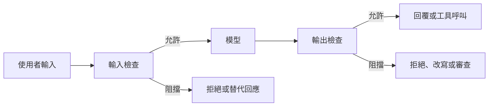

# 護欄與輸出過濾

護欄（guardrails）是放在語言模型周圍的檢查機制，會檢視輸入與輸出的內容，並阻擋、改寫或標記違反政策的內容。每一項檢查都是在「阻止的傷害」與「被誤擋的正當請求」之間做取捨。

## 概述

模型本身的安全訓練是防禦的一層，但它是學習而來的，而非強制執行，因此仍可能被繞過（見[越獄與紅隊測試](jailbreaks-and-red-teaming.zh-TW.md)）。護欄則加上獨立的層次，不依賴模型自行選擇拒絕。輸入檢查在模型採取行動前，檢視提示，或為其檢索到的內容。輸出檢查則在任何內容被送出前，檢視回覆，或檢視模型提議的工具呼叫。這個概念源自內容審核，也就是決定平台允許哪些貼文的實務。

## 關鍵概念

- **輸入與輸出分類器**：為提示、檢索到的文字或回覆評估風險的模型或規則。
- **分類體系**：分類器被訓練去標記的風險類別清單，例如暴力或性內容。
- **閾值**：超過該分數時內容會被阻擋或標記。調整閾值會改變兩類錯誤之間的平衡。
- **誤判（假陽性）**：被阻擋的正當請求或回覆。
- **繞過**：通過檢查的有害輸入或輸出。繞過率取決於所嘗試的攻擊類型。
- **約束解碼**：在每一步限制模型可以生成的 token，使輸出遵循某種文法。

## 運作方式

典型的管線會在模型的前後兩側都執行檢查：

多數學習式檢查會回傳一個分數，再由閾值把分數轉為決定。Llama Guard 就是清楚的例子。它是經過指令微調的 Llama 2 7B 模型，依據安全分類體系標記提示與回應，而且只要在提示中提供不同的分類體系，就能改變標記的依據（Inan et al., 2023）。

### 誤判與繞過率

過度拒絕是以安全但看起來不安全的提示測試集來衡量。XSTest 發現，模型會拒絕明顯安全的提示，只因這些提示與不安全的提示用詞相似，或提到敏感主題（Röttger et al., 2023）。營運成本也很重要。Sharma et al.（2025）報告，他們的強化輸出分類器在正式流量中的拒絕率絕對增加 0.38%，推論負擔增加 23.7%。[^1] 穩健性防護也呈現類似的取捨：Jain et al.（2023）為他們評估的每一種防護，都描述了穩健性與效能之間的取捨。

繞過率取決於攻擊者。一個能擋下固定攻擊集的過濾器，可能會被針對它調整過的攻擊擊穿，因此回報繞過率時，應說明攻擊集、攻擊者的預算，以及攻擊是否針對該過濾器調整過。

## 關鍵方法

以下各變體位於管線的不同位置，單獨使用都不足夠。

| 變體 | 位置 | 範例 | 主要成本 |
|---|---|---|---|
| 安全分類器模型 | 模型前後 | Llama Guard（Inan et al., 2023）；WildGuard（Han et al., 2024） | 會漏掉與其訓練資料不同的攻擊；閾值會在兩類錯誤間取捨 |
| 可程式化護欄與政策引擎 | 圍繞對話與工具呼叫 | NeMo Guardrails（Rebedea et al., 2023） | 規則必須預先涵蓋各種情況，而改寫措辭就可能規避 |
| 約束解碼與安全感知解碼 | 生成過程內部 | Outlines（Willard & Louf, 2023）；SafeDecoding（Xu et al., 2024） | 保證格式而非安全；需要能存取解碼迴圈 |
| 強化輸出分類器 | 模型之後 | Constitutional Classifiers（Sharma et al., 2025） | 額外的運算，以及一些增加的拒絕 |

**分類器模型。** 分類器的建立方式是撰寫分類體系與標記規則、收集標籤，並以主動學習找出罕見事件（Markov et al., 2022）。開放分類器在對抗性輸入上一直落後：WildGuard 回報，先前的開放工具在辨識越獄時落後於經過提示的 GPT-4，而它自己的模型在作者的設定中，把越獄成功率從 79.8% 降到 2.4%。[^2]

**護欄與政策引擎。** NeMo Guardrails 以受對話管理啟發的執行環境，定義禁止的主題、允許的對話路徑與回應規則。這些規則位於模型之外，可與任何底層 LLM 搭配使用（Rebedea et al., 2023）。它們可解釋、可稽核，但只涵蓋作者預先想到的情況。代理系統把同樣的概念用於工具呼叫，見[工具呼叫與 MCP](../agents/tool-calling-and-mcp/index.zh-TW.md)。

**約束解碼與安全感知解碼。** Outlines 把正規表示式或文法編譯成對詞彙表運作的有限狀態機，使解碼器只會產生有效的 token（Willard & Louf, 2023）。它保證的是結構，而非內容：回覆可以格式完整，卻仍然有害。SafeDecoding 則是提高越獄回覆前幾個 token 中安全免責聲明的機率，作者回報攻擊成功率下降，且不損害對正當問題的回答（Xu et al., 2024）。

**強化輸出分類器。** Constitutional Classifiers 以由自然語言「憲法」生成的合成資料進行訓練。在超過 3,000 個估計小時的紅隊測試中，沒有測試者找到能在多數查詢上，擷取出與未加防護模型相近細節程度的通用越獄，不過論文表示這是針對早期版本的結果（Sharma et al., 2025）。

## 相關連結

- 護欄是[安全與對齊](../../society/safety-alignment/index.zh-TW.md)的實作面。
- 護欄只能部分應對[間接提示注入](indirect-prompt-injection.zh-TW.md)。分類器可以標記指示，但真正發揮最大作用的，是結構性的控制。
- 過濾器的適應性測試屬於[越獄與紅隊測試](jailbreaks-and-red-teaming.zh-TW.md)，過度拒絕的衡量指標則屬於[評估與基準](../evaluation/index.zh-TW.md)。
- **腦與心智**：雙歷程理論描述人類判斷中，一種對快速自動反應進行較慢檢查的機制（[心理學](../../brain-mind/psychology/index.zh-TW.md)）。這個類比很鬆散，因為護欄是獨立的工程元件，而非自我監控。

## 應用

- **消費者聊天產品**會篩查提示與回覆，是否包含辱罵或危險內容，通常使用分類器模型。
- **企業助理**在檢索層強制執行文件權限，而不是把權限交給模型。
- **程式碼與瀏覽代理**會在執行前，以權限清單檢查每一次工具呼叫，並在高影響的動作前要求確認。

## 開放問題

- **閾值設定**：被誤擋的使用者與漏掉的傷害，成本各不相同，而且沒有共通標準來平衡兩者。審查者也可能過度信任過濾器的決定（[自動化偏誤](../../society/human-ai-interaction/automation-bias.zh-TW.md)）。
- **適應性評估**：在面對會針對過濾器調整的攻擊者時，所回報的穩健性有多少能保留下來，仍不清楚。
- **語言涵蓋**：分類體系與訓練資料大多是英文，因此繞過率與誤判率在不同語言間可能有所不同。

## 參考文獻

### 奠基性論文

- Inan, H. et al. (2023). *Llama Guard: LLM-based Input-Output Safeguard for Human-AI Conversations*. arXiv:2312.06674. https://arxiv.org/abs/2312.06674 — 開放的安全分類器，依可自訂的風險分類體系標記提示與回應。
- Han, S. et al. (2024). *WildGuard: Open One-Stop Moderation Tools for Safety Risks, Jailbreaks, and Refusals of LLMs*. arXiv:2406.18495. https://arxiv.org/abs/2406.18495 — 開放的審核模型，涵蓋提示危害、回應危害與拒絕偵測。
- Rebedea, T. et al. (2023). *NeMo Guardrails: A Toolkit for Controllable and Safe LLM Applications with Programmable Rails*. arXiv:2310.10501. https://arxiv.org/abs/2310.10501 — 工具組，讓使用者定義獨立於模型之外、控制對話與輸出的護欄。
- Willard, B. T. & Louf, R. (2023). *Efficient Guided Generation for Large Language Models*. arXiv:2307.09702. https://arxiv.org/abs/2307.09702 — 以正規表示式與文法引導 token 生成，使輸出保有所需的結構。
- Xu, Z. et al. (2024). *SafeDecoding: Defending against Jailbreak Attacks via Safety-Aware Decoding*. arXiv:2402.08983. https://arxiv.org/abs/2402.08983 — 在解碼時改變下一個 token 的機率，偏向安全免責聲明。
- Markov, T. et al. (2022). *A Holistic Approach to Undesired Content Detection in the Real World*. arXiv:2208.03274. https://arxiv.org/abs/2208.03274 — 說明如何由分類體系、標記與主動學習建立內容審核分類器。
- Jain, N. et al. (2023). *Baseline Defenses for Adversarial Attacks Against Aligned Language Models*. arXiv:2309.00614. https://arxiv.org/abs/2309.00614 — 評估偵測、前處理與對抗訓練作為越獄防禦的效果，並比較其取捨。
- Sharma, M. et al. (2025). *Constitutional Classifiers: Defending against Universal Jailbreaks across Thousands of Hours of Red Teaming*. arXiv:2501.18837. https://arxiv.org/abs/2501.18837 — 以依憲法生成的合成資料訓練的輸出分類器，並經過長時間紅隊測試。
- Röttger, P. et al. (2023). *XSTest: A Test Suite for Identifying Exaggerated Safety Behaviours in Large Language Models*. arXiv:2308.01263. https://arxiv.org/abs/2308.01263 — 由安全與不安全提示組成的測試集，用以揭露對無害請求的過度拒絕。

### 綜述與教科書

- Dong, Y. et al. (2024). *Building Guardrails for Large Language Models*. arXiv:2402.01822. https://arxiv.org/abs/2402.01822 — 比較開源護欄工具並主張系統化、可測試設計的立場論文。

[^1]: Sharma et al. (2025)，摘要：正式流量中的拒絕率絕對增加 0.38%，推論負擔增加 23.7%；這是作者針對其部署所報告的數字。
[^2]: Han et al. (2024)，摘要：在 LLM 介面中，越獄攻擊的成功率由 79.8% 降至 2.4%；這是作者在自己的評估中得到的數字。
