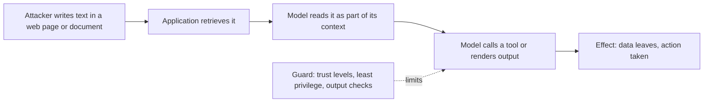

---
related:
- engineering/llm-security
- engineering/rag
- engineering/prompting
tags:
- engineering
- security
- prompt injection
aliases:
- Indirect prompt injection
- 間接提示注入
---

# Indirect Prompt Injection

Indirect prompt injection places instructions in content that an LLM application retrieves or processes, such as a web page, an email or a document in a retrieval index. The user never types the instructions. Greshake et al. (2023) introduced the term and showed attacks against real LLM-integrated applications.

## Overview

A chat application that only sees the user's typing is hard to hijack from outside. Once the application also reads web pages, mail or shared files, anyone who can edit one of those sources can write text that the model may treat as an instruction. The model does not reliably separate the instructions it was given from the data it reads, so the attack works through ordinary content.

## Key concepts

- **Trust boundary**: the point where content from an untrusted source enters the model's context alongside the developer's instructions.
- **Data exfiltration**: an injected instruction asks the model to send private data somewhere, for example by rendering a link or image whose URL carries the data.
- **Propagation**: an injected instruction can ask the model to repeat itself in later outputs or messages, so the attack spreads across a conversation or a system.
- **Tool misuse**: injected text can ask the model to call a tool, such as sending a message or changing a setting, with the user's permissions.

## How it works

## Key ideas

- **Problem:** applications that retrieve web pages, emails or documents feed that text into the model's context, which the developer does not control.
- **Core idea:** place instructions in content the application will later retrieve. When the model processes that content, it may follow the instructions, for example to exfiltrate conversation data or to change its answer.
- **Equation or algorithm:** no formula; the paper gives a threat taxonomy and attack patterns, including data theft, worming across messages, and manipulating retrieved information.
- **Results:** the paper demonstrates attacks against real LLM-integrated applications, including a search-augmented chat system, showing that the attacks work outside a lab setting.
- **Limitations:** the paper predates standard defences such as separate tool permissions and output checks, so its success rates describe systems of that time.

## Defences

No single defence is sufficient, and the defences that matter most are structural:

- **Least privilege**: an application that reads untrusted content should have few tools, and write actions should need confirmation.
- **Separate data from instructions**: mark retrieved text as data, and do not let it change system prompts or tool permissions. Techniques such as spotlighting are proposed for this.
- **Check outputs**: escape rendered HTML and block links or images to domains that are not on an allow list, so that exfiltration through rendering fails.
- **Limit the source**: retrieve only from sources with clear owners, and apply access control in retrieval rather than in the model.

## Trade-offs

- **Utility against exposure**: the more content an application reads and the more tools it has, the more useful it is and the more an injection can reach.
- **Filters**: classifiers that flag injected text help, but they miss some attacks, so they complement the structural controls rather than replace them.

## Open questions

- Can a model be trained to respect a reliable boundary between instructions and data, and how would that be measured?
- How should evaluation cover the many ways an injection can be phrased, given that a low measured rate does not prove safety?

## References

- Greshake, K. et al. (2023). *Not What You've Signed Up For: Compromising Real-World LLM-Integrated Applications with Indirect Prompt Injection*. arXiv:2302.12173. https://arxiv.org/abs/2302.12173 — Introduces indirect prompt injection and shows attacks against real LLM-integrated applications.
- Zou, A. et al. (2023). *Universal and Transferable Adversarial Attacks on Aligned Language Models*. arXiv:2307.15043. https://arxiv.org/abs/2307.15043 — Shows that automatically found adversarial suffixes can transfer across prompts and to closed models.
- Liu, Y. et al. (2023). *Prompt Injection attack against LLM-integrated Applications*. arXiv:2306.05499. https://arxiv.org/abs/2306.05499 — Studies prompt injection against applications built on LLMs, using attacks on real application prompts.
- Perez, F. & Ribeiro, I. (2022). *Ignore Previous Prompt: Attack Techniques For Language Models*. arXiv:2211.09527. https://arxiv.org/abs/2211.09527 — Catalogues goal hijacking and prompt leaking attacks on prompt-based applications, from the NeurIPS 2022 ML Safety Workshop.
- Wei, A., Haghtalab, N. & Steinhardt, J. (2023). *Jailbroken: How Does LLM Safety Training Fail?* arXiv:2307.02483. https://arxiv.org/abs/2307.02483 — Explains why safety training can be bypassed, which bears on how much a model can resist injected instructions.
- OWASP Foundation. *OWASP Top 10 for Large Language Model Applications*. https://owasp.org/www-project-top-10-for-large-language-model-applications/ — Lists prompt injection and insecure output handling as top risks, with mitigation guidance.
