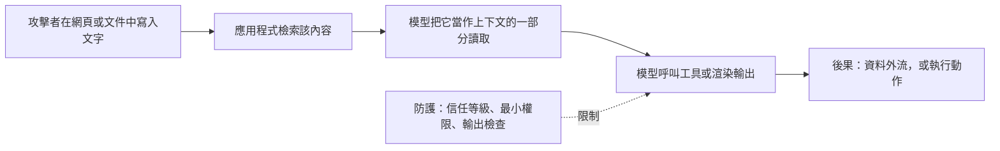

---
related:
- engineering/llm-security
- engineering/rag
- engineering/prompting
tags:
- engineering
- security
- prompt injection
aliases:
- Indirect prompt injection
- 間接提示注入
---

# 間接提示注入

間接提示注入把指示藏在 LLM 應用程式檢索或處理的內容中，例如網頁、電子郵件或檢索索引中的文件。使用者從未輸入這些指示。Greshake 等人（2023）提出了這個術語，並展示了對真實 LLM 整合應用程式的攻擊。

## 概述

只看得到使用者輸入的聊天應用程式，從外部很難被劫持。一旦應用程式也會讀取網頁、郵件或共享檔案，任何能編輯這些來源之一的人，都可能寫入模型會當作指示來處理的文字。模型無法可靠地區分它被給予的指示與它所讀取的資料，因此攻擊可以透過一般的內容發動。

## 關鍵概念

- **信任邊界**：來自不受信任來源的內容，與開發者的指示一起進入模型上下文的那個點。
- **資料外送**：被注入的指示要求模型把私有資料送到別處，例如渲染一個網址或圖片，而該網址帶有資料。
- **擴散**：被注入的指示可以要求模型在之後的輸出或訊息中重複自己，使攻擊在對話或系統中擴散。
- **工具誤用**：被注入的文字可以要求模型以使用者的權限呼叫工具，例如發送訊息或變更設定。

## 運作方式

## 關鍵想法

- **問題**：會檢索網頁、電子郵件或文件的應用程式，會把這些文字送進模型的上下文，而開發者無法控制其內容。
- **核心想法**：把指示放在應用程式之後會檢索的內容中。模型處理該內容時，可能會遵循這些指示，例如外送對話資料，或改變它的回答。
- **方程式或演算法**：沒有公式；論文提出威脅分類與攻擊模式，包括資料竊取、透過多則訊息的蠕蟲式擴散，以及操控被檢索的資訊。
- **結果**：論文展示了對真實 LLM 整合應用程式的攻擊，包括搜尋增強的聊天系統，顯示這類攻擊在實驗室之外也可行。
- **限制**：論文早於現今標準的防護，例如獨立的工具權限與輸出檢查，因此其成功率描述的是當時的系統。

## 防護

沒有單一防護就足夠，其中最重要的是結構性的設計：

- **最小權限**：讀取不受信任內容的應用程式，應只有少數工具，寫入類動作需要確認。
- **區分資料與指示**：把檢索到的文字標記為資料，不讓它改變系統提示或工具權限。標示隔離（spotlighting）等技術即為此而提出。
- **檢查輸出**：跳脫渲染的 HTML，並阻擋指向不在允許清單上網域的連結或圖片，使透過渲染的資料外送失效。
- **限制來源**：只從有明確擁有者的來源檢索，並在檢索時而非在模型中施加存取控制。

## 取捨

- **效用與暴露**：應用程式讀取的內容越多、擁有的工具越多，它就越有用，但注入能觸及的範圍也越大。
- **過濾器**：用來標記被注入文字的分類器有幫助，但會漏掉部分攻擊，因此只能補充結構性控制，無法取代它們。

## 開放問題

- 能否訓練模型，使其尊重指示與資料之間可靠的邊界？這該如何衡量？
- 考量到注入可以有許多不同的措辭，評估應如何涵蓋？畢竟測得的低比率並不代表安全。

## 參考文獻

- Greshake, K. et al. (2023). *Not What You've Signed Up For: Compromising Real-World LLM-Integrated Applications with Indirect Prompt Injection*. arXiv:2302.12173. https://arxiv.org/abs/2302.12173 — 提出間接提示注入，並展示對真實 LLM 整合應用程式的攻擊。
- Zou, A. et al. (2023). *Universal and Transferable Adversarial Attacks on Aligned Language Models*. arXiv:2307.15043. https://arxiv.org/abs/2307.15043 — 顯示自動找到的對抗後綴能跨提示遷移，也能遷移到閉源模型。
- Liu, Y. et al. (2023). *Prompt Injection attack against LLM-integrated Applications*. arXiv:2306.05499. https://arxiv.org/abs/2306.05499 — 研究針對以 LLM 建構的應用程式之提示注入，並以真實應用程式的提示進行攻擊。
- Perez, F. & Ribeiro, I. (2022). *Ignore Previous Prompt: Attack Techniques For Language Models*. arXiv:2211.09527. https://arxiv.org/abs/2211.09527 — 整理針對提示式應用程式的目標劫持與提示洩露攻擊，來自 NeurIPS 2022 ML Safety Workshop。
- Wei, A., Haghtalab, N. & Steinhardt, J. (2023). *Jailbroken: How Does LLM Safety Training Fail?* arXiv:2307.02483. https://arxiv.org/abs/2307.02483 — 解釋安全訓練為何會被繞過，這關係到模型能抵抗被注入指示的程度。
- OWASP Foundation. *OWASP Top 10 for Large Language Model Applications*. https://owasp.org/www-project-top-10-for-large-language-model-applications/ — 列出提示注入與不安全的輸出處理等主要風險，並提供緩解指引。
