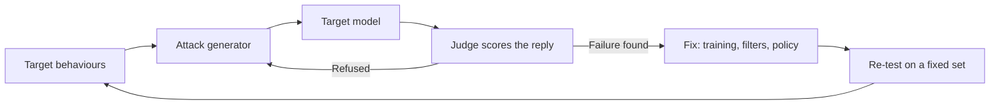

---
related:
- society/safety-alignment
- applications/cybersecurity
tags:
- security
- jailbreak
- evaluation
aliases:
- Jailbreaks and red-teaming
- Jailbreak
- Red teaming
- 越獄
- 紅隊測試
status: draft
last_reviewed: 2026-10-28
---

# Jailbreaks and Red-Teaming

A jailbreak is an input that gets a language model to produce content its safety training is meant to prevent. Red-teaming is the practice of attacking a system on purpose, by hand or with automated tools, so that its failures are found before users find them.

## Overview

Safety-tuned language models are trained to decline requests for harmful help. That refusal is a learned behaviour rather than a hard rule, so it can be probed and sometimes bypassed. Researchers group the many techniques by mechanism and by the access an attacker needs.

Red-teaming is the evaluation side. Developers and outside testers attack a system before release, and the results inform training, safeguards and release decisions, as described in [Safety & Alignment](../../society/safety-alignment/index.md). Jailbreaks are related to [indirect prompt injection](indirect-prompt-injection.md), which hijacks an application rather than unlocking forbidden content, but the two are often studied together.

## Key concepts

- **Refusal behaviour**: the learned tendency to decline harmful requests, produced by safety fine-tuning and preference training.
- **Competing objectives**: a conflict between helpfulness and harm avoidance, which an attack can exploit (Wei et al., 2023).
- **Mismatched generalisation**: safety training covers fewer inputs than pretraining does, such as rare encodings or languages (Wei et al., 2023).
- **Attack success rate**: the fraction of attempts judged harmful. It depends on the judge and the attempt budget.
- **Black-box and white-box access**: whether an attacker sees only outputs or also gradients, log-probabilities or weights.

## How it works

A red-team loop has four parts: target behaviours, an attack generator, the target model, and a judge that decides whether a reply is harmful.

### Why refusal training falls short

Wei et al. (2023) explain many jailbreaks with two failure modes: competing objectives, where a request pulls helpfulness against safety, and mismatched generalisation, where a capability from pretraining reaches inputs that safety training never covered. Casper et al. (2023) survey further limits of human feedback, such as unreliable labels and reward hacking.

## Key methods

The families below differ mainly in how the attack is built and how much access it needs. Optimised suffixes have their own page, [Universal and transferable adversarial suffixes](universal-adversarial-suffixes.md).

| Family | Mechanism | Access assumed | Reference |
|---|---|---|---|
| Persona and role-play | Asks the model to adopt a character without its usual limits; persona modulation generates such prompts automatically | Black box | Shah et al. (2023) |
| Encoding and language shift | Sends the request in a cipher or a low-resource language | Black box | Yuan et al. (2023); Yong et al. (2023) |
| Persuasion | Rewrites a request using persuasion techniques from social science | Black box | Zeng et al. (2024) |
| Many-shot | Fills a long context with example exchanges that show compliance | Black box | Anthropic (2024) |
| Multi-turn escalation | Starts from a benign topic and escalates over several turns | Black box | Russinovich et al. (2024) |
| Automated iterative search | An attacker model refines prompts using the target's replies | Black box | Chao et al. (2023); Mehrotra et al. (2023) |
| Optimised suffixes | Gradient or random search over suffix tokens | Open model, or target feedback | Zou et al. (2023); Andriushchenko et al. (2024) |

Black-box families matter most for deployed products, since they need only ordinary access.

### Automated red-teaming

Manual red-teaming is slow and limited by the testers' imagination. Perez et al. (2022) used one language model to write test questions for another, and a classifier to find harmful replies, so that many tests ran without a person writing each one. A clean result from automated search is evidence only about the methods that were implemented.

### Measuring refusals

HarmBench (Mazeika et al., 2024) standardises the comparison: a fixed set of harmful behaviours, common target models, several attack methods and a trained classifier to score completions. StrongREJECT (Souly et al., 2024) argues that many jailbreak claims count any non-refusal as success, even when the reply is vague or wrong. It proposes a judge that scores whether a response is specific and convincing, not only whether it was refused.

## Connections

- **Brain and mind**: persuasion-based attacks resemble social engineering in people, which is discussed in [Psychology & AI](../../brain-mind/psychology/index.md). The parallel is useful, but models learn from text rather than experience.
- **Evaluation**: judges, uncertainty and contamination are covered in [Evaluation & Benchmarks](../evaluation/index.md), which applies directly to jailbreak measurements.
- **Prompting**: many attacks reuse prompt structures that are legitimate in ordinary use; see [Prompt Engineering](../prompting/index.md).
- **Security practice**: red-teaming borrows from penetration testing, described in [Cybersecurity](../../applications/cybersecurity/index.md).
- **Other model risks**: [training-data extraction](../../society/privacy/training-data-extraction.md) attacks the same models through a different route.

## Applications

- **Pre-deployment testing** of frontier models, where red-team results inform the safeguards and release decisions in [Safety & Alignment](../../society/safety-alignment/index.md).
- **Product regression suites**: teams keep a fixed set of harmful behaviours and re-run it after each change to a prompt, model or policy.

## Open questions

- Does a jailbreak success rate predict real misuse? The judge, the chosen behaviours and the attacker's budget all change the number.
- Robustness to fixed attacks does not show robustness to adaptive ones (Andriushchenko et al., 2024). How can testers show that a defence holds against an attacker who adapts to it?
- How much attack detail should be published? Documentation helps defenders and also helps misuse, and the field has not settled this.

## References

### Seminal papers

- Wei, A., Haghtalab, N. & Steinhardt, J. (2023). *Jailbroken: How Does LLM Safety Training Fail?* arXiv:2307.02483. https://arxiv.org/abs/2307.02483 — Proposes competing objectives and mismatched generalisation as the two failure modes behind many jailbreaks.
- Perez, E. et al. (2022). *Red Teaming Language Models with Language Models*. arXiv:2202.03286. https://arxiv.org/abs/2202.03286 — Uses one language model to generate test inputs for another and classifies its harmful replies.
- Zou, A. et al. (2023). *Universal and Transferable Adversarial Attacks on Aligned Language Models*. arXiv:2307.15043. https://arxiv.org/abs/2307.15043 — Finds adversarial suffixes by gradient search that transfer to closed models.
- Shah, R. et al. (2023). *Scalable and Transferable Black-Box Jailbreaks for Language Models via Persona Modulation*. arXiv:2311.03348. https://arxiv.org/abs/2311.03348 — Uses a model to write persona prompts that make a black-box target comply with requests.
- Chao, P. et al. (2023). *Jailbreaking Black Box Large Language Models in Twenty Queries*. arXiv:2310.08419. https://arxiv.org/abs/2310.08419 — Shows an attacker model can refine prompts iteratively from a black-box target's replies and a judge's scores.
- Mehrotra, A. et al. (2023). *Tree of Attacks: Jailbreaking Black-Box LLMs Automatically*. arXiv:2312.02119. https://arxiv.org/abs/2312.02119 — Adds branching search and pruning of candidate prompts before any are sent to the target.
- Yuan, Y. et al. (2023). *GPT-4 Is Too Smart To Be Safe: Stealthy Chat with LLMs via Cipher*. arXiv:2308.06463. https://arxiv.org/abs/2308.06463 — Shows that safety behaviour learned in plain language does not fully carry over to ciphered conversations.
- Yong, Z.-X., Menghini, C. & Bach, S. H. (2023). *Low-Resource Languages Jailbreak GPT-4*. arXiv:2310.02446. https://arxiv.org/abs/2310.02446 — Shows that translating unsafe requests into low-resource languages raises the rate of harmful replies from GPT-4.
- Russinovich, M., Salem, A. & Eldan, R. (2024). *Great, Now Write an Article About That: The Crescendo Multi-Turn LLM Jailbreak Attack*. arXiv:2404.01833. https://arxiv.org/abs/2404.01833 — Describes a multi-turn attack that escalates gradually, using the model's own earlier replies as context.
- Zeng, Y. et al. (2024). *How Johnny Can Persuade LLMs to Jailbreak Them: Rethinking Persuasion to Challenge AI Safety by Humanizing LLMs*. arXiv:2401.06373. https://arxiv.org/abs/2401.06373 — Rewrites harmful requests with persuasion techniques drawn from social science and measures the resulting compliance.
- Mazeika, M. et al. (2024). *HarmBench: A Standardized Evaluation Framework for Automated Red Teaming and Robust Refusal*. arXiv:2402.04249. https://arxiv.org/abs/2402.04249 — Standardised comparison of automated red-teaming methods and refusal robustness across many models and behaviours.
- Andriushchenko, M., Croce, F. & Flammarion, N. (2024). *Jailbreaking Leading Safety-Aligned LLMs with Simple Adaptive Attacks*. arXiv:2404.02151. https://arxiv.org/abs/2404.02151 — Shows that attacks tailored to each target can succeed where generic attacks fail, so robustness claims need adaptive testing.
- Souly, A. et al. (2024). *A StrongREJECT for Empty Jailbreaks*. arXiv:2402.10260. https://arxiv.org/abs/2402.10260 — Proposes a judge that scores whether a jailbreak response is specific and convincing, not only whether it was refused.

### Surveys and textbooks

- Yi, S. et al. (2024). *Jailbreak Attacks and Defenses Against Large Language Models: A Survey*. arXiv:2407.04295. https://arxiv.org/abs/2407.04295 — Organises attack and defence methods into a taxonomy, useful for placing any new technique.
- Casper, S. et al. (2023). *Open Problems and Fundamental Limitations of Reinforcement Learning from Human Feedback*. arXiv:2307.15217. https://arxiv.org/abs/2307.15217 — Surveys practical and fundamental limits of human-feedback training, including how safety behaviour can be gamed.

### Articles and documentation

- Anthropic (2024). *Many-shot jailbreaking*. https://www.anthropic.com/research/many-shot-jailbreaking — Describes the long-context attack and how its effectiveness changes with the number of example exchanges.
