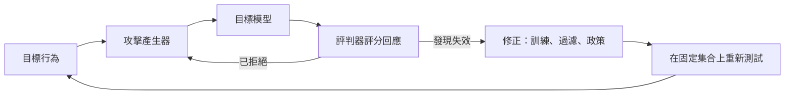

# 越獄與紅隊測試

越獄（jailbreak）是一種輸入，會讓語言模型產生安全訓練原本要阻止的內容。紅隊測試（red-teaming）則是有意識地攻擊一個系統，無論是人工或使用自動化工具，目的是讓它的失效在使用者發現之前就先被找出來。

## 概述

經過安全調校的語言模型，被訓練成拒絕有害的協助請求。這種拒絕是一種習得的行為，而非硬性規則，因此它可以被探測，有時也能被繞過。研究者會依照機制以及攻擊者所需的存取權限，把眾多技術分組。

紅隊測試是評估的一面。開發者與外部測試者會在發布前攻擊一個系統，而結果會影響訓練、防護措施與發布決策，相關內容見[安全與對齊](../../society/safety-alignment/index.zh-TW.md)。越獄與[間接提示注入](indirect-prompt-injection.zh-TW.md)有關聯；後者劫持的是應用程式，而不是解鎖被禁止的內容，但兩者經常一起研究。

## 關鍵概念

- **拒絕行為**：模型學到的拒絕有害請求的傾向，由安全微調與偏好訓練產生。
- **目標衝突**：樂於助人與避免傷害之間的衝突，攻擊可以利用這種衝突（Wei et al., 2023）。
- **錯配的泛化**：安全訓練涵蓋的輸入比預訓練少，例如罕見的編碼或語言，因此在這些輸入上的行為較不可靠（Wei et al., 2023）。
- **攻擊成功率**：被判定為有害的嘗試所佔的比例。它取決於評判器與嘗試次數的預算。
- **黑箱與白箱存取**：攻擊者只看得到輸出，或同時能取得梯度、對數機率或權重。

## 運作方式

一個紅隊測試的迴圈包含四個部分：目標行為、攻擊產生器、目標模型，以及判斷回應是否有害的評判器。

### 為什麼拒絕訓練有其侷限

Wei et al.（2023）用兩種失效模式解釋許多越獄：一是目標衝突，即請求把樂於助人與安全拉向相反方向；二是錯配的泛化，即預訓練學到的能力觸及了安全訓練從未涵蓋的輸入。Casper et al.（2023）則綜述了人類回饋的其他侷限，例如標註不可靠與獎勵駭客。

## 關鍵方法

以下各類攻擊的差異，主要在於攻擊如何構造，以及需要多少存取權限。最佳化後綴有自己的頁面，即[通用且可轉移的對抗後綴](universal-adversarial-suffixes.zh-TW.md)。

| 類型 | 機制 | 假設的存取權限 | 參考 |
|---|---|---|---|
| 角色設定與扮演 | 要求模型採用一個不受其一般限制的角色；角色調制會自動產生這類提示 | 黑箱 | Shah et al. (2023) |
| 編碼與語言轉換 | 以密碼或低資源語言傳送請求 | 黑箱 | Yuan et al. (2023)；Yong et al. (2023) |
| 說服 | 以社會科學中的說服技巧改寫請求 | 黑箱 | Zeng et al. (2024) |
| 多範例 | 用展示順從的範例對話填滿長上下文 | 黑箱 | Anthropic (2024) |
| 多輪逐步升級 | 從良性話題開始，在數輪對話中逐步升級 | 黑箱 | Russinovich et al. (2024) |
| 自動化迭代搜尋 | 攻擊者模型根據目標的回覆來修改提示 | 黑箱 | Chao et al. (2023)；Mehrotra et al. (2023) |
| 最佳化後綴 | 對後綴 token 進行梯度或隨機搜尋 | 開源模型，或目標的回饋 | Zou et al. (2023)；Andriushchenko et al. (2024) |

黑箱類型對已部署的產品最為重要，因為它們只需要一般的存取權限。

### 自動化紅隊測試

人工紅隊測試既緩慢，又受限於測試者的想像力。Perez et al.（2022）用一個語言模型為另一個模型撰寫測試問題，再以分類器找出有害的回覆，使大量測試無需人工逐一撰寫即可執行。自動化搜尋得到的乾淨結果，只能說明被實作過的那些方法。

### 衡量拒絕

HarmBench（Mazeika et al., 2024）將比較標準化：固定的有害行為集合、共同的目標模型、數種攻擊方法，以及用來為回應評分的訓練好的分類器。StrongREJECT（Souly et al., 2024）主張，許多越獄宣稱把任何不拒絕的回應都算作成功，即使回應含糊或錯誤。它提出一種評判器，評估回應是否具體且有說服力，而不只看它是否被拒絕。

## 相關連結

- **腦與心智**：以說服為基礎的攻擊類似人類身上的社會工程，相關討論見[心理學與 AI](../../brain-mind/psychology/index.zh-TW.md)。這個類比有參考價值，但模型是從文字學習，而非從經驗學習。
- **評估**：評判器、不確定性與資料污染見[評估與基準](../evaluation/index.zh-TW.md)，這些直接適用於越獄的衡量。
- **提示**：許多攻擊重用在一般使用中也合法的提示結構，見[提示工程](../prompting/index.zh-TW.md)。
- **資安實務**：紅隊測試借鏡滲透測試，見[資訊安全](../../applications/cybersecurity/index.zh-TW.md)。
- **其他模型風險**：[訓練資料萃取](../../society/privacy/training-data-extraction.zh-TW.md)透過不同的途徑攻擊同一類模型。

## 應用

- **發布前測試**：前沿模型的紅隊結果，會影響[安全與對齊](../../society/safety-alignment/index.zh-TW.md)中討論的防護與發布決策。
- **產品回歸測試套件**：團隊保留一組固定的有害行為，並在每次提示、模型或政策改動後重新執行。

## 開放問題

- 越獄成功率能否預測真實的濫用？評判器、所選的行為與攻擊者的預算，都會改變這個數字。
- 對固定攻擊的穩健性，並不代表對適應性攻擊的穩健性（Andriushchenko et al., 2024）。測試者要如何證明，一個防護在面對會針對它調整的攻擊者時仍然有效？
- 攻擊細節應該公開到什麼程度？記錄方法有助於防禦者，也有助於濫用者，而這個取捨在領域內尚無定論。

## 參考文獻

### 開創性論文

- Wei, A., Haghtalab, N. & Steinhardt, J. (2023). *Jailbroken: How Does LLM Safety Training Fail?* arXiv:2307.02483. https://arxiv.org/abs/2307.02483 — 提出目標衝突與錯配的泛化，作為許多越獄背後的兩種失效模式。
- Perez, E. et al. (2022). *Red Teaming Language Models with Language Models*. arXiv:2202.03286. https://arxiv.org/abs/2202.03286 — 用一個語言模型為另一個模型產生測試輸入，並對其有害的回覆進行分類。
- Zou, A. et al. (2023). *Universal and Transferable Adversarial Attacks on Aligned Language Models*. arXiv:2307.15043. https://arxiv.org/abs/2307.15043 — 透過梯度搜尋找出對抗後綴，這些後綴能遷移到閉源模型。
- Shah, R. et al. (2023). *Scalable and Transferable Black-Box Jailbreaks for Language Models via Persona Modulation*. arXiv:2311.03348. https://arxiv.org/abs/2311.03348 — 使用一個模型撰寫角色提示，使黑箱目標模型順從請求。
- Chao, P. et al. (2023). *Jailbreaking Black Box Large Language Models in Twenty Queries*. arXiv:2310.08419. https://arxiv.org/abs/2310.08419 — 顯示攻擊者模型可以根據黑箱目標的回覆與評判器的分數，迭代地修改提示。
- Mehrotra, A. et al. (2023). *Tree of Attacks: Jailbreaking Black-Box LLMs Automatically*. arXiv:2312.02119. https://arxiv.org/abs/2312.02119 — 加入分支搜尋，並在送往目標模型之前修剪候選提示。
- Yuan, Y. et al. (2023). *GPT-4 Is Too Smart To Be Safe: Stealthy Chat with LLMs via Cipher*. arXiv:2308.06463. https://arxiv.org/abs/2308.06463 — 顯示以純自然語言學到的安全行為，無法完全延伸到以密碼加密的對話中。
- Yong, Z.-X., Menghini, C. & Bach, S. H. (2023). *Low-Resource Languages Jailbreak GPT-4*. arXiv:2310.02446. https://arxiv.org/abs/2310.02446 — 顯示把不安全的請求翻譯成低資源語言，會提高 GPT-4 產生有害回覆的比例。
- Russinovich, M., Salem, A. & Eldan, R. (2024). *Great, Now Write an Article About That: The Crescendo Multi-Turn LLM Jailbreak Attack*. arXiv:2404.01833. https://arxiv.org/abs/2404.01833 — 描述一種逐步升級的多輪攻擊，並以模型自己先前的回覆作為上下文。
- Zeng, Y. et al. (2024). *How Johnny Can Persuade LLMs to Jailbreak Them: Rethinking Persuasion to Challenge AI Safety by Humanizing LLMs*. arXiv:2401.06373. https://arxiv.org/abs/2401.06373 — 以取自社會科學的說服技巧改寫有害請求，並衡量由此產生的順從程度。
- Mazeika, M. et al. (2024). *HarmBench: A Standardized Evaluation Framework for Automated Red Teaming and Robust Refusal*. arXiv:2402.04249. https://arxiv.org/abs/2402.04249 — 在多個模型與行為上，標準化地比較自動化紅隊測試方法與拒絕的穩健性。
- Andriushchenko, M., Croce, F. & Flammarion, N. (2024). *Jailbreaking Leading Safety-Aligned LLMs with Simple Adaptive Attacks*. arXiv:2404.02151. https://arxiv.org/abs/2404.02151 — 顯示針對每個目標量身打造的攻擊，可以成功，而通用攻擊可能失敗，因此穩健性的主張需要以適應性測試來檢驗。
- Souly, A. et al. (2024). *A StrongREJECT for Empty Jailbreaks*. arXiv:2402.10260. https://arxiv.org/abs/2402.10260 — 提出一種評判器，評估越獄回應是否具體且有說服力，而不只看它是否被拒絕。

### 綜述與教科書

- Yi, S. et al. (2024). *Jailbreak Attacks and Defenses Against Large Language Models: A Survey*. arXiv:2407.04295. https://arxiv.org/abs/2407.04295 — 將攻擊與防禦方法整理成分類體系，有助於為任何新技術定位。
- Casper, S. et al. (2023). *Open Problems and Fundamental Limitations of Reinforcement Learning from Human Feedback*. arXiv:2307.15217. https://arxiv.org/abs/2307.15217 — 綜述以人類回饋進行訓練的實務與根本性限制，包括安全行為如何被鑽空子。

### 文章與文件

- Anthropic (2024). *Many-shot jailbreaking*. https://www.anthropic.com/research/many-shot-jailbreaking — 描述這種長上下文攻擊，以及其效果如何隨範例對話的數量改變。
