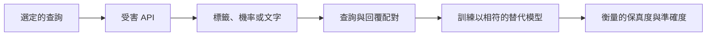

# 模型萃取與竊取

模型萃取是一種攻擊：攻擊者只能查詢已部署的模型，卻能建立出它的行為複本，或還原其部分參數，而無需取得權重。這會威脅擁有者在訓練上的投資，也會威脅模型的機密性。

## 概述

訓練大型模型所費不貲，許多供應商因此透過銷售 API 存取權來回收成本。API 同時也是攻擊面：每一次回覆都會透露一些資訊，無論是標籤、機率或一段文字，而攻擊者只要蒐集到足夠的回覆，就能用它們訓練第二個模型。

Tramèr 等人（2016）指出，簡單的預測服務可以被以近乎完美的保真度複製。語言模型讓風險更高，因為它們的回覆是豐富的文字；而當教師模型是自己的模型時，同樣的程序（蒸餾）只是一種一般的訓練方法。

有兩種目標值得區分。*功能竊取*追求在任務上表現相似的複本。*參數萃取*追求權重本身，這需要特定結構的輸出。

## 關鍵概念

- **受害模型與替代模型**：已部署的模型，以及攻擊者訓練出來的複本。
- **保真度與準確度**：保真度是複本與受害模型輸出相符的程度；準確度是它在真實任務上的表現。一個複本可能準確卻不忠實於原模型。
- **軟輸出**：機率或 logit，所含資訊比單一標籤多。
- **蒸餾**：以教師模型的輸出訓練學生模型，由 Hinton 等人（2015）提出。見[知識蒸餾](../../theory/model-compression/knowledge-distillation/index.zh-TW.md)。

## 運作方式

多數攻擊遵循同一個循環：發送查詢、記錄回覆、以這些配對訓練替代模型，然後衡量它與受害模型的吻合程度。

替代模型 $f_\theta$ 的擬合目標，是在查詢 $x_i$ 上最小化損失，其中 $f_V$ 為受害模型：

$$\hat\theta = \arg\min_\theta \sum_i \mathcal{L}\big(f_\theta(x_i),\, f_V(x_i)\big)$$

有三個選擇會決定效果。第一是查詢的分布：Orekondy 等人（2019）發現，來自無關分布的隨機影像仍能產生可用的影像 API 複本。第二是輸出：機率所揭露的資訊比標籤多。第三是架構，替代模型不必與受害模型相同。

Gudibande 等人（2023）以專有聊天模型的回覆微調開源模型。模仿者複製了它的風格，在眾包評分者眼中也頗具競爭力，但在模仿資料未涵蓋的任務上，縮小的差距很有限。

Carlini 等人（2024）則走向參數還原。Transformer 對許多提示所產生的 logit 向量，落在維度至多等於其隱藏維度的子空間中。對這類輸出做線性代數運算，可以揭示該維度，並在差一個對稱變換的範圍內，還原最後的嵌入投影層。[^1]

## 關鍵方法

下表的各種方法，差異在於攻擊者學到什麼，以及 API 必須回傳什麼。每種方法都沒有自己的頁面。

| 變體 | 攻擊者得到的 | API 須回傳的 | 主要限制 |
|---|---|---|---|
| 僅用標籤的替代模型（Papernot 等人，2017） | 能轉移到受害模型的對抗樣本 | 預測標籤 | 取決於替代模型的擬合程度 |
| 基於信心值的萃取（Tramèr 等人，2016） | 簡單模型的近乎完美複本 | 信心值 | 隱藏信心值並不足夠 |
| 文字模仿（Krishna 等人，2020；Gudibande 等人，2023） | 風格與部分行為相符的複本 | 生成的文字 | 風格容易複製；事實能力則不然 |
| 對數機率還原（Carlini 等人，2024） | 生產模型最後的投影層 | 對數機率 | 僅還原一層 |

## 防禦

沒有單一控制措施足夠，而且多數只在部分情境下測試過。

- **限制輸出。** 只回傳最高機率的標籤，可減少每次查詢所含的資訊，但 Tramèr 等人（2016）指出這仍不夠。
- **偵測查詢模式。** PRADA（Juuti 等人，2019）會標記查詢偏離正常使用的用戶端。其評估針對當時既有的攻擊，因此對會適應偵測的攻擊者說服力有限。
- **速率限制與存取控制。** 限制流量與帳號數量可提高攻擊的成本，但攻擊者可以把查詢分散到多個帳號。
- **擾動回覆。** Orekondy 等人（2020）擾動預測結果，以誤導攻擊者的訓練，對正常使用者的影響則很小。
- **浮水印與指紋。** Peng 等人（2023）在嵌入中植入後門，使被竊取的嵌入模型能被檢驗。Krishna 等人（2020）發現，對更精密的攻擊者而言，API 浮水印並不有效。Xu 等人（2024）為 LLM 植入私有的指令觸發器作為指紋。Maini 等人（2021）則檢驗可疑模型是否學過擁有者的訓練資料。[^2]

## 相關連結

- **蒸餾。** 萃取與[知識蒸餾](../../theory/model-compression/knowledge-distillation/index.zh-TW.md)共享同一機制，差別在於同意與擁有權。另見[大型語言模型的蒸餾](../../theory/model-compression/knowledge-distillation/llm-distillation/index.zh-TW.md)。
- **隱私攻擊。** [訓練資料萃取](../../society/privacy/training-data-extraction.zh-TW.md)還原的是被記憶的文字；模型萃取還原的則是行為或權重。可與[成員推論](../../society/privacy/membership-inference.zh-TW.md)比較。
- **後門。** 指紋與浮水印依賴刻意植入的後門，這正是[資料投毒與後門](data-poisoning-and-backdoors.zh-TW.md)所研究的機制。
- **封閉與開放模型。** 存取控制是區分多數封閉供應商與開放權重釋出的關鍵，而萃取會模糊這條界線。見[開放與封閉模型](../../society/open-vs-closed/index.zh-TW.md)。
- **護欄。** 在別處製作的複本，會脫離原始服務的[護欄](guardrails.zh-TW.md)。

## 應用

- **競爭產品**以低成本模仿商用模型的行為（Gudibande 等人，2023）。
- **規避偵測。** 替代模型為攻擊者提供一個替身，用來製作能轉移到受害模型的對抗樣本（Papernot 等人，2017）。
- **所有權爭議。** 指紋與資料集推論可作為證據（Xu 等人，2024；Maini 等人，2021）。

## 開放問題

- **參數還原的範圍。** Carlini 等人（2024）還原的是一層投影層。類似方法能否還原更深的結構，目前尚不清楚。
- **合法或具萃取性？** 競爭者的流量可能看起來與一般使用無異，因此以查詢為基礎的偵測器未必能區分兩者。
- **能力差距。** 模仿能否在模仿資料未涵蓋的任務上縮小差距，仍無定論；Oliynyk 等人（2023）綜述了這個領域。
- **標記的持久性與法律地位。** 微調可能移除浮水印或指紋；模型輸出在服務條款與著作權法下的法律地位，也尚未確定。

## 參考文獻

### 奠基性論文

- Tramèr, F. et al. (2016). *Stealing Machine Learning Models via Prediction APIs*. USENIX Security Symposium. https://arxiv.org/abs/1609.02943 — 對數種簡單模型的近乎完美萃取，包括對現場雲端預測服務的萃取。
- Papernot, N. et al. (2017). *Practical Black-Box Attacks against Machine Learning*. ACM ASIA CCS. https://arxiv.org/abs/1602.02697 — 以遠端 DNN 的標籤訓練替代模型，並顯示其對抗樣本能轉移至目標模型。
- Hinton, G., Vinyals, O. & Dean, J. (2015). *Distilling the Knowledge in a Neural Network*. arXiv:1503.02531. https://arxiv.org/abs/1503.02531 — 提出蒸餾，即以較大模型的軟輸出訓練小模型。
- Orekondy, T., Schiele, B. & Fritz, M. (2019). *Knockoff Nets: Stealing Functionality of Black-Box Models*. CVPR. https://arxiv.org/abs/1812.02766 — 顯示來自分布外的隨機查詢影像，能產生影像 API 的可用複本。
- Krishna, K. et al. (2020). *Thieves on Sesame Street! Model Extraction of BERT-based APIs*. ICLR. https://arxiv.org/abs/1910.12366 — 以隨機詞序列作為查詢，萃取基於 BERT 的 NLP API，並測試兩種防禦。
- Carlini, N. et al. (2024). *Stealing Part of a Production Language Model*. ICML. https://arxiv.org/abs/2403.06634 — 透過 API 存取還原生產語言模型的嵌入投影層，成本很低。
- Gudibande, A. et al. (2023). *The False Promise of Imitating Proprietary LLMs*. arXiv:2305.15717. https://arxiv.org/abs/2305.15717 — 發現模仿專有聊天模型時，複製的是風格而非事實能力。
- Juuti, M. et al. (2019). *PRADA: Protecting against DNN Model Stealing Attacks*. IEEE EuroS&P. https://arxiv.org/abs/1805.02628 — 透過分析每個用戶端連續查詢的分布，偵測萃取行為。
- Orekondy, T., Schiele, B. & Fritz, M. (2020). *Prediction Poisoning: Towards Defenses Against DNN Model Stealing Attacks*. ICLR. https://arxiv.org/abs/1906.10908 — 擾動預測結果以誤導攻擊者的訓練，同時對正常使用者的影響很小。
- Peng, W. et al. (2023). *Are You Copying My Model? Protecting the Copyright of Large Language Models for EaaS via Backdoor Watermark*. arXiv:2305.10036. https://arxiv.org/abs/2305.10036 — 在嵌入中植入後門浮水印，使被竊取的嵌入模型能被驗證。
- Xu, J. et al. (2024). *Instructional Fingerprinting of Large Language Models*. arXiv:2401.12255. https://arxiv.org/abs/2401.12255 — 植入私有的指令觸發器作為指紋，並在十一個常用 LLM 上測試。
- Maini, P., Yaghini, M. & Papernot, N. (2021). *Dataset Inference: Ownership Resolution in Machine Learning*. ICLR. https://arxiv.org/abs/2104.10706 — 檢驗可疑模型是否掌握擁有者訓練資料的知識，作為所有權防禦。

### 綜述與教科書

- Oliynyk, D., Mayer, R. & Rauber, A. (2023). *I Know What You Trained Last Summer: A Survey on Stealing Machine Learning Models and Defences*. ACM Computing Surveys. https://arxiv.org/abs/2206.08451 — 萃取攻擊與防禦的分類，並分析哪些防禦已被現有攻擊削弱。

[^1]: Carlini 等人（2024）回報，以不到 20 美元的 API 查詢，萃取了兩個 OpenAI 模型的完整投影矩陣，數據取自論文摘要。

[^2]: Maini 等人（2021）回報，以 50 個訓練點即可使擁有者的主張信心超過 99%，數據取自論文摘要。
