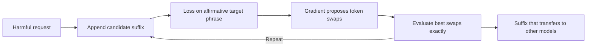

---
related:
- engineering/llm-security
- society/safety-alignment
tags:
- engineering
- security
- jailbreak
- adversarial attacks
aliases:
- Universal adversarial suffixes
- 通用對抗後綴
---

# Universal and Transferable Adversarial Suffixes

Universal and transferable adversarial suffixes are token sequences, found by automated search, that make an aligned language model answer a request it would otherwise refuse. Zou et al. (2023) introduced the method. Its significance for applications is that the suffix can be found on an open model and then used against closed models.

## Overview

Aligned models refuse direct harmful requests, but refusal is a learned behaviour that can be probed. The attack treats the prompt as something to optimise. It appends a suffix to a request and searches for tokens that make the model begin its reply with an affirmative phrase. Because the search is automated, it can be run at scale over many requests.

## Key concepts

- **Adversarial suffix**: a short sequence of tokens appended to a request, which may look like nonsense to a human reader.
- **Target phrase**: the start of an affirmative reply, which the search uses as its objective.
- **Greedy coordinate gradient**: a search that uses gradients to propose token swaps and then evaluates the best of them exactly.
- **Transfer**: a suffix found on one model or set of requests that works on other models or requests.

## How it works

## Key ideas

- **Problem:** aligned models refuse direct harmful requests, but it was unclear whether refusals could be broken automatically at scale.
- **Core idea:** search for a suffix of tokens that, appended to a harmful request, makes the model begin its answer with an affirmative phrase. The search uses greedy coordinate gradient steps on an open model and selects token swaps that lower the loss of that target phrase.
- **Equation or algorithm:** choose the suffix $s$ that minimises $\mathcal{L}(x \oplus s) = -\log p(y^\star \mid x \oplus s)$, where $x$ is the request and $y^\star$ is an affirmative target. Candidate token swaps are ranked by gradient, then evaluated exactly.
- **Results:** the paper reports suffixes that transfer across prompts and to closed commercial models that were not used in the search.
- **Limitations:** the attack needs gradient access to an open model and produces unusual text. Later defences, including input perplexity filters and adversarial training, reduce but do not eliminate it.

## Defences and trade-offs

- **Perplexity filters**: unusual suffixes have high perplexity, so a filter can flag them, but an attacker can search for fluent suffixes instead.
- **Adversarial training**: training against known suffixes improves robustness to them, but new suffixes can be found by repeating the search.
- **Evaluation**: a benchmark of fixed suffixes measures only the attacks it includes, so robustness needs testing with adaptive attacks.

## Open questions

- Do defences that resist this search also resist adaptive attacks that search against the defence itself?
- How should transfer be measured fairly across models with different training and safety layers?

## References

- Zou, A. et al. (2023). *Universal and Transferable Adversarial Attacks on Aligned Language Models*. arXiv:2307.15043. https://arxiv.org/abs/2307.15043 — Introduces the gradient-based suffix search and shows transfer to closed models.
- Wei, A., Haghtalab, N. & Steinhardt, J. (2023). *Jailbroken: How Does LLM Safety Training Fail?* arXiv:2307.02483. https://arxiv.org/abs/2307.02483 — Explains the failure modes of safety training that make such attacks possible.
- Greshake, K. et al. (2023). *Not What You've Signed Up For: Compromising Real-World LLM-Integrated Applications with Indirect Prompt Injection*. arXiv:2302.12173. https://arxiv.org/abs/2302.12173 — Shows that the same kind of attack matters once an application reads untrusted content.
- Perez, F. & Ribeiro, I. (2022). *Ignore Previous Prompt: Attack Techniques For Language Models*. arXiv:2211.09527. https://arxiv.org/abs/2211.09527 — Catalogues manually written attacks on prompt-based applications, the baseline against which automated suffixes are compared.
- Liu, Y. et al. (2023). *Prompt Injection attack against LLM-integrated Applications*. arXiv:2306.05499. https://arxiv.org/abs/2306.05499 — Studies prompt injection against LLM-integrated applications, a related threat model.
