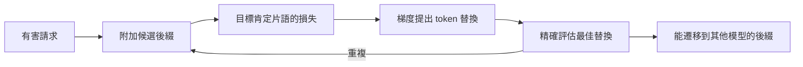

---
related:
- engineering/llm-security
- society/safety-alignment
tags:
- engineering
- security
- jailbreak
- adversarial attacks
aliases:
- Universal adversarial suffixes
- 通用對抗後綴
---

# 通用且可轉移的對抗後綴

通用且可轉移的對抗後綴，是透過自動搜尋找到的一串 token，附加在請求之後，能讓對齊後的語言模型回答它原本會拒絕的請求。Zou 等人（2023）提出了這個方法。它對應用程式的意義在於：後綴可以在開源模型上找到，再用於閉源模型。

## 概述

對齊後的模型會拒絕直接的有害請求，但拒絕是一種學來的行為，而這種行為是可以被探測的。這個攻擊把提示當作可以最佳化的對象：把後綴附加在請求之後，搜尋能讓模型以肯定片語開頭回答的 token。因為搜尋是自動進行的，它可以大規模地套用到許多請求上。

## 關鍵概念

- **對抗後綴**：附加在請求之後的一小段 token，對人類讀者而言可能看起來像無意義的文字。
- **目標片語**：肯定回答的開頭，搜尋以它作為目標。
- **貪婪座標梯度**：一種利用梯度提出 token 替換、再精確評估最佳候選的搜尋方法。
- **遷移**：在某個模型或某組請求上找到、也能用在其他模型或請求上的後綴。

## 運作方式

## 關鍵想法

- **問題**：對齊後的模型會拒絕直接的有害請求，但不清楚拒絕能否被大規模地自動破解。
- **核心想法**：搜尋一段 token 後綴，附加在有害請求之後，使模型的回答以肯定的片語開頭。搜尋在開源模型上以貪婪座標梯度步驟進行，挑選能降低該目標片語損失的 token 替換。
- **方程式或演算法**：選擇使 $\mathcal{L}(x \oplus s) = -\log p(y^\star \mid x \oplus s)$ 最小的後綴 $s$，其中 $x$ 為請求，$y^\star$ 為肯定的目標片語。候選的 token 替換依梯度排序，再以精確評估。
- **結果**：論文指出，找到的後綴能跨越不同提示遷移，也能遷移到搜尋時未使用的閉源商用模型。
- **限制**：攻擊需要開源模型的梯度存取，且產生的文字很不尋常。後來的防護，包括輸入困惑度過濾與對抗訓練，能降低但無法消除它。

## 防護與取捨

- **困惑度過濾**：不尋常的後綴困惑度較高，過濾器可以標記它們，但攻擊者可以改為搜尋流暢的後綴。
- **對抗訓練**：針對已知後綴做訓練能提高對它們的穩健性，但重複搜尋仍能找到新的後綴。
- **評估**：以固定後綴組成的基準，只能衡量其中包含的攻擊，因此穩健性需要以適應性攻擊來測試。

## 開放問題

- 能抵抗這種搜尋的防護，是否也能抵抗針對防護本身進行搜尋的適應性攻擊？
- 對於訓練與安全層各不相同的模型，應如何公平地衡量遷移性？

## 參考文獻

- Zou, A. et al. (2023). *Universal and Transferable Adversarial Attacks on Aligned Language Models*. arXiv:2307.15043. https://arxiv.org/abs/2307.15043 — 提出以梯度為基礎的後綴搜尋，並顯示能遷移到閉源模型。
- Wei, A., Haghtalab, N. & Steinhardt, J. (2023). *Jailbroken: How Does LLM Safety Training Fail?* arXiv:2307.02483. https://arxiv.org/abs/2307.02483 — 解釋使此類攻擊成為可能的安全訓練失效模式。
- Greshake, K. et al. (2023). *Not What You've Signed Up For: Compromising Real-World LLM-Integrated Applications with Indirect Prompt Injection*. arXiv:2302.12173. https://arxiv.org/abs/2302.12173 — 顯示當應用程式讀取不受信任的內容時，同類攻擊同樣重要。
- Perez, F. & Ribeiro, I. (2022). *Ignore Previous Prompt: Attack Techniques For Language Models*. arXiv:2211.09527. https://arxiv.org/abs/2211.09527 — 整理針對提示式應用程式的人工撰寫攻擊，是自動化後綴的比較基準。
- Liu, Y. et al. (2023). *Prompt Injection attack against LLM-integrated Applications*. arXiv:2306.05499. https://arxiv.org/abs/2306.05499 — 研究針對 LLM 整合應用程式的提示注入，是相關的威脅模型。
