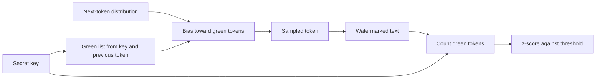

# Watermarking Model Output

A watermark is a signal that a generative model embeds in its output, so that a later check can tell the content came from that model. The signal should be invisible to a reader and is found statistically with a secret key. For text it usually lives in the choice of words; for images, in pixels or in the generation process.

## Overview

Generative models make text and images that are cheap to produce and hard to tell from human work. Watermarking differs from provenance metadata in that the signal sits in the content, so stripping a file header does not remove it. The result is statistical: a detector returns evidence against a threshold, and paraphrase or cropping can weaken the signal. Policy is covered in [Misinformation and Deepfakes](../../society/misinformation/index.md).

## Key concepts

- **Watermark key**: a secret value that seeds the signal. Only its holder can run detection.
- **Green list**: a pseudo-random subset of the vocabulary, chosen from the key and the preceding token.
- **False positive rate**: the share of human text wrongly flagged. Providers set it very low.
- **Entropy**: how much choice the model has at each step. Low-entropy output, such as code, leaves less room for a signal.

## How it works

### Text

At each step a language model gives a probability for every next token. A text watermark changes how the next token is sampled, using the key. In the green-list scheme of Kirchenbauer et al. (2023), the key and the previous token define a green list holding a fraction $\gamma$ of the vocabulary, and a small bias $\delta$ is added to the logits of green tokens. Ordinary text contains about a fraction $\gamma$ of green tokens by chance. Detection counts the green tokens $|s|_G$ among $T$ scored tokens and computes

$$
z = \frac{|s|_G - \gamma T}{\sqrt{T\gamma(1-\gamma)}}
$$

A large $z$ is unlikely by chance, so a threshold on $z$ sets the false positive rate. Detection needs only the key and the text.

### Images

Tree-Ring puts a Fourier-structured pattern in the initial noise of a diffusion model and detects it by inverting the diffusion process (Wen et al., 2023). The Stable Signature tunes the decoder so every output carries a binary signature (Fernandez et al., 2023). SynthID-Image embeds a learned signal in images and reads it with a learned detector (Gowal et al., 2025).

### Robustness to paraphrase and removal

Kirchenbauer et al. (2023b) found that watermarks survive human and machine paraphrase, which dilutes the signal but still leaves detectable fragments.[^1] Krishna et al. (2023) showed that a paraphraser can evade detection, and proposed a defence that matches suspect text against the provider's stored generations.[^2]

Removal and forgery are hard to rule out. Zhang et al. (2023) argue, under stated assumptions, that a strong watermark is impossible. Jovanović et al. (2024) show that querying a watermarked API can approximate the watermark, so an attacker can forge it onto human text or scrub it from model output.[^3] For images, Zhao et al. (2023) show that regeneration, which adds noise and reconstructs the image with a generative model, removes pixel-level invisible marks.

### Detection trade-offs

A watermark balances signal strength, quality cost and text length. A stronger bias finds more watermarked text but changes the output more; a stricter threshold misses some true cases. Low-entropy outputs are hardest: in Kuditipudi et al.'s experiments, only about a quarter of typical responses from one instruction-tuned model were detectable.[^4] Christ et al. (2023) give a theoretical construction of undetectable watermarks.

## Key methods

None of these variants has a child page.

| Variant | Medium | What it changes | How it is checked | Main limit |
|---|---|---|---|---|
| Green-list biasing (Kirchenbauer et al., 2023) | Text | Raises the probability of green tokens | Counts green tokens and applies the z-test | Quality cost grows with the bias |
| Distortion-free sampling (Kuditipudi et al., 2023) | Text | Derives samples from key-seeded random numbers | Aligns the text with the random sequence | Needs many tokens |
| Production sampling (SynthID-Text, Dathathri et al., 2024) | Text | Modifies only the sampling step | Runs without the LLM | Only a provider that embeds it can produce it |
| In-generation patterns (Tree-Ring, Stable Signature) | Image | Noise pattern, or a tuned decoder | Inverts the diffusion process, or runs an extractor | Robustness claims rest on the authors' attack suites |
| Learned image marks (SynthID-Image, Gowal et al., 2025) | Image | A learned signal embedded in the image | Learned detector | Robustness is reported mainly by the provider |

Green lists shift probabilities and so are not distortion-free; distortion-free schemes avoid this at the cost of longer detection. SynthID-Text is the production case, with reported gains in detectability and no measured loss in ratings.

## Connections

- **Model-level watermarks.** [Model Extraction and Theft](model-extraction.md) covers watermarks that protect a model's own copyright, often by planting a backdoor as [Data Poisoning and Backdoors](data-poisoning-and-backdoors.md) describes. The methods here protect outputs instead.
- **Output checks.** [Guardrails and Output Filtering](guardrails.md) judge whether a reply is harmful. A watermark only records its origin.
- **Brain and mind.** An image watermark is meant to be invisible to people, a judgement made by the visual system ([Perception and the Visual System](../../brain-mind/visual-perception/index.md)). People also accept automated verdicts too readily ([Automation Bias](../../society/human-ai-interaction/automation-bias.md)), which matters when detector results are used.

## Applications

- **Provider labelling.** SynthID marks images and video across Google's services (Gowal et al., 2025), and SynthID-Text was tested live on Gemini responses (Dathathri et al., 2024).
- **Checking and tracing.** Trusted testers can check images through a verification service, and providers can trace bulk spam to their own API.

## Open questions

- **Strong watermarks.** Zhang et al. (2023) argue that a strong watermark cannot be built under stated assumptions. It is open whether practical schemes can come close enough to matter.
- **Coverage.** A watermark exists only if the provider embeds it, and open-weight models can run with ordinary sampling ([Open vs Closed](../../society/open-vs-closed/index.md)).
- **Short and structured outputs.** Code and short answers carry little signal, and thresholds tuned on essays may not transfer.

[^1]: Kirchenbauer et al. (2023b), abstract: after strong human paraphrasing, about 800 tokens are needed on average at a false positive rate of 1e-5.
[^2]: Krishna et al. (2023), abstract: the paraphraser lowers DetectGPT's accuracy from 70.3% to 4.6% at a 1% false positive rate.
[^3]: Jovanović et al. (2024), abstract: spoofing and scrubbing succeed at an average rate above 80%, for under US$50.
[^4]: Kuditipudi et al. (2023), abstract: for Alpaca-7B, about 25% of responses, with a median length near 100 tokens, are detectable at p ≤ 0.01.

## References

### Seminal papers

- Kirchenbauer, J. et al. (2023a). *A Watermark for Large Language Models*. arXiv:2301.10226. https://arxiv.org/abs/2301.10226 — Introduces the green-list watermark and its statistical test.
- Kirchenbauer, J. et al. (2023b). *On the Reliability of Watermarks for Large Language Models*. arXiv:2306.04634. https://arxiv.org/abs/2306.04634 — Tests detection after human and machine paraphrase.
- Christ, M., Gunn, S. & Zamir, O. (2023). *Undetectable Watermarks for Language Models*. arXiv:2306.09194. https://arxiv.org/abs/2306.09194 — Defines watermarks indistinguishable from model output without the key.
- Kuditipudi, R. et al. (2023). *Robust Distortion-free Watermarks for Language Models*. arXiv:2307.15593. https://arxiv.org/abs/2307.15593 — A distortion-free text watermark that tolerates random edits.
- Krishna, K. et al. (2023). *Paraphrasing evades detectors of AI-generated text, but retrieval is an effective defense*. arXiv:2303.13408. https://arxiv.org/abs/2303.13408 — Shows a paraphraser evading watermark detection, with a retrieval defence.
- Zhang, H. et al. (2023). *Watermarks in the Sand: Impossibility of Strong Watermarking for Generative Models*. arXiv:2311.04378. https://arxiv.org/abs/2311.04378 — Argues strong watermarks are impossible under stated assumptions.
- Jovanović, N., Staab, R. & Vechev, M. (2024). *Watermark Stealing in Large Language Models*. arXiv:2402.19361. https://arxiv.org/abs/2402.19361 — Approximates a watermark from API queries, enabling spoofing and scrubbing.
- Dathathri, S. et al. (2024). *Scalable watermarking for identifying large language model outputs*. Nature. https://doi.org/10.1038/s41586-024-08025-4 — Describes SynthID-Text, a production sampling watermark.
- Wen, Y. et al. (2023). *Tree-Ring Watermarks: Fingerprints for Diffusion Images that are Invisible and Robust*. arXiv:2305.20030. https://arxiv.org/abs/2305.20030 — Embeds a pattern in the initial noise of a diffusion model.
- Fernandez, P. et al. (2023). *The Stable Signature: Rooting Watermarks in Latent Diffusion Models*. arXiv:2303.15435. https://arxiv.org/abs/2303.15435 — Fine-tunes the decoder so every image carries a signature.
- Zhao, X. et al. (2023). *Invisible Image Watermarks Are Provably Removable Using Generative AI*. arXiv:2306.01953. https://arxiv.org/abs/2306.01953 — Shows regeneration attacks remove pixel-level invisible marks.
- Gowal, S. et al. (2025). *SynthID-Image: Image watermarking at internet scale*. arXiv:2510.09263. https://arxiv.org/abs/2510.09263 — Describes the deployed SynthID-Image system, its threat models and the practical challenges of watermarking at internet scale.

### Surveys and textbooks

- Liu, A. et al. (2023). *A Survey of Text Watermarking in the Era of Large Language Models*. arXiv:2312.07913. https://arxiv.org/abs/2312.07913 — Surveys text watermarks by detectability and robustness.
