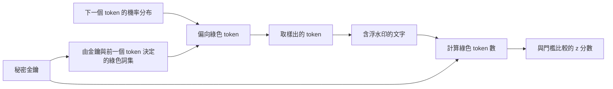

# 模型輸出浮水印

浮水印是生成模型嵌入其輸出中的訊號，之後的檢查可據此判斷內容是否來自該模型。這個訊號的設計目標是讀者察覺不到，並需要用秘密金鑰以統計方式找出。文字的浮水印通常藏在用字的選擇中；影像的浮水印則藏在像素或生成過程中。

## 概述

生成模型能以低成本產出文字與影像，而且難以與人類作品區分。浮水印與其他做法並存：事後猜測的偵測器，以及隨檔案傳遞的來源中繼資料。與中繼資料不同，浮水印的訊號位於內容本身，因此刪除檔案標頭並不會移除它。不過其結果是統計性的：偵測器依據門檻回傳證據，而改寫或裁切都可能削弱訊號。政策層面的內容見[不實資訊與深偽](../../society/misinformation/index.zh-TW.md)。

## 關鍵概念

- **浮水印金鑰（watermark key）**：用來啟動訊號的秘密值。只有持有者能執行偵測。
- **綠色詞集（green list）**：依金鑰與前一個 token，以偽隨機方式從詞彙表中選出的子集合。
- **偽陽性率（false positive rate）**：人類文字被誤判為含有浮水印的比例。供應商會把它設得很低。
- **熵（entropy）**：模型在每一步有多少選擇空間。低熵的輸出（例如程式碼）留給訊號的空間較少。

## 運作方式

### 文字

在每一步，語言模型都會對每個可能的下一個 token 給出機率。文字浮水印會利用金鑰改變下一個 token 的取樣方式。在 Kirchenbauer 等人（2023）的綠色詞集方案中，金鑰與前一個 token 決定一個綠色詞集，其中包含詞彙表的比例 $\gamma$，並在綠色 token 的 logits 上加入一個小的偏置 $\delta$。一般文字中，偶然出現的綠色 token 約佔 $\gamma$ 的比例。偵測時，計算 $T$ 個計分 token 中的綠色 token 數 $|s|_G$，並算出

$$
z = \frac{|s|_G - \gamma T}{\sqrt{T\gamma(1-\gamma)}}
$$

一個很大的 $z$ 不太可能是偶然造成的，因此對 $z$ 設定門檻即可決定偽陽性率。偵測只需要金鑰與文字。

### 影像

Tree-Ring 在擴散模型的初始雜訊中放入一個以傅立葉空間結構化的圖樣，偵測時再反向推算擴散過程，找出這個圖樣（Wen 等人，2023）。Stable Signature 則微調解碼器，使每張輸出都帶有一組二進位簽章（Fernandez 等人，2023）。SynthID-Image 則在影像中嵌入學習而來的訊號，並以學習式偵測器讀取（Gowal 等人，2025）。

### 改寫與移除下的穩健性

最主要的攻擊方式是編輯。Kirchenbauer 等人（2023b）發現，浮水印能撐過人工與機器改寫；改寫會稀釋訊號，但仍會留下可被偵測的片段。[^1] Krishna 等人（2023）則指出，改寫工具能讓偵測失效，並提出一種防禦方式：將可疑文字與供應商儲存的生成內容比對。[^2]

移除與偽造則很難完全排除。Zhang 等人（2023）在既定假設下主張，強浮水印是不可能實現的。Jovanović 等人（2024）指出，向含浮水印的 API 查詢，可以逼近該浮水印，因此攻擊者能把它偽造到人類文字上，或從模型輸出中刪除。[^3] 就影像而言，Zhao 等人（2023）顯示，重新生成（先加入雜訊，再以生成模型重建影像）能移除像素層級、肉眼看不見的浮水印。

### 偵測的取捨

浮水印必須在訊號強度、品質成本與文字長度之間取得平衡。偏置越強，找到的含浮水印文字越多，但輸出的改變也越大；門檻越嚴格，就會漏掉一些真正的案例。低熵輸出最困難：在 Kuditipudi 等人的實驗中，某個經指令微調的模型，其典型回應中只有約四分之一能被偵測到。[^4] Christ 等人（2023）提出不可偵測浮水印的理論構造。

## 關鍵方法

下列各方法都沒有子頁面。

| 方法 | 媒介 | 改變了什麼 | 如何檢查 | 主要限制 |
|---|---|---|---|---|
| 綠色詞集偏置（Kirchenbauer 等人，2023） | 文字 | 提高綠色 token 的機率 | 計數綠色 token，並套用 z 檢定 | 偏置越強，品質成本越高 |
| 無失真取樣（Kuditipudi 等人，2023） | 文字 | 以金鑰種子的隨機數推導樣本 | 將文字與隨機序列對齊 | 需要較多 token |
| 生產環境取樣（SynthID-Text，Dathathri 等人，2024） | 文字 | 只修改取樣步驟 | 不需執行 LLM 即可偵測 | 只有嵌入此機制的供應商能產生 |
| 生成過程中的圖樣（Tree-Ring、Stable Signature） | 影像 | 初始雜訊中的圖樣，或經調整的解碼器 | 反向推算擴散過程，或執行萃取器 | 穩健性主張仰賴作者自行設計的攻擊測試 |
| 學習式影像浮水印（SynthID-Image，Gowal 等人，2025） | 影像 | 在影像中嵌入學習而來的訊號 | 學習式偵測器 | 穩健性主要由供應商自行報告 |

綠色詞集會改變機率，因此並非無失真；無失真方案避開了這點，代價是偵測步驟較長。SynthID-Text 是生產環境的案例，作者報告其偵測能力有所提升，評分上則未見損失。

## 相關連結

- **模型層級的浮水印。** [模型萃取與竊取](model-extraction.zh-TW.md)涵蓋保護模型本身著作權的浮水印，這類浮水印常靠植入後門實現，如[資料投毒與後門](data-poisoning-and-backdoors.zh-TW.md)所述。本頁的方法則是保護輸出。
- **輸出檢查。** [護欄與輸出過濾](guardrails.zh-TW.md)判斷回覆是否有害。浮水印只記錄內容的來源。
- **大腦與心智。** 影像浮水印的定義是人眼看不見，而這個判斷由視覺系統作出（[知覺與視覺系統](../../brain-mind/visual-perception/index.zh-TW.md)）。人們也往往過度接受自動化的判定（[自動化偏誤與過度依賴](../../society/human-ai-interaction/automation-bias.zh-TW.md)），這在使用偵測結果時很重要。

## 應用

- **供應商標示。** SynthID 已用於 Google 服務中的影像與影片（Gowal 等人，2025），SynthID-Text 也曾在 Gemini 回應上進行即時實驗（Dathathri 等人，2024）。
- **查核與追蹤。** 受信任的測試者可透過驗證服務檢查影像；供應商也能把大量垃圾訊息追溯到其自身的 API。

## 開放問題

- **強浮水印。** Zhang 等人（2023）主張，在既定假設下無法建構強浮水印。實際的方案能否接近到足以產生實際效果，仍是未解的問題。
- **涵蓋範圍。** 浮水印只有在供應商嵌入時才存在，而開放權重模型可以用一般取樣方式執行（[開放與封閉模型](../../society/open-vs-closed/index.zh-TW.md)）。
- **短文字與結構化輸出。** 程式碼與簡短回答所承載的訊號很少，針對論文調校的門檻可能不適用於這些情況。

[^1]: Kirchenbauer et al. (2023b)，摘要：經過強力人工改寫後，平均需要約 800 個 token，才能在偽陽性率 1e-5 下偵測出浮水印。
[^2]: Krishna et al. (2023)，摘要：該改寫工具將 DetectGPT 的準確率從 70.3% 降至 4.6%（偽陽性率為 1%）。
[^3]: Jovanović et al. (2024)，摘要：偽造與移除的平均成功率超過 80%，成本低於 50 美元。
[^4]: Kuditipudi et al. (2023)，摘要：對 Alpaca-7B 而言，中位長度約 100 個 token 的回應中，約 25% 能在 p ≤ 0.01 的水準下被偵測到。

## 參考文獻

### 奠基性論文

- Kirchenbauer, J. et al. (2023a). *A Watermark for Large Language Models*. arXiv:2301.10226. https://arxiv.org/abs/2301.10226 — 提出綠色詞集浮水印及其統計檢定。
- Kirchenbauer, J. et al. (2023b). *On the Reliability of Watermarks for Large Language Models*. arXiv:2306.04634. https://arxiv.org/abs/2306.04634 — 測試人工與機器改寫後的偵測情形。
- Christ, M., Gunn, S. & Zamir, O. (2023). *Undetectable Watermarks for Language Models*. arXiv:2306.09194. https://arxiv.org/abs/2306.09194 — 定義在沒有金鑰時，與模型輸出無法區分的浮水印。
- Kuditipudi, R. et al. (2023). *Robust Distortion-free Watermarks for Language Models*. arXiv:2307.15593. https://arxiv.org/abs/2307.15593 — 一種無失真的文字浮水印，能承受隨機編輯。
- Krishna, K. et al. (2023). *Paraphrasing evades detectors of AI-generated text, but retrieval is an effective defense*. arXiv:2303.13408. https://arxiv.org/abs/2303.13408 — 顯示改寫工具能規避浮水印偵測，並提出以檢索為基礎的防禦。
- Zhang, H. et al. (2023). *Watermarks in the Sand: Impossibility of Strong Watermarking for Generative Models*. arXiv:2311.04378. https://arxiv.org/abs/2311.04378 — 在既定假設下主張強浮水印不可能實現。
- Jovanović, N., Staab, R. & Vechev, M. (2024). *Watermark Stealing in Large Language Models*. arXiv:2402.19361. https://arxiv.org/abs/2402.19361 — 透過 API 查詢逼近浮水印，實現偽造與移除。
- Dathathri, S. et al. (2024). *Scalable watermarking for identifying large language model outputs*. Nature. https://doi.org/10.1038/s41586-024-08025-4 — 描述 SynthID-Text，一種生產環境的取樣浮水印。
- Wen, Y. et al. (2023). *Tree-Ring Watermarks: Fingerprints for Diffusion Images that are Invisible and Robust*. arXiv:2305.20030. https://arxiv.org/abs/2305.20030 — 在擴散模型的初始雜訊中嵌入圖樣。
- Fernandez, P. et al. (2023). *The Stable Signature: Rooting Watermarks in Latent Diffusion Models*. arXiv:2303.15435. https://arxiv.org/abs/2303.15435 — 微調解碼器，使每張影像都帶有簽章。
- Zhao, X. et al. (2023). *Invisible Image Watermarks Are Provably Removable Using Generative AI*. arXiv:2306.01953. https://arxiv.org/abs/2306.01953 — 顯示重新生成攻擊能移除像素層級的隱形浮水印。
- Gowal, S. et al. (2025). *SynthID-Image: Image watermarking at internet scale*. arXiv:2510.09263. https://arxiv.org/abs/2510.09263 — 描述已部署的 SynthID-Image 系統。

### 綜述與教科書

- Liu, A. et al. (2023). *A Survey of Text Watermarking in the Era of Large Language Models*. arXiv:2312.07913. https://arxiv.org/abs/2312.07913 — 依可偵測性與穩健性綜述文字浮水印。
