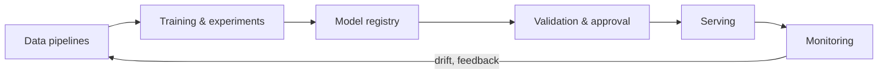

---
related:
- engineering/frameworks
- engineering/hardware
- theory/paradigms/continual
- engineering/evaluation
tags:
- engineering
- mlops
aliases:
- MLOps 與部署
---

# MLOps & Deployment

MLOps applies software-engineering discipline to the whole machine-learning lifecycle: data, training, release, serving and monitoring. The term is used loosely, but the core claim is consistent. Sculley et al. (2015) illustrate that the model code is a small part of a production ML system, and that the surrounding infrastructure, data dependencies and configuration are a major source of long-term cost.

## Overview

A model that works in a notebook is a small part of a service. Once it serves real traffic it needs reproducible training, validated releases, monitoring for changes in the data, and a way to roll back when it fails. MLOps is the set of practices and tools that make these steps repeatable. For large language models the same concerns remain, but the costs shift toward serving efficiency, prompt and model versioning, and evaluation.

## Key concepts

- **Training-serving skew**: features computed differently at training and serving time, which silently degrades a model. Feature stores and shared transformation code are the usual remedies.
- **Data drift and concept drift**: the input distribution, or the relation between inputs and labels, changes after deployment. Monitoring compares live data with a reference window.
- **Model registry**: a versioned store of trained artifacts with their data, code, metrics and approval state, so that any deployed model can be traced and reproduced.
- **Release strategy**: how a new model reaches users. Shadow, canary and A/B deployments differ in how much risk they expose and how fast they give evidence.

## How it works

The lifecycle is a loop rather than a line. Monitoring feeds back into data collection and retraining, and each stage produces artifacts that the next stage consumes.

## Key practices

| Practice | Tools / notes |
|---|---|
| Reproducibility | Version code, data, configs and environments; fixed seeds where possible |
| Experiment tracking | MLflow, Weights & Biases |
| Pipelines and orchestration | Airflow, Dagster, Kubeflow, Prefect |
| Feature stores | Feast, Tecton: consistent features for training and serving |
| Model registry | Versioned, approved models with lineage |
| CI/CD for ML | Automated tests on data, model quality and fairness before release |
| Deployment strategies | Shadow mode, canary releases, A/B tests, rollbacks (see below) |
| Monitoring | Data drift, prediction drift, performance against delayed labels, latency, cost |

## Deployment strategies

These strategies are compared by how much traffic and risk the new model takes before it is judged. They are operational practices rather than algorithms, so they are summarised here without separate method pages.

| Strategy | How traffic is used | Main trade-off |
|---|---|---|
| Shadow | The new model receives copies of live requests, but its outputs are not shown to users | Safe and informative, but gives no user-facing feedback and doubles compute |
| Canary | A small share of real traffic goes to the new model, increased if metrics hold | Limits blast radius; needs careful metric thresholds and rollback automation |
| A/B test | Users are randomly split between versions to compare a business or quality metric | Measures causal effect; needs enough traffic and a clear metric |

## Serving LLMs efficiently

| Technique | Effect |
|---|---|
| Continuous batching, PagedAttention (vLLM) | Higher throughput; see [Inference Optimization](../inference-optimization/index.md) |
| KV-cache reuse and prefix (prompt) caching | Lower latency and cost for repeated context |
| Weight quantisation (INT8, INT4, FP8) | Smaller, faster models with small quality loss |
| Speculative decoding | A small draft model proposes tokens; the large model verifies them |
| Distillation and smaller models | Route easy queries to cheap models |
| Model routing and cascades | Choose a model per request by difficulty |
| Streaming | Better perceived latency |

## Monitoring and drift

Deployed models fail quietly when inputs change, so monitoring has to detect shifts without waiting for labels. Rabanser, Günnemann and Lipton (2019) compared methods for detecting dataset shift and found that the choice of test and the amount of data change how reliably a shift is caught. In practice teams combine input-distribution checks with delayed quality metrics once labels arrive.

## LLMOps specifics

- **Prompt and model versioning**: model providers update models; pin versions.
- **Evaluation in CI**: see [Evaluation](../evaluation/index.md).
- **Tracing** of multi-step agent runs (Langfuse, OpenTelemetry-based tracing).
- **Guardrails**: input and output filters, PII redaction, policy classifiers.
- **Cost management**: token budgets, caching, batching APIs.
- **Human feedback loops**: thumbs up and down, escalations, annotation queues.

## Edge and on-device AI

- Mobile NPUs and frameworks (Core ML, LiteRT, ExecuTorch, ONNX Runtime).
- Small language models (1–8B parameters, quantised) running on laptops and phones.
- Privacy and latency benefits; constraints on memory and power.
- Microcontrollers: TinyML for sensors and wearables.

## Responsible operations

- Incident response for AI failures; model and system cards.
- Logging with privacy safeguards.
- Access control and secrets management for agents.
- Obligations for regulated systems. The EU AI Act (Regulation (EU) 2024/1689) sets duties that depend on a system's risk category, so operational records should be planned from the start.

## Open questions

- How should drift be separated from ordinary seasonal change, so that alerts do not fire on predictable variation?
- How should prompt and model versions be tested together when a provider changes a model without notice?
- What is the right evaluation cadence for LLM applications whose quality depends on a moving target of user inputs?

## References

### Seminal papers

- Sculley, D. et al. (2015). *Hidden Technical Debt in Machine Learning Systems*. NeurIPS 2015. https://papers.nips.cc/paper/5656-hidden-technical-debt-in-machine-learning-systems — Illustrates that the model code is a small part of a production ML system and names data dependencies and configuration as sources of long-term cost.

### Related work

- Kreuzberger, D., Kühl, N. & Hirschl, S. (2022). *Machine Learning Operations (MLOps): Overview, Definition, and Architecture*. arXiv:2205.02302. https://arxiv.org/abs/2205.02302 — Defines MLOps as a set of principles and roles and proposes an architecture that covers the full lifecycle.
- Paleyes, A., Urma, R.-G. & Lawrence, N. D. (2020). *Challenges in Deploying Machine Learning: a Survey of Case Studies*. arXiv:2011.09926. https://arxiv.org/abs/2011.09926 — Surveys published deployment case studies and the recurring obstacles, from data management to monitoring.
- Shankar, S. et al. (2022). *Operationalizing Machine Learning: An Interview Study*. arXiv:2209.09125. https://arxiv.org/abs/2209.09125 — Reports interviews with ML engineers about the operational work that surrounds model development.
- Rabanser, S., Günnemann, S. & Lipton, Z. C. (2019). *Failing Loudly: An Empirical Study of Methods for Detecting Dataset Shift*. arXiv:1810.11953. https://arxiv.org/abs/1810.11953 — Compares methods for detecting shifts in input data and shows how the choice of test affects detection.
- European Parliament and Council (2024). *Regulation (EU) 2024/1689 laying down harmonised rules on artificial intelligence (Artificial Intelligence Act)*. https://eur-lex.europa.eu/eli/reg/2024/1689/oj/eng — The primary text of the EU AI Act, which sets obligations for AI systems by risk category.
