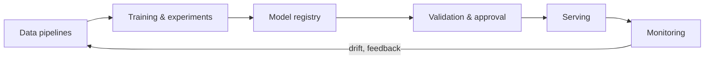

---
related:
- engineering/frameworks
- engineering/hardware
- foundations/paradigms/continual
- engineering/evaluation
---

# MLOps & Deployment

MLOps applies software-engineering discipline to the whole ML lifecycle. "Hidden Technical Debt in Machine Learning Systems" (Sculley et al., 2015) showed that model code is a small fraction of a real ML system.

## Lifecycle

## Key practices

| Practice | Tools / notes |
|---|---|
| Reproducibility | Version code, data, configs and environments; fixed seeds where possible |
| Experiment tracking | MLflow, Weights & Biases |
| Pipelines and orchestration | Airflow, Dagster, Kubeflow, Prefect |
| Feature stores | Feast, Tecton — consistent features for training and serving |
| Model registry | Versioned, approved models with lineage |
| CI/CD for ML | Automated tests on data, model quality and fairness before release |
| Deployment strategies | Shadow mode, canary releases, A/B tests, rollbacks |
| Monitoring | Data drift, prediction drift, performance against delayed labels, latency, cost |

## Serving LLMs efficiently

| Technique | Effect |
|---|---|
| Continuous batching, PagedAttention (vLLM) | Higher throughput |
| KV-cache reuse / prefix (prompt) caching | Lower latency and cost for repeated context |
| Quantisation (INT8, INT4, FP8; GPTQ, AWQ, GGUF) | Smaller, faster models with small quality loss |
| Speculative decoding | A small draft model proposes tokens; the large model verifies |
| Distillation and smaller models | Route easy queries to cheap models |
| Model routing and cascades | Choose a model per request by difficulty |
| Streaming | Better perceived latency |

## LLMOps specifics

- **Prompt and model versioning** — model providers update models; pin versions
- **Evaluation in CI** (see [Evaluation](../evaluation/index.md))
- **Tracing** of multi-step agent runs (Langfuse, OpenTelemetry-based tracing)
- **Guardrails**: input/output filters, PII redaction, policy classifiers
- **Cost management**: token budgets, caching, batching APIs
- **Human feedback loops**: thumbs up/down, escalations, annotation queues

## Edge and on-device AI

- Mobile NPUs and frameworks (Core ML, LiteRT, ExecuTorch, ONNX Runtime)
- Small language models (1–8B parameters, quantised) running on laptops and phones
- Privacy and latency benefits; constraints on memory and power
- Microcontrollers: TinyML for sensors and wearables

## Responsible operations

- Incident response for AI failures; model and system cards
- Logging with privacy safeguards
- Access control and secrets management for agents
- Regulatory record-keeping (e.g. EU AI Act obligations for high-risk systems)

## Resources

- Huyen, *Designing Machine Learning Systems* and *AI Engineering*
- Google, "Rules of Machine Learning" and "MLOps: Continuous delivery and automation pipelines"
- [Made With ML](https://madewithml.com/)
- [Full Stack Deep Learning](https://fullstackdeeplearning.com/) materials
