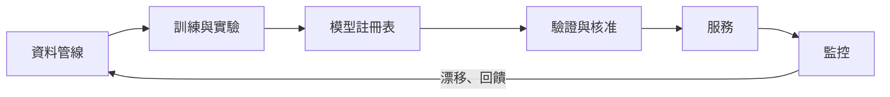

---
related:
- engineering/frameworks
- engineering/hardware
- theory/paradigms/continual
- engineering/evaluation
tags:
- engineering
- mlops
aliases:
- MLOps & Deployment
---

# MLOps 與部署

MLOps 把軟體工程的紀律套用到機器學習的整個生命週期：資料、訓練、發布、服務與監控。這個詞的用法很寬鬆，但核心主張很一致。Sculley 等人（2015）說明，模型程式碼在一個實際的 ML 系統中只佔很小的一部分，而周圍的基礎設施、資料相依與設定才是長期成本的主要來源。

## 概述

在筆記本裡能跑的模型，只是服務的一小部分。一旦它開始接收真實流量，就需要可重現的訓練、經過驗證的發布、對資料變化的監控，以及失敗時能回滾的方式。MLOps 就是讓這些步驟能重複進行的一組做法與工具。對大型語言模型而言，關注點仍然相同，只是成本重心轉向服務效率、提示與模型版本管理，以及評估。

## 關鍵概念

- **訓練與服務偏差（training-serving skew）**：同一個特徵在訓練與服務時的計算方式不同，會悄悄地讓模型變差。常見的解法是特徵儲存與共用的轉換程式碼。
- **資料漂移與概念漂移（data drift and concept drift）**：部署後，輸入的分布或輸入與標籤之間的關係改變了。監控會把即時資料與參考時段比較。
- **模型註冊表（model registry）**：一個有版本的儲存庫，記錄訓練好的模型及其資料、程式碼、指標與核准狀態，讓任何已部署的模型都能追溯與重現。
- **發布策略（release strategy）**：新模型如何送到使用者手上。影子部署、金絲雀部署與 A/B 測試，對風險的暴露程度與取得證據的速度各不相同。

## 運作方式

生命週期是一個迴圈，而不是一條直線。監控會回饋到資料收集與再訓練，每個階段都會產生下一個階段要使用的產物。

## 關鍵做法

| 做法 | 工具 / 說明 |
|---|---|
| 可重現性 | 對程式碼、資料、設定與環境做版本管理；盡可能固定隨機種子 |
| 實驗追蹤 | MLflow、Weights & Biases |
| 管線與編排 | Airflow、Dagster、Kubeflow、Prefect |
| 特徵儲存 | Feast、Tecton：訓練與服務使用一致的特徵 |
| 模型註冊表 | 有版本、經核准、可追溯來源的模型 |
| ML 的 CI/CD | 發布前對資料、模型品質與公平性做自動測試 |
| 部署策略 | 影子模式、金絲雀發布、A/B 測試、回滾（見下文） |
| 監控 | 資料漂移、預測漂移、延遲標籤下的效能、延遲與成本 |

## 部署策略

這些策略的比較依據，是新模型在被判定好壞之前接觸了多少流量與風險。它們是營運上的做法而不是演算法，因此這裡只做摘要，不另設方法頁。

| 策略 | 流量如何使用 | 主要取捨 |
|---|---|---|
| 影子部署 | 新模型接收即時請求的副本，但輸出不顯示給使用者 | 安全且能提供資訊，但沒有使用者端的回饋，且運算量加倍 |
| 金絲雀發布 | 一小部分真實流量送到新模型，指標穩定時再逐步增加 | 限制影響範圍；需要謹慎設定指標門檻與自動回滾 |
| A/B 測試 | 使用者隨機分配到不同版本，比較商業或品質指標 | 能測量因果效應；需要足夠流量與明確的指標 |

## 高效服務大型語言模型

| 技術 | 效果 |
|---|---|
| 連續批次處理、PagedAttention（vLLM） | 提高吞吐量；見[推論最佳化](../inference-optimization/index.zh-TW.md) |
| KV 快取重用與前綴（提示）快取 | 對重複的上下文降低延遲與成本 |
| 權重量化（INT8、INT4、FP8） | 模型較小、較快，品質損失很小 |
| 推測式解碼 | 小型草稿模型提出 token，大型模型驗證 |
| 蒸餾與較小的模型 | 把簡單的查詢導向便宜的模型 |
| 模型路由與級聯 | 依難度為每個請求選擇模型 |
| 串流輸出 | 改善使用者感受到的延遲 |

## 監控與漂移

部署後的模型會在輸入改變時悄悄失效，因此監控必須在拿不到標籤之前就偵測出偏移。Rabanser、Günnemann 與 Lipton（2019）比較了偵測資料集偏移的方法，發現檢定的選擇與資料量會影響偏移被發現的可靠程度。實務上，團隊會把輸入分布的檢查，與標籤到達後的延遲品質指標結合起來。

## LLMOps 的特別之處

- **提示與模型版本管理**：模型供應商會更新模型，應固定版本。
- **在 CI 中評估**：見[評估與基準](../evaluation/index.zh-TW.md)。
- **追蹤多步驟代理執行**：Langfuse 或以 OpenTelemetry 為基礎的追蹤。
- **防護機制**：輸入與輸出過濾、個人資訊遮蔽、政策分類器。
- **成本管理**：token 預算、快取、批次 API。
- **人類回饋迴圈**：讚或踩、升級處理、標註佇列。

## 邊緣與裝置端 AI

- 行動裝置 NPU 與框架（Core ML、LiteRT、ExecuTorch、ONNX Runtime）。
- 在筆電與手機上執行的小型語言模型（1–8B 參數、量化後）。
- 隱私與延遲的好處；記憶體與功耗的限制。
- 微控制器：用於感測器與穿戴裝置的 TinyML。

## 負責任的營運

- AI 失效的事件應變；模型卡與系統卡。
- 在保護隱私的前提下記錄日誌。
- 代理的存取控制與機密管理。
- 受規範系統的義務。歐盟《人工智慧法》（Regulation (EU) 2024/1689）依系統的風險類別設定義務，因此營運紀錄應從一開始就規劃。

## 開放問題

- 如何區分漂移與一般的季節性變化，讓警示不會在可預期的波動時誤觸發？
- 當供應商在未通知的情況下更換模型時，如何一起測試提示與模型版本？
- 對於品質取決於不斷變動的使用者輸入的 LLM 應用程式，合適的評估頻率應該是多少？

## 參考文獻

### 重要論文

- Sculley, D. et al. (2015). *Hidden Technical Debt in Machine Learning Systems*. NeurIPS 2015. https://papers.nips.cc/paper/5656-hidden-technical-debt-in-machine-learning-systems — 說明模型程式碼只是實際 ML 系統的一小部分，並指出資料相依與設定是長期成本的來源。

### 相關工作

- Kreuzberger, D., Kühl, N. & Hirschl, S. (2022). *Machine Learning Operations (MLOps): Overview, Definition, and Architecture*. arXiv:2205.02302. https://arxiv.org/abs/2205.02302 — 把 MLOps 定義為一組原則與角色，並提出涵蓋整個生命週期的架構。
- Paleyes, A., Urma, R.-G. & Lawrence, N. D. (2020). *Challenges in Deploying Machine Learning: a Survey of Case Studies*. arXiv:2011.09926. https://arxiv.org/abs/2011.09926 — 調查已發表的部署案例，以及從資料管理到監控之間反覆出現的障礙。
- Shankar, S. et al. (2022). *Operationalizing Machine Learning: An Interview Study*. arXiv:2209.09125. https://arxiv.org/abs/2209.09125 — 以訪談 ML 工程師的方式，記錄圍繞模型開發的營運工作。
- Rabanser, S., Günnemann, S. & Lipton, Z. C. (2019). *Failing Loudly: An Empirical Study of Methods for Detecting Dataset Shift*. arXiv:1810.11953. https://arxiv.org/abs/1810.11953 — 比較偵測輸入資料偏移的方法，並說明檢定的選擇如何影響偵測結果。
- European Parliament and Council (2024). *Regulation (EU) 2024/1689 laying down harmonised rules on artificial intelligence (Artificial Intelligence Act)*. https://eur-lex.europa.eu/eli/reg/2024/1689/oj/eng — 《人工智慧法》的原始條文，依風險類別為 AI 系統設定義務。
