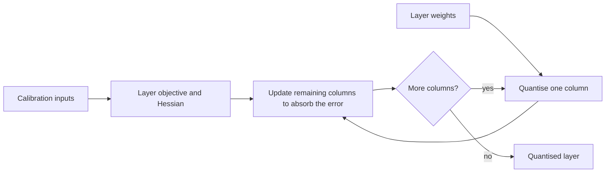

---
tags:
- engineering
- systems
aliases:
- GPTQ 後訓練量化
---

# GPTQ

GPTQ is a post-training quantisation method for large transformer models. It rounds the weights of each layer to a few bits, one column at a time, and after each rounding it adjusts the remaining weights to compensate for the error. It needs only a small calibration set and no retraining, which makes it practical for models with billions of parameters.

## Overview

Quantising weights to four bits cuts the memory of a model roughly fourfold, but naive rounding of each weight separately loses accuracy quickly, especially in large models. Quantisation-aware training would fix this, but it needs the full training pipeline and a lot of compute. GPTQ takes a middle route: it keeps the trained model, and uses a layer-wise objective to choose the rounding so that the layer's output stays close to the original.

## Key concepts

- **Post-training quantisation**: converting trained weights to low precision without further training.
- **Layer-wise objective**: the error in a layer's output, measured on calibration inputs, rather than the error in the weights themselves.
- **Second-order information**: the Hessian of the layer objective, used to decide how much each remaining weight should move after one is rounded.
- **Calibration data**: a small set of inputs that represent the model's typical activations, used to compute the objective.

## How it works

Within each layer, the weight columns are quantised in a fixed order. After a column is rounded, the error is spread over the columns not yet quantised, using the inverse Hessian of the layer objective. Blocks of columns are processed together so that the computation stays practical for large matrices.

## Key methods

The method is column-wise rounding with error compensation through the layer's second-order information, run layer by layer on calibration data. Frantar et al. (2023) present the algorithm and evaluate it on large GPT-style models at low bit widths, comparing it with earlier layer-wise methods on both quality and speed.

## Results

The paper reports quality for large GPT-style models quantised to low bit widths, and compares the running time of its algorithm with earlier layer-wise methods. The exact numbers depend on the model, the bit width and the calibration data, so readers should check the paper's tables.

## Limitations

- **Calibration sensitivity**: the choice of calibration data affects the result, and data that does not match the deployment can hurt quality.
- **Bit width matters**: at very low bit widths, the quality loss grows and may not be acceptable for all tasks.
- **Runtime support**: the quantised format only saves time if the inference runtime has kernels for it.
- **Outlier activations**: the method quantises weights, not activations, so models with large activation outliers may still need a method that handles them, such as the approach in LLM.int8.

## Open questions

- How should calibration data be selected so that quantised models stay reliable on inputs the calibration set did not cover?
- How does weight-only quantisation combine with quantised activations on device NPUs?

## References

### Seminal papers

- Frantar, E. et al. (2023). *GPTQ: Accurate Post-Training Quantization for Generative Pre-trained Transformers*. ICLR 2023. arXiv:2210.17323. https://arxiv.org/abs/2210.17323 — Quantises the weights of large transformers layer by layer, compensating each rounding error with second-order information.

### Related work

- Dettmers, T. et al. (2022). *LLM.int8(): 8-bit Matrix Multiplication for Transformers at Scale*. NeurIPS 2022. arXiv:2208.07339. https://arxiv.org/abs/2208.07339 — Handles outlier activation features separately, a complementary problem to weight-only quantisation.
- Jacob, B. et al. (2017). *Quantization and Training of Neural Networks for Efficient Integer-Arithmetic-Only Inference*. arXiv:1712.05877. https://arxiv.org/abs/1712.05877 — Integer-only quantised inference with quantisation-aware training, the alternative that needs training.
- Han, S., Mao, H. & Dally, W. J. (2016). *Deep Compression: Compressing Deep Neural Networks with Pruning, Trained Quantization and Huffman Coding*. ICLR 2016. arXiv:1510.00149. https://arxiv.org/abs/1510.00149 — Trained quantisation combined with pruning and entropy coding, for smaller convolutional and fully connected networks.
- Hinton, G., Vinyals, O. & Dean, J. (2015). *Distilling the Knowledge in a Neural Network*. arXiv:1503.02531. https://arxiv.org/abs/1503.02531 — The alternative of training a smaller model, which can then be quantised.
