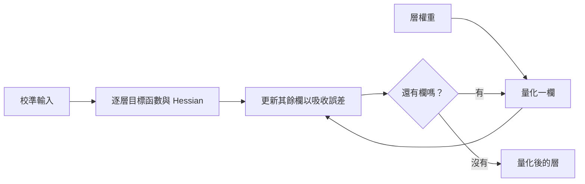

---
tags:
- engineering
- systems
aliases:
- GPTQ 後訓練量化
---

# GPTQ

GPTQ 是大型 Transformer 模型的後訓練量化方法。它把每一層的權重逐欄地量化到幾個位元，每次量化一欄後，會調整其餘尚未量化的權重，以補償產生的誤差。它只需要一小組校準資料，不需要重新訓練，因此對數十億參數的模型也能實際使用。

## 概述

把權重量化到四位元，模型的記憶體大約會縮小為四分之一，但若每個權重各自四捨五入，準確度會很快下降，大型模型尤其明顯。量化感知訓練可以解決這個問題，但需要完整的訓練流程與大量運算。GPTQ 走中間路線：保留已訓練的模型，並用逐層的目標函數選擇捨入方式，使該層的輸出仍接近原始輸出。

## 關鍵概念

- **後訓練量化**：在不再訓練的情況下，把已訓練的權重轉換為低精度。
- **逐層目標函數**：以校準輸入衡量的該層輸出誤差，而不是權重本身的誤差。
- **二階資訊**：逐層目標函數的 Hessian，用來決定一個權重被捨入後，其餘權重應該移動多少。
- **校準資料**：一小組能代表模型典型激活值的輸入，用來計算目標函數。

## 運作方式

在每一層內，權重欄會依固定順序量化。一欄被捨入後，誤差會利用逐層目標函數的反 Hessian，分散到尚未量化的欄上。欄會分成區塊一起處理，使大型矩陣的計算仍然可行。

## 關鍵方法

這個方法是逐欄捨入，並利用該層的二階資訊補償誤差，在校準資料上逐層執行。Frantar 等人（2023）提出此演算法，並在大型 GPT 類模型上以低位元寬度評估，同時與早期的逐層方法比較品質與速度。

## 結果

論文報告大型 GPT 類模型在低位元寬度下的品質，並比較其演算法與早期逐層方法的執行時間。實際數字取決於模型、位元寬度與校準資料，因此讀者應參考論文的表格。

## 限制

- **對校準資料敏感**：校準資料的選擇會影響結果，若與實際部署的資料不符，品質可能受損。
- **位元寬度很重要**：位元數非常低時，品質損失會增加，可能無法滿足所有任務。
- **執行環境的支援**：只有推論執行環境具備對應的核心時，量化格式才會節省時間。
- **異常激活值**：此方法量化的是權重而非激活值，因此激活值有很大離群值的模型，可能仍需要像 LLM.int8 那樣處理的方法。

## 開放問題

- 應如何選擇校準資料，才能讓量化後的模型在校準集未涵蓋的輸入上仍然可靠？
- 僅量化權重的方法，如何與裝置 NPU 上的量化激活值結合？

## 參考文獻

### 重要論文

- Frantar, E. et al. (2023). *GPTQ: Accurate Post-Training Quantization for Generative Pre-trained Transformers*. ICLR 2023. arXiv:2210.17323. https://arxiv.org/abs/2210.17323 — 逐層量化大型 Transformer 的權重，並以二階資訊補償每次捨入的誤差。

### 相關工作

- Dettmers, T. et al. (2022). *LLM.int8(): 8-bit Matrix Multiplication for Transformers at Scale*. NeurIPS 2022. arXiv:2208.07339. https://arxiv.org/abs/2208.07339 — 分開處理異常激活值特徵，是與僅量化權重互補的問題。
- Jacob, B. et al. (2017). *Quantization and Training of Neural Networks for Efficient Integer-Arithmetic-Only Inference*. arXiv:1712.05877. https://arxiv.org/abs/1712.05877 — 僅整數的量化推論，搭配在訓練中加入量化的做法，是需要訓練的替代方案。
- Han, S., Mao, H. & Dally, W. J. (2016). *Deep Compression: Compressing Deep Neural Networks with Pruning, Trained Quantization and Huffman Coding*. ICLR 2016. arXiv:1510.00149. https://arxiv.org/abs/1510.00149 — 訓練後量化結合剪枝與熵編碼，用於較小的卷積與全連接網路。
- Hinton, G., Vinyals, O. & Dean, J. (2015). *Distilling the Knowledge in a Neural Network*. arXiv:1503.02531. https://arxiv.org/abs/1503.02531 — 另一種做法：先訓練一個較小的模型，再對它量化。
