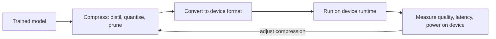

---
related:
- engineering/hardware
- engineering/inference-optimization
- engineering/mlops
- engineering/frameworks
tags:
- engineering
- systems
aliases:
- 裝置端與邊緣 AI
---

# On-device and Edge AI

On-device AI runs models on the device that produces the data, such as a phone, laptop, car, camera or sensor, instead of on a server. It trades raw compute for privacy, latency that does not depend on the network, and the ability to keep working offline. The main engineering problem is fitting a model into a small memory and power budget while keeping it accurate enough for the task.

## Overview

A data-centre accelerator has tens of gigabytes of fast memory and a steady power supply. A phone or microcontroller has a few gigabytes, or kilobytes, shared with the rest of the system, and a battery. The model must shrink, and the runtime must use the hardware that exists on the device. Large language models make the gap sharper, because their weights alone are often larger than the memory of a consumer device before compression.

## Key concepts

- **Memory footprint**: the weights, activations and any cache the model needs at run time. For autoregressive models the key-value cache grows with the context length.
- **Compression**: techniques that reduce the number of bits or parameters, such as quantisation, pruning and distillation.
- **Hardware-aware runtime**: an inference runtime that maps operations onto the CPU, GPU, or neural processing unit (NPU) available on the device, and falls back when an operator is unsupported.
- **Privacy and latency**: data that never leaves the device, and responses that do not wait for a network round trip.

## How it works

A typical deployment starts from a trained model, compresses it, converts it to a format the device runtime accepts, and then measures quality and speed on the target hardware. Each step can change the result, so the measurement has to be done on the device, not on a development machine.

## Key methods

The method pages live in the theory chapter, so this section compares the two methods used here and links to them. The engineering page for distillation keeps the deployment notes.

| Method | Problem it solves | Core idea | Main trade-off | Page |
|---|---|---|---|---|
| Knowledge distillation | A small model must reach the quality of a large one | Train the small student to match the soft outputs of a large teacher | Needs a teacher and training compute | [Knowledge Distillation](knowledge-distillation.md) (engineering notes); [theory page](../../theory/model-compression/knowledge-distillation/index.md) |
| GPTQ | A large model's weights must shrink after training, without retraining | Post-training quantisation that rounds weights layer by layer while correcting the error | Quality depends on calibration data and bit width | [GPTQ](../../theory/model-compression/quantisation/post-training/gptq/index.md) |

Other compression approaches, such as quantisation-aware training and structured pruning, are not given separate pages here yet. The pruning and quantisation work in the references below is the starting point for them.

## Compression choices

| Choice | Effect | Watch for |
|---|---|---|
| Smaller model | Lower memory and compute, fixed cost per request | Quality loss on hard inputs |
| Post-training quantisation | Smaller weights with little or no training | Outlier activations and calibration data |
| Distillation | A small model learns from a large one | Teacher quality and data coverage |
| Pruning | Fewer parameters | Hardware support for sparse operations |

## Hardware and runtimes

- Mobile NPUs and their frameworks (Core ML, LiteRT, ExecuTorch, ONNX Runtime) map operators to the accelerator.
- Small language models with 1–8 billion parameters, quantised, run on laptops and phones.
- Microcontrollers run TinyML models for sensors and wearables, where the budget is kilobytes of memory. The runtimes behind these choices, from TinyML to Core ML, LiteRT, ExecuTorch and on-device LLMs, are compared in [TinyML and mobile runtimes](tinyml-and-mobile-runtimes.md).
- Efficient vision architectures, such as MobileNets, are designed for these budgets from the start, and are covered under the [CNN family](../../theory/models/cnn/index.md).

## Trade-offs

- **Privacy and latency** improve, because data stays on the device and responses do not wait for a network.
- **Quality** can drop, because the device model is smaller and cannot be updated as easily as a server model.
- **Updates and monitoring** are harder, since many devices run different versions and report less telemetry. The [MLOps](../mlops/index.md) practices for versioning and rollback apply, with extra care for offline devices.

## Open questions

- How should a model be split between device and server, so that privacy and quality are both acceptable?
- How can quality be measured on hundreds of device types with different accelerators and runtimes?

## References

### Seminal papers

- Hinton, G., Vinyals, O. & Dean, J. (2015). *Distilling the Knowledge in a Neural Network*. arXiv:1503.02531. https://arxiv.org/abs/1503.02531 — Introduces distillation, in which a small student learns from the softened outputs of a large teacher.
- Han, S., Mao, H. & Dally, W. J. (2016). *Deep Compression: Compressing Deep Neural Networks with Pruning, Trained Quantization and Huffman Coding*. ICLR 2016. arXiv:1510.00149. https://arxiv.org/abs/1510.00149 — Combines pruning, weight sharing and quantisation, with entropy coding, to shrink networks for deployment.

### Related work

- Jacob, B. et al. (2017). *Quantization and Training of Neural Networks for Efficient Integer-Arithmetic-Only Inference*. arXiv:1712.05877. https://arxiv.org/abs/1712.05877 — Describes integer-only quantised inference and training with quantisation in the loop, for mobile hardware.
- Frantar, E. et al. (2023). *GPTQ: Accurate Post-Training Quantization for Generative Pre-trained Transformers*. ICLR 2023. arXiv:2210.17323. https://arxiv.org/abs/2210.17323 — Post-training weight quantisation for large language models, layer by layer.
- Dettmers, T. et al. (2022). *LLM.int8(): 8-bit Matrix Multiplication for Transformers at Scale*. NeurIPS 2022. arXiv:2208.07339. https://arxiv.org/abs/2208.07339 — 8-bit inference for large transformers, handling the outlier features that break naive quantisation.
- Howard, A. G. et al. (2017). *MobileNets: Efficient Convolutional Neural Networks for Mobile Vision Applications*. arXiv:1704.04861. https://arxiv.org/abs/1704.04861 — An efficient convolutional architecture for mobile vision, built around depthwise separable convolutions.
