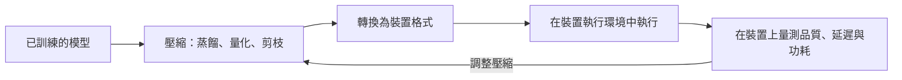

---
related:
- engineering/hardware
- engineering/inference-optimization
- engineering/mlops
- engineering/frameworks
tags:
- engineering
- systems
aliases:
- On-device and Edge AI
---

# 裝置端與邊緣 AI

裝置端 AI 讓模型在產生資料的裝置上執行，例如手機、筆電、汽車、相機或感測器，而不是在伺服器上執行。它用原始運算能力換取隱私、不依賴網路的延遲，以及離線工作的能力。主要的工程問題，是在很小的記憶體與功耗預算內放下模型，同時維持足夠的準確度。

## 概述

資料中心的加速器有數十 GB 的快速記憶體與穩定的電力。手機或微控制器則只有幾 GB 甚至幾 KB 的記憶體，而且要與系統其他部分共用，還要靠電池運作。因此模型必須縮小，執行環境也必須使用裝置上實際存在的硬體。大型語言模型讓這個差距更明顯，因為它們的權重在壓縮前，往往就已超過一般消費裝置的記憶體。

## 關鍵概念

- **記憶體佔用**：模型執行時需要的權重、激活值與任何快取。對自迴歸模型而言，key-value 快取會隨上下文長度增加。
- **壓縮**：減少位元數或參數數量的技術，例如量化、剪枝與蒸餾。
- **硬體感知的執行環境**：把運算對應到裝置上可用的 CPU、GPU 或神經處理單元（NPU），遇到不支援的運算子時則退回其他執行方式的推論執行環境。
- **隱私與延遲**：資料不離開裝置，回應也不必等待網路往返。

## 運作方式

典型的部署流程是：從已訓練的模型開始，壓縮它，轉換成裝置執行環境接受的格式，然後在目標硬體上量測品質與速度。每一步都可能改變結果，因此量測必須在裝置上進行，而不能只在開發機上做。

## 關鍵方法

每個具名方法都有自己的頁面。下表比較本頁的兩個方法，其餘部分說明周邊的選擇。

| 方法 | 要解決的問題 | 核心想法 | 主要取捨 | 頁面 |
|---|---|---|---|---|
| 知識蒸餾 | 小模型需要達到大模型的品質 | 讓小的學生模型學習大型教師模型的軟輸出 | 需要教師模型與訓練運算 | [知識蒸餾](knowledge-distillation.zh-TW.md) |
| GPTQ | 訓練後必須縮小大型模型的權重，且不重新訓練 | 逐層量化的後訓練方法，每次取捨時補償誤差 | 品質取決於校準資料與位元寬度 | [GPTQ](gptq.zh-TW.md) |

其他壓縮方法，例如量化感知訓練與結構化剪枝，目前還沒有獨立的頁面，之後再補上。下方參考文獻中的剪枝與量化工作，是進一步研究的起點。

## 壓縮的選擇

| 選擇 | 效果 | 需要注意 |
|---|---|---|
| 較小的模型 | 降低記憶體與運算，每次請求的成本固定 | 遇到困難輸入時品質下降 |
| 訓練後量化 | 不需訓練即可縮小權重 | 異常激活值與校準資料 |
| 蒸餾 | 小模型向大模型學習 | 教師模型的品質與資料涵蓋範圍 |
| 剪枝 | 減少參數數量 | 硬體對稀疏運算的支援 |

## 硬體與執行環境

- 行動 NPU 與其框架（Core ML、LiteRT、ExecuTorch、ONNX Runtime）會把運算子對應到加速器上。
- 量化後、參數量 10 億到 80 億的小型語言模型，可在筆電與手機上執行。
- 微控制器執行用於感測器與穿戴裝置的 TinyML 模型，其記憶體預算只有幾 KB。
- 像 MobileNets 這類高效的視覺架構，從一開始就為這些預算設計，見 [CNN 家族](../../theory/models/cnn/index.zh-TW.md)。

## 取捨

- **隱私與延遲**會改善，因為資料留在裝置上，回應也不必等待網路。
- **品質**可能下降，因為裝置上的模型較小，而且不像伺服器模型那樣容易更新。
- **更新與監控**較困難，因為許多裝置執行的版本不同，回傳的遙測資料也較少。版本管理與回滾的 [MLOps](../mlops/index.zh-TW.md) 做法仍然適用，但對離線裝置要格外小心。

## 開放問題

- 模型應如何在裝置與伺服器之間切分，才能同時兼顧隱私與品質？
- 面對數百種具有不同加速器與執行環境的裝置，應如何量測品質？

## 參考文獻

### 重要論文

- Hinton, G., Vinyals, O. & Dean, J. (2015). *Distilling the Knowledge in a Neural Network*. arXiv:1503.02531. https://arxiv.org/abs/1503.02531 — 提出蒸餾：小的學生模型學習大型教師模型軟化後的輸出，並以溫度作為控制參數。
- Han, S., Mao, H. & Dally, W. J. (2016). *Deep Compression: Compressing Deep Neural Networks with Pruning, Trained Quantization and Huffman Coding*. ICLR 2016. arXiv:1510.00149. https://arxiv.org/abs/1510.00149 — 結合剪枝、權重共享與量化，再加上熵編碼，以縮小網路以便部署。

### 相關工作

- Jacob, B. et al. (2017). *Quantization and Training of Neural Networks for Efficient Integer-Arithmetic-Only Inference*. arXiv:1712.05877. https://arxiv.org/abs/1712.05877 — 為行動硬體描述僅使用整數的量化推論，以及在訓練中加入量化的做法。
- Frantar, E. et al. (2023). *GPTQ: Accurate Post-Training Quantization for Generative Pre-trained Transformers*. ICLR 2023. arXiv:2210.17323. https://arxiv.org/abs/2210.17323 — 針對大型語言模型的訓練後權重量化，逐層進行。
- Dettmers, T. et al. (2022). *LLM.int8(): 8-bit Matrix Multiplication for Transformers at Scale*. NeurIPS 2022. arXiv:2208.07339. https://arxiv.org/abs/2208.07339 — 大型 Transformer 的 8 位元推論，並把異常的特徵維度保留在較高精度。
- Howard, A. G. et al. (2017). *MobileNets: Efficient Convolutional Neural Networks for Mobile Vision Applications*. arXiv:1704.04861. https://arxiv.org/abs/1704.04861 — 為行動視覺設計的高效卷積架構，以深度可分離卷積為核心。
