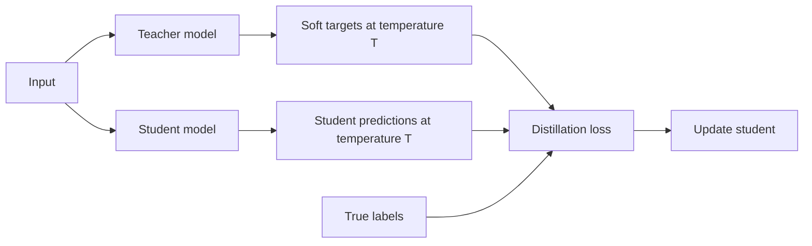

---
tags:
- engineering
- systems
aliases:
- 知識蒸餾
---

# Knowledge Distillation

Knowledge distillation trains a small student model to imitate a large teacher model. The student learns from the teacher's output probabilities, not only from the hard labels, because those probabilities carry information about which wrong classes are close to the right one. A student that is a fraction of the teacher's size can keep much of its accuracy, which makes it a standard way to produce models for devices.

## Overview

A large model is accurate but too expensive to run on a phone or in a low-latency service. Training a small model directly on the labels often gives a weaker result than the large model could, because the labels say only which answer is right. Distillation supplies a richer target: the teacher's distribution over all outputs, softened by a temperature so that near-miss classes are visible.

## Key concepts

- **Teacher and student**: a large, trained model and a smaller model that learns to match it.
- **Soft targets**: the teacher's output probabilities, computed with a temperature $T > 1$ so that the distribution is less peaked.
- **Temperature**: a scaling factor applied to the logits before the softmax. Higher values reveal more of the relative similarity between classes.
- **Hard and soft loss**: the student is usually trained on a weighted sum of the cross-entropy with the true labels and the cross-entropy with the teacher's soft targets.

## How it works

For logits $z$, the softened teacher and student distributions are $p_i = \frac{\exp(z_i / T)}{\sum_j \exp(z_j / T)}$. The student minimises a combination of the cross-entropy with the true labels and the cross-entropy with the teacher's softened distribution, often scaled by $T^2$ so that gradients keep a stable size as the temperature changes.

## Key methods

The method is training the student on the teacher's softened outputs, combined with the usual loss on the true labels. Hinton, Vinyals and Dean (2015) introduced the procedure and the use of softened outputs as training targets.

## Results

The original paper reports that distillation recovers much of the accuracy of a large model in a smaller network, and that soft targets carry information that hard labels do not. The effect depends on the task, the temperature and how the student is sized, so readers should check the paper's experiments.

## Limitations

- **Teacher cost**: the teacher must be trained and run on the training data, which can dominate the total compute.
- **Capacity gap**: a student that is much smaller than the teacher may not match it, and very large gaps can make the teacher's targets harder to imitate.
- **Data coverage**: the student only learns the behaviour that the distillation data shows, so inputs outside that data are a risk.
- **Hyperparameters**: the temperature and the loss weighting need tuning for each task.

## Open questions

- How should the distillation data be chosen when the teacher's behaviour on rare inputs is unknown?
- How does distillation combine with quantisation, so that the final device model is both small and accurate?

## References

### Seminal papers

- Hinton, G., Vinyals, O. & Dean, J. (2015). *Distilling the Knowledge in a Neural Network*. arXiv:1503.02531. https://arxiv.org/abs/1503.02531 — Introduces training a small student on the softened outputs of a large teacher, with the temperature as a control.

### Related work

- Han, S., Mao, H. & Dally, W. J. (2016). *Deep Compression: Compressing Deep Neural Networks with Pruning, Trained Quantization and Huffman Coding*. ICLR 2016. arXiv:1510.00149. https://arxiv.org/abs/1510.00149 — A different route to smaller networks, combining pruning and quantisation, that distillation is often used alongside.
- Jacob, B. et al. (2017). *Quantization and Training of Neural Networks for Efficient Integer-Arithmetic-Only Inference*. arXiv:1712.05877. https://arxiv.org/abs/1712.05877 — Quantised inference for mobile hardware, which a distilled student is often deployed with.
- Frantar, E. et al. (2023). *GPTQ: Accurate Post-Training Quantization for Generative Pre-trained Transformers*. ICLR 2023. arXiv:2210.17323. https://arxiv.org/abs/2210.17323 — Post-training quantisation for large language models, which can be applied to a distilled model as well.
- Dettmers, T. et al. (2022). *LLM.int8(): 8-bit Matrix Multiplication for Transformers at Scale*. NeurIPS 2022. arXiv:2208.07339. https://arxiv.org/abs/2208.07339 — 8-bit inference for large transformers that keeps the outlier features in higher precision.
