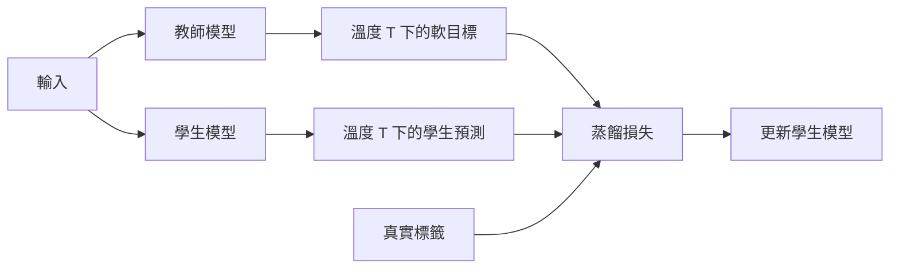

---
tags:
- engineering
- systems
aliases:
- 知識蒸餾
---

# 知識蒸餾

知識蒸餾訓練一個小的學生模型去模仿大型教師模型。學生模型學習的是教師的輸出機率，而不只是硬標籤，因為這些機率包含哪些錯誤類別與正確答案相近的資訊。學生模型的大小只是教師的一小部分，卻能保留相當多的準確度，因此它是為裝置產生模型的標準做法。

## 概述

大型模型很準確，但在手機上或低延遲的服務中執行成本太高。直接用標籤訓練小模型，結果往往比大模型差，因為標籤只說明哪個答案正確。蒸餾提供了更豐富的目標：教師對所有輸出的分布，並以溫度軟化，使接近的錯誤類別也能被看見。

## 關鍵概念

- **教師與學生**：一個大型、已訓練好的模型，以及一個學習去符合它的小模型。
- **軟目標（soft targets）**：教師的輸出機率，以溫度 $T > 1$ 計算，使分布較不尖銳。
- **溫度**：在 softmax 之前套用到 logits 上的縮放因子。溫度越高，越能看出類別之間的相對相似性。
- **硬損失與軟損失**：學生通常在真實標籤的交叉熵與教師軟目標的交叉熵的加權和上訓練。

## 運作方式

對 logits $z$，軟化後的教師與學生分布為 $p_i = \frac{\exp(z_i / T)}{\sum_j \exp(z_j / T)}$。學生最小化真實標籤交叉熵與教師軟化分布交叉熵的組合，通常還會乘上 $T^2$，使溫度改變時梯度大小保持穩定。

## 關鍵方法

這個方法是讓學生模型在教師軟化後的輸出上訓練，並結合通常在真實標籤上的損失。Hinton、Vinyals 與 Dean（2015）提出此流程，以及把軟化輸出當作訓練目標的做法。

## 結果

原始論文指出，蒸餾能讓較小的網路回收大型模型的大部分準確度，而且軟目標所攜帶的資訊是硬標籤沒有的。效果取決於任務、溫度與學生模型的大小，因此讀者應參考論文的實驗。

## 限制

- **教師的成本**：教師必須在訓練資料上訓練與推論，可能佔總運算的大部分。
- **容量差距**：學生若比教師小太多，可能無法達到相同品質，而且差距很大時，教師的目標也較難模仿。
- **資料涵蓋範圍**：學生只學到蒸餾資料中展現的行為，因此資料以外的輸入有風險。
- **超參數**：溫度與損失權重需要依任務調整。

## 開放問題

- 當教師在罕見輸入上的行為未知時，應如何選擇蒸餾資料？
- 蒸餾如何與量化結合，使最終的裝置模型既小又準確？

## 參考文獻

### 重要論文

- Hinton, G., Vinyals, O. & Dean, J. (2015). *Distilling the Knowledge in a Neural Network*. arXiv:1503.02531. https://arxiv.org/abs/1503.02531 — 提出讓小的學生模型學習大型教師模型軟化後輸出的方法，並以溫度作為控制參數。

### 相關工作

- Han, S., Mao, H. & Dally, W. J. (2016). *Deep Compression: Compressing Deep Neural Networks with Pruning, Trained Quantization and Huffman Coding*. ICLR 2016. arXiv:1510.00149. https://arxiv.org/abs/1510.00149 — 與蒸餾常被一起使用的另一條縮小網路路線，結合剪枝與量化。
- Jacob, B. et al. (2017). *Quantization and Training of Neural Networks for Efficient Integer-Arithmetic-Only Inference*. arXiv:1712.05877. https://arxiv.org/abs/1712.05877 — 為行動硬體設計的量化推論，蒸餾後的學生模型常與之搭配部署。
- Frantar, E. et al. (2023). *GPTQ: Accurate Post-Training Quantization for Generative Pre-trained Transformers*. ICLR 2023. arXiv:2210.17323. https://arxiv.org/abs/2210.17323 — 大型語言模型的訓練後量化，也可以套用在蒸餾後的模型上。
- Dettmers, T. et al. (2022). *LLM.int8(): 8-bit Matrix Multiplication for Transformers at Scale*. NeurIPS 2022. arXiv:2208.07339. https://arxiv.org/abs/2208.07339 — 大型 Transformer 的 8 位元推論，並把異常特徵保留在較高精度。
