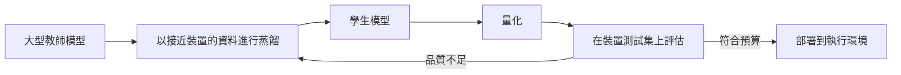

---
related:
- theory/model-compression/knowledge-distillation
- engineering/on-device-edge
tags:
- engineering
- systems
aliases:
- 知識蒸餾
---

# 知識蒸餾

本頁說明如何把知識蒸餾用於預算緊縮的裝置與服務，以產生模型。方法本身，包括溫度軟化的損失函數與其變體，見理論章節：[知識蒸餾](../../theory/model-compression/knowledge-distillation/index.zh-TW.md)。原始的流程見 [Hinton 蒸餾](../../theory/model-compression/knowledge-distillation/response-based/hinton-distillation/index.zh-TW.md)，語言模型的蒸餾見 [序列層級知識蒸餾](../../theory/model-compression/knowledge-distillation/llm-distillation/sequence-level/index.zh-TW.md)。

## 概述

大型模型準確，但在手機或低延遲服務中執行的成本太高。蒸餾能產生較小的學生模型，並保留教師模型的大部分行為。對部署而言，關心的問題與理論章節不同：教師的成本多高、學生必須處理哪些輸入，以及學生還要如何進一步壓縮。

## 工程筆記

- **教師成本**：教師必須在蒸餾資料上執行，這可能佔去大部分運算量。把教師的輸出快取一次，之後在各次學生實驗中重複使用，可以節省時間。
- **學生架構**：選擇目標執行環境能良好支援的學生模型。使用裝置加速器支援之運算子的小型網路，通常比不支援的同尺寸網路快。
- **資料涵蓋**：學生只會學到蒸餾資料所呈現的行為。應使用取自裝置實際流量的輸入，這往往是影響品質最大的因素。
- **蒸餾後的量化**：先蒸餾，再量化。兩個步驟的誤差可能疊加，因此要在裝置自己的測試集上衡量最終的量化模型。[GPTQ](../../theory/model-compression/quantisation/post-training/gptq/index.zh-TW.md) 等訓練後量化的方法見理論章節。
- **調校**：溫度與損失權重需要依任務調整，學生模型尺寸改變時，最佳值也可能改變。

## 如何納入裝置流程

## 開放問題

- 當教師在罕見輸入上的行為未知時，應如何選擇蒸餾資料？
- 蒸餾如何與量化結合，才能讓最終的裝置模型既小又準確？

## 參考文獻

### 奠基性論文

- Hinton, G., Vinyals, O. & Dean, J. (2015). *Distilling the Knowledge in a Neural Network*. arXiv:1503.02531. https://arxiv.org/abs/1503.02531 — 提出讓小型學生模型學習大型教師模型的軟化輸出，並以溫度作為控制參數。

### 相關工作

- Han, S., Mao, H. & Dally, W. J. (2016). *Deep Compression: Compressing Deep Neural Networks with Pruning, Trained Quantization and Huffman Coding*. ICLR 2016. arXiv:1510.00149. https://arxiv.org/abs/1510.00149 — 另一種得到較小網路的途徑，結合剪枝與量化，蒸餾常與之並用。
- Jacob, B. et al. (2017). *Quantization and Training of Neural Networks for Efficient Integer-Arithmetic-Only Inference*. arXiv:1712.05877. https://arxiv.org/abs/1712.05877 — 行動硬體上的量化推論，蒸餾後的學生模型常以此部署。
- Frantar, E. et al. (2023). *GPTQ: Accurate Post-Training Quantization for Generative Pre-trained Transformers*. ICLR 2023. arXiv:2210.17323. https://arxiv.org/abs/2210.17323 — 針對大型語言模型的訓練後量化，也可套用在蒸餾後的模型上。
- Dettmers, T. et al. (2022). *LLM.int8(): 8-bit Matrix Multiplication for Transformers at Scale*. NeurIPS 2022. arXiv:2208.07339. https://arxiv.org/abs/2208.07339 — 大型 Transformer 的 8 位元推論，並以較高精度保留離群特徵。
