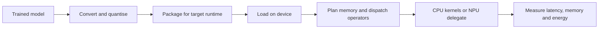

# TinyML and Mobile Runtimes

TinyML runs machine learning models on microcontrollers that have kilobytes of memory. Mobile runtimes run them on phones and laptops, using the CPU, GPU and neural processing unit (NPU) of the device. Both fit a trained model into a fixed budget of memory, compute and energy, and both depend on the runtime that loads, schedules and executes the model.

## Overview

The two ends of this range differ by orders of magnitude. A microcontroller is a single chip with a small processor, a few kilobytes to a few hundred kilobytes of SRAM for working memory, and often no operating system. A phone has several gigabytes of memory, a multi-core CPU, a GPU and an NPU, but that memory is shared with the operating system and other applications. The MCUNet paper notes that microcontroller memory is two to three orders of magnitude smaller than that of a mobile phone.[^1]

A runtime is the software between the model file and the hardware. It reads the model in a device format, plans where intermediate results are stored, chooses an implementation for each operation, and sends work to accelerators where it can. The same network can run at very different speeds on different runtimes, which is why measurements belong on the target device, as the [On-device and Edge AI](index.md) overview stresses.

## Key concepts

- **Microcontroller (MCU)**: a chip with a processor, on-chip flash for code and constants, and SRAM for working memory. Many run bare-metal firmware or a small real-time operating system.
- **Tensor arena**: a fixed block of RAM in which the runtime places intermediate activations. Because it is planned before inference starts, the device does not allocate memory while it runs.
- **Peak memory**: the largest amount of memory in use at any one moment. It depends on the sizes of intermediate activations, not only on the number of parameters. The MCUNetV2 paper found that the early blocks of a convolutional network often set this peak.[^2]
- **Kernel library**: optimised implementations of operations such as convolution and matrix multiplication for one family of processors.
- **Delegate**: a plug-in that hands part of the model graph to an accelerator such as a GPU or an NPU. Operators the delegate does not support run on the CPU, and frequent switches between the two can cost more time than the accelerator saves.
- **Ahead-of-time conversion**: the model is converted, quantised and optimised before it reaches the device. See [Quantisation](../../theory/model-compression/quantisation/index.md).

## How it works

Deployment has four stages: training, conversion, packaging for the target runtime, and execution on the device. Measurement on the device closes the loop.

On a microcontroller the model is often compiled into the firmware as a constant array in flash. A small interpreter walks the graph and runs one operator after another, using the tensor arena for working memory. The peak memory is set by the layers that must hold their input and output at the same time. Patch-based scheduling reduces this peak by computing a large early layer in small spatial patches, at the cost of recomputing some values where patches overlap.

Mobile runtimes follow the same pattern with more machinery: a graph optimiser, a CPU kernel library, and delegates for the GPU or NPU. The model file is usually memory-mapped, so the operating system loads weights from storage only when they are read.

## Key methods

The runtimes below are compared inline, because none has a page of its own yet.

| Runtime | Target devices | Model format | What separates it |
|---|---|---|---|
| TensorFlow Lite Micro | Microcontrollers without an operating system | TFLite flatbuffer | Interpreter designed to run in a few kilobytes of memory, with arena allocation |
| CMSIS-NN | Arm Cortex-M processors | Kernel library used by microcontroller runtimes | Hand-optimised kernels that reduce memory footprint and raise throughput |
| LiteRT (formerly TensorFlow Lite) | Android, iOS and embedded Linux | `.tflite` | Cross-platform runtime with GPU and NPU delegates supplied by hardware vendors |
| Core ML | Apple platforms such as iPhone, iPad and Mac | Converted model package | Platform-specific: the framework chooses among CPU, GPU and Neural Engine for each model |
| ExecuTorch | Phones and embedded devices | PyTorch program exported ahead of time | Runs models exported from PyTorch, with backends for vendor accelerators |
| ONNX Runtime Mobile | Android and iOS | ONNX with a reduced operator set | Smaller build of ONNX Runtime, with execution providers for accelerators |

The main choice is between platform-specific runtimes, which expose the most of each device, and cross-platform runtimes, which give one model file for many devices at some cost in peak speed. Delegate coverage often matters more than peak speed. An NPU that supports most operators can be much faster than the CPU, but one unsupported operator in the middle of the graph splits the model into two parts that run on different processors.

### On-device language models

Language models change the problem, because their weights are large and the [KV cache](../../theory/models/transformer/kv-cache/index.md) grows with the context. As a rough guide, the weights of a model with N parameters stored at b bits take about N × b / 8 bytes. A 3-billion-parameter model at 4 bits therefore needs about 1.5 GB, and at 16 bits about 6 GB, before the cache, the activations and the operating system are counted.

Three approaches address this:

- **Smaller architectures.** MobileLLM studies language models below one billion parameters for mobile use, with deep and thin designs, embedding sharing and grouped-query attention.[^3] Phi-3-mini, with 3.8 billion parameters, is described as small enough to be deployed on a phone.[^4]
- **Low-bit weights.** AWQ is a weight-only quantisation method. It observes that a small fraction of weights, about 1%, matter far more than the rest, and protects them with activation-aware scaling.[^5]
- **Streaming from flash.** The "LLM in a flash" work keeps parameters in flash storage and loads them into DRAM on demand, so a model larger than the available DRAM can still run.

## Connections

Biological nervous systems compute within tight energy budgets, with memory and computation close together. [Spiking networks and neuromorphic hardware](../../brain-mind/snn-neuromorphic/index.md) take a related route: they compute only when spikes occur, which suits always-on sensing with little power. Today's TinyML systems use conventional networks, but they face the same question of where data and computation sit.

Compression supplies the models. [Model compression](../../theory/model-compression/index.md) covers quantisation, pruning and distillation, and the [knowledge distillation](knowledge-distillation.md) page gives the deployment notes. Serving-side techniques for large models are in [Inference optimization](../inference-optimization/index.md), and mobile NPUs are listed in [AI hardware](../hardware/index.md). Architectures built for small budgets, such as MobileNets, sit in the [CNN family](../../theory/models/cnn/index.md).

On-device processing also changes privacy, because raw input stays on the device; see [Privacy and data protection](../../society/privacy/index.md). Keeping a fleet of devices updated is an operations problem covered in [MLOps](../mlops/index.md).

## Applications

- **Always-on sensing.** Keyword spotting, gesture detection and anomaly detection run on microcontrollers in wearables and appliances. The MLPerf Tiny benchmark suite measures accuracy, latency and energy for such ultra-low-power systems.[^6]
- **Phone features.** Camera, text and voice features increasingly run on the device, on the NPU where one is available. Apple's report on its foundation models describes an on-device model of about 3 billion parameters.
- **On-device adaptation.** Training on the device has been shown within 256 KB of memory, so a sensor can adapt to its own data without sending it to a server.

## Open questions

- How can a model be updated across thousands of devices with different NPUs and runtime versions, while confirming that each behaves the same?
- Will cross-platform runtimes close the gap with platform-specific ones, or will vendor delegates remain necessary for speed?
- As context windows grow, will the KV cache outgrow device memory, and is streaming weights from flash a lasting answer?

[^1]: Lin et al. (2020), *MCUNet*. The abstract states that microcontroller memory is "2-3 orders of magnitude smaller" than that of mobile phones.
[^2]: Lin et al. (2021), *MCUNetV2*. The abstract reports that the first several blocks of a CNN can use an order of magnitude more memory than the rest of the network.
[^3]: Liu et al. (2024), *MobileLLM*. The abstract describes the sub-billion scale as "a practical choice for mobile deployment".
[^4]: Abdin et al. (2024), *Phi-3 Technical Report*. The abstract describes phi-3-mini as a 3.8-billion-parameter model "small enough to be deployed on a phone".
[^5]: Lin et al. (2023), *AWQ*. The abstract states that protecting only 1% of salient weights can greatly reduce quantisation error.
[^6]: Banbury et al. (2021), *MLPerf Tiny*. The abstract describes the suite as measuring accuracy, latency and energy for ultra-low-power TinyML systems.

## References

### Seminal papers

- Lin, J., Chen, W.-M., Lin, Y., Cohn, J., Gan, C. & Han, S. (2020). *MCUNet: Tiny Deep Learning on IoT Devices*. NeurIPS 2020. arXiv:2007.10319. https://arxiv.org/abs/2007.10319 — Co-designs a neural architecture search and a lightweight inference engine so that ImageNet-scale models run on microcontrollers.
- Lin, J., Chen, W.-M., Cai, H., Gan, C. & Han, S. (2021). *MCUNetV2: Memory-Efficient Patch-based Inference for Tiny Deep Learning*. NeurIPS 2021. arXiv:2110.15352. https://arxiv.org/abs/2110.15352 — Shows that early blocks of a CNN dominate peak memory and proposes patch-by-patch inference to reduce it.
- David, R. et al. (2021). *TensorFlow Lite Micro: Embedded Machine Learning on TinyML Systems*. MLSys 2021. arXiv:2010.08678. https://arxiv.org/abs/2010.08678 — Describes an interpreter-based framework for microcontrollers that runs within a few kilobytes of memory.
- Lai, L., Suda, N. & Chandra, V. (2018). *CMSIS-NN: Efficient Neural Network Kernels for Arm Cortex-M CPUs*. arXiv:1801.06601. https://arxiv.org/abs/1801.06601 — Kernel library for Arm Cortex-M processors that reduces memory footprint and improves runtime and energy use.
- Howard, A. G. et al. (2017). *MobileNets: Efficient Convolutional Neural Networks for Mobile Vision Applications*. arXiv:1704.04861. https://arxiv.org/abs/1704.04861 — An efficient convolutional architecture for mobile vision, built from depthwise separable convolutions.
- Lin, J. et al. (2023). *AWQ: Activation-aware Weight Quantization for LLM Compression and Acceleration*. MLSys 2024. arXiv:2306.00978. https://arxiv.org/abs/2306.00978 — Low-bit weight-only quantisation for large language models that protects the salient weights, aimed at on-device use.
- Alizadeh, K. et al. (2023). *LLM in a flash: Efficient Large Language Model Inference with Limited Memory*. arXiv:2312.11514. https://arxiv.org/abs/2312.11514 — Runs models larger than DRAM by storing parameters in flash and loading them on demand.
- Lin, J. et al. (2022). *On-Device Training Under 256KB Memory*. NeurIPS 2022. arXiv:2206.15472. https://arxiv.org/abs/2206.15472 — Makes fine-tuning possible within 256 KB of memory, using a co-designed algorithm and system.

### Surveys and textbooks

- Gholami, A. et al. (2021). *A Survey of Quantization Methods for Efficient Neural Network Inference*. arXiv:2103.13630. https://arxiv.org/abs/2103.13630 — Surveys quantisation methods for efficient inference, the background to the conversion step described above.

### Articles and documentation

- Apple. *Core ML*. Apple Developer Documentation. https://developer.apple.com/documentation/coreml — Apple's reference for the framework that runs converted models on its devices.
- Banbury, C. et al. (2021). *MLPerf Tiny Benchmark*. arXiv:2106.07597. https://arxiv.org/abs/2106.07597 — Benchmark suite that measures accuracy, latency and energy for ultra-low-power machine learning systems.
- Abdin, M. et al. (2024). *Phi-3 Technical Report: A Highly Capable Language Model Locally on Your Phone*. arXiv:2404.14219. https://arxiv.org/abs/2404.14219 — Technical report on a 3.8-billion-parameter model designed to run on a phone.
- Gunter, T. et al. (2024). *Apple Intelligence Foundation Language Models*. arXiv:2407.21075. https://arxiv.org/abs/2407.21075 — Describes an on-device model of about 3 billion parameters and how it is optimised for inference.
- Liu, Z. et al. (2024). *MobileLLM: Optimizing Sub-billion Parameter Language Models for On-Device Use Cases*. ICML 2024. arXiv:2402.14905. https://arxiv.org/abs/2402.14905 — Architecture study for language models below one billion parameters, for mobile use.
