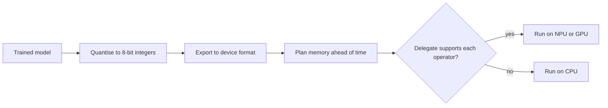

# TinyML and Mobile Runtimes

!!! info "Part of On-device and Edge AI"
    This page sits under [On-device and Edge AI](../index.md). It compares the runtimes that carry a model onto a device; each method has its own page.

A model that runs on a phone or a microcontroller needs two things from its software: a format and runtime that fit the device's memory, and a way to use the accelerator the device has. TinyML covers the smallest end, where the budget is kilobytes of SRAM and flash. Mobile runtimes cover phones and laptops, where the budget is gigabytes but the hardware is varied, with CPUs, GPUs and neural processing units (NPUs) that each need their own code path.

## Overview

The two ends of the range need different designs. A microcontroller has no operating system to speak of, a few hundred kilobytes of SRAM, and a flash memory that holds the weights. The model architecture must be designed or searched for that budget, and the runtime must avoid dynamic memory allocation. A phone has enough memory for a large model, but the same model must run on many chips, so the runtime must map each operator to the best available hardware and fall back when one is missing.

## Key concepts

- **Peak memory.** The largest amount of activation memory the model needs at any moment during inference. On a microcontroller this, not the total parameter count, decides whether the model fits.
- **Integer inference.** Running the model with 8-bit integer arithmetic, which many microcontrollers and NPUs support natively and which uses less energy than floating point.
- **Delegate.** A plug-in that hands a subgraph of the model to an accelerator, while the rest runs on the CPU.
- **Export format.** The file the runtime loads, such as a flatbuffer or a program in an ahead-of-time format, produced from a framework model.

## How it works

A typical flow starts from a trained model, converts it to a quantised format, plans its memory ahead of time, and loads it into the device runtime. The runtime then assigns each operator to a delegate or to the CPU. Peak memory and the operator coverage of each delegate decide the result, so both must be checked on the target device.

## Key methods

Each method has its own page. The table compares the three runtimes and model designs covered here.

| Method | Problem it solves | Core idea | Main trade-off | Page |
|---|---|---|---|---|
| MCUNet | A useful image classifier must fit in microcontroller memory | Co-design a small network and its memory schedule under the device's limits | Accuracy is capped by the memory budget, and the design is specific to one device class | [MCUNet](mcunet.md) |
| LiteRT | A trained model must run on phones with CPU, GPU and NPU delegates | A flatbuffer format and an interpreter with hardware delegates, formerly TensorFlow Lite | Operator coverage differs across delegates, so a model may split across hardware | [LiteRT](litert.md) |
| ExecuTorch | A PyTorch model must run on edge devices from one export path | An ahead-of-time export to a compact program, run by a small runtime with pluggable backends | A newer stack, and backend support depends on the target | [ExecuTorch](executorch.md) |

Core ML, the Apple runtime for devices in its ecosystem, and ONNX Runtime Mobile follow the same pattern of converting a model and assigning operators to hardware. They are mentioned here without separate pages.

## Runtime choices

| Choice | Effect | Watch for |
|---|---|---|
| Integer quantisation | Smaller and faster on NPUs and microcontrollers | Accuracy loss on sensitive layers, and calibration data |
| Ahead-of-time memory planning | No allocation at run time, so memory use is predictable | Model changes require a new plan |
| Hardware delegate | Large speed-up on supported operators | Unsupported operators fall back to the CPU and add copies |
| Small architecture | Fits the budget from the start | Lower accuracy than a model scaled down afterwards |

## Trade-offs

- **Coverage.** A delegate that supports only part of the model splits the graph, and each boundary costs a copy. A model that runs fully on one delegate is usually faster than a larger model that splits.
- **Measurement.** Speed and memory on one phone do not predict another. Benchmarks must run on each target chip.
- **Updates.** Devices run different runtime versions, so a model is tested against the exact runtime it ships with.

## Open questions

- Can a single export path cover microcontrollers and phones without losing the memory planning that small devices need?
- How should a runtime choose between delegates when the NPU is fast but supports fewer operators?

## References

### Seminal papers

- Lin, J. et al. (2020). *MCUNet: Tiny Deep Learning on IoT Devices*. NeurIPS 2020. arXiv:2007.10319. https://arxiv.org/abs/2007.10319 — Co-designs a compact network and its inference memory schedule for microcontrollers with a few hundred kilobytes of SRAM.
- Howard, A. G. et al. (2017). *MobileNets: Efficient Convolutional Neural Networks for Mobile Vision Applications*. arXiv:1704.04861. https://arxiv.org/abs/1704.04861 — An efficient convolutional architecture for mobile vision, built on depthwise separable convolutions.
- Jacob, B. et al. (2017). *Quantization and Training of Neural Networks for Efficient Integer-Arithmetic-Only Inference*. arXiv:1712.05877. https://arxiv.org/abs/1712.05877 — Integer-only inference with quantisation in the training loop, the basis of 8-bit mobile deployment.
- Han, S., Mao, H. & Dally, W. J. (2016). *Deep Compression: Compressing Deep Neural Networks with Pruning, Trained Quantization and Huffman Coding*. ICLR 2016. arXiv:1510.00149. https://arxiv.org/abs/1510.00149 — Combines pruning, quantisation and entropy coding to shrink networks for deployment on constrained devices.

### Articles and documentation

- Google. *LiteRT: On-device AI runtime*. https://developers.google.com/edge/litert — Official page for the runtime formerly known as TensorFlow Lite, with its CPU, GPU and NPU acceleration.
- PyTorch. *ExecuTorch documentation*. https://docs.pytorch.org/executorch/stable/index.html — Official documentation of the PyTorch edge runtime, its design goals and its backends.
