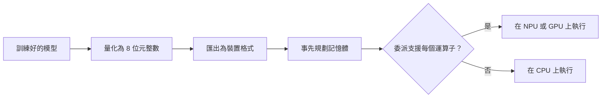

# TinyML 與行動執行環境

在手機或微控制器上執行的模型，需要軟體提供兩件事：能放進裝置記憶體的格式與執行環境，以及能利用裝置上加速器的方法。TinyML 涵蓋最小的一端，預算只有數 kB 的 SRAM 與快閃記憶體。行動執行環境則涵蓋手機與筆電，預算以 GB 計，但硬體多樣，包括 CPU、GPU 與各需獨立程式路徑的神經處理單元（NPU）。

!!! info "屬於裝置端與邊緣 AI"
    本頁位於[裝置端與邊緣 AI](../index.zh-TW.md)之下。它比較把模型載入裝置的各種執行環境；每個方法都有自己的頁面，記載詳細內容。

## 概述

範圍兩端需要不同的設計。微控制器幾乎沒有作業系統可言，只有數百 kB 的 SRAM，且快閃記憶體必須存放權重。模型架構必須依該預算來設計或搜尋，執行環境也必須避免動態配置記憶體。手機有足夠記憶體容納大型模型，但同一個模型必須在許多晶片上執行，因此執行環境必須把每個運算子對應到最佳的可用硬體，並在缺少時退回其他路徑。

## 關鍵概念

- **峰值記憶體。** 推論過程中任一時刻所需的最大激活記憶體。在微控制器上，決定模型能否放得下的是它，而不是參數總量。
- **整數推論。** 以 8 位元整數運算執行模型。許多微控制器與 NPU 原生支援這種運算，且比浮點數耗能少，[Jacob 等人（2017）](https://arxiv.org/abs/1712.05877) 描述了量化網路的這種做法。
- **委派（delegate）。** 一種外掛，把模型的子圖交給加速器，其餘部分在 CPU 上執行。
- **匯出格式。** 執行環境載入的檔案，例如 `.tflite` 檔，或由事先匯出產生的程式，由框架模型產生。

## 運作方式

典型流程是從訓練好的模型開始，轉為量化格式，事先規劃記憶體，然後載入裝置執行環境。執行環境接著把每個運算子指派給委派或 CPU。峰值記憶體與每個委派的運算子涵蓋範圍，決定最後結果，因此兩者都必須在目標裝置上檢查。

## 關鍵方法

每個方法都有自己的頁面。下表比較本頁涵蓋的三個系統。

| 方法 | 要解決的問題 | 核心想法 | 主要權衡 | 頁面 |
|---|---|---|---|---|
| MCUNet | 有用的影像分類器必須放進微控制器記憶體 | 在裝置預算下協同設計小型網路（TinyNAS）與其記憶體排程（TinyEngine） | 準確率受記憶體預算限制，且設計只針對一類裝置 | [MCUNet](mcunet.zh-TW.md) |
| LiteRT | 訓練好的模型必須在具 CPU、GPU 與 NPU 加速的手機上執行 | `.tflite` 格式與具硬體委派的直譯器，為 TensorFlow Lite 的後繼者 | 各委派的運算子涵蓋範圍不同，模型可能跨硬體切分 | [LiteRT](litert.zh-TW.md) |
| ExecuTorch | PyTorch 模型必須從同一條匯出路徑部署到邊緣裝置 | 事先匯出為緊湊程式，由具可插拔後端的小型執行環境執行 | 較新的堆疊，且後端支援取決於目標 | [ExecuTorch](executorch.zh-TW.md) |

Core ML 是 Apple 為其裝置提供的執行環境，也是 ExecuTorch 可以鎖定的後端之一，因此在此透過該途徑出現，而非另設頁面。

## 執行環境的選擇

| 選擇 | 效果 | 注意事項 |
|---|---|---|
| 整數量化 | 在 NPU 與微控制器上更小、更快 | 敏感層的準確率損失，以及校準資料 |
| 事先的記憶體規劃 | 執行時不配置記憶體，因此記憶體用量可預測 | 模型改變後需要新的計畫 |
| 硬體委派 | 在支援的運算子上大幅加速 | 不支援的運算子退回 CPU，並增加複製 |
| 小型架構 | 從一開始就符合預算 | 準確率低於事後縮小的大型模型 |

## 權衡

- **涵蓋範圍。** 只支援部分模型的委派會切分圖，每個邊界都要付出一次複製的代價。一個完整在單一委派上執行的模型，通常比一個需要切分的大型模型更快。
- **測量。** 在一部手機上的速度與記憶體，無法預測另一部手機的表現。基準測試必須在每種目標晶片上執行。
- **更新。** 裝置執行的執行環境版本各不相同，因此模型必須以其出貨所用的確切執行環境版本來測試。

## 未解問題

- 單一匯出路徑能否同時涵蓋微控制器與手機，而不失去小型裝置所需的記憶體規劃？
- 當 NPU 速度快但支援的運算子較少時，執行環境應如何在各委派之間選擇？

## 參考文獻

### 開創性論文

- Lin, J. et al. (2020). *MCUNet: Tiny Deep Learning on IoT Devices*. arXiv:2007.10319. https://arxiv.org/abs/2007.10319 — 為微控制器協同設計的緊湊網路與其推論記憶體排程，適用於只有數百 kB SRAM 的微控制器。
- Lin, J. et al. (2021). *MCUNetV2: Memory-Efficient Patch-based Inference for Tiny Deep Learning*. arXiv:2110.15352. https://arxiv.org/abs/2110.15352 — 以逐塊推論降低峰值記憶體的後續研究，為 MCUNet 的延伸。
- Howard, A. G. et al. (2017). *MobileNets: Efficient Convolutional Neural Networks for Mobile Vision Applications*. arXiv:1704.04861. https://arxiv.org/abs/1704.04861 — 基於深度可分離卷積的高效行動視覺卷積架構。
- Jacob, B. et al. (2017). *Quantization and Training of Neural Networks for Efficient Integer-Arithmetic-Only Inference*. arXiv:1712.05877. https://arxiv.org/abs/1712.05877 — 在訓練迴圈中加入量化的純整數推論，是 8 位元行動部署的基礎。
- Han, S., Mao, H. & Dally, W. J. (2016). *Deep Compression: Compressing Deep Neural Networks with Pruning, Trained Quantization and Huffman Coding*. ICLR 2016. arXiv:1510.00149. https://arxiv.org/abs/1510.00149 — 結合剪枝、訓練後量化與霍夫曼編碼，以在受限裝置上縮小網路。

### 文件與說明

- Google. *LiteRT: High-Performance On-Device Machine Learning Framework*. https://developers.google.com/edge/litert — 前身為 TensorFlow Lite 的執行環境之官方頁面，包括其 CPU、GPU 與 NPU 加速。
- PyTorch. *ExecuTorch documentation*. https://docs.pytorch.org/executorch/stable/index.html — PyTorch 邊緣執行環境的官方文件，包括其設計目標與後端。
