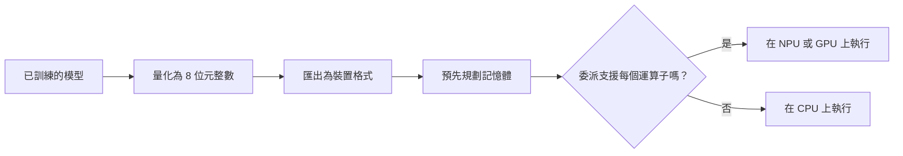

# TinyML 與行動執行環境

!!! info "屬於裝置端與邊緣 AI"
    本頁隸屬於[裝置端與邊緣 AI](../index.zh-TW.md)。它比較把模型放上裝置的執行環境；每個方法各有自己的頁面。

要在手機或微控制器上執行的模型，軟體需要兩件事：一種適合裝置記憶體的格式與執行環境，以及一種能使用裝置上加速器的方法。TinyML 涵蓋最小的一端，其預算只有幾 KB 的 SRAM 與快閃記憶體。行動執行環境涵蓋手機與筆電，其記憶體預算有幾 GB，但硬體種類多樣，包括 CPU、GPU 與神經處理單元（NPU），每一種都需要自己的程式路徑。

## 概述

範圍的兩端需要不同的設計。微控制器幾乎沒有作業系統，只有幾百 KB 的 SRAM，而權重則存放在快閃記憶體中。模型架構必須依照這個預算來設計或搜尋，執行環境也必須避免動態配置記憶體。手機的記憶體足以容納大型模型，但同一個模型必須在許多不同的晶片上執行，因此執行環境要把每個運算子對應到最合適的可用硬體，遇到缺少的硬體時則退回其他方式。

## 關鍵概念

- **峰值記憶體。** 推論過程中任一時刻所需啟動值記憶體的最大量。在微控制器上，決定模型能否放下的是這個數字，而不是參數總數。
- **整數推論。** 以 8 位元整數運算執行模型。許多微控制器與 NPU 原生支援這種運算，能耗也低於浮點數。
- **委派（delegate）。** 一種外掛程式，把模型的一個子圖交給加速器執行，其餘部分仍在 CPU 上執行。
- **匯出格式。** 執行環境載入的檔案，例如 flatbuffer 或預先編譯的程式，由框架模型產生。

## 運作方式

典型的流程從已訓練的模型開始，轉換為量化格式，預先規劃記憶體，再載入裝置的執行環境。接著執行環境會把每個運算子指派給某個委派或 CPU。峰值記憶體與每個委派支援的運算子範圍，決定最後的結果，因此兩者都必須在目標裝置上檢查。

## 關鍵方法

每個方法各有自己的頁面。下表比較本頁涵蓋的三種執行環境與模型設計。

| 方法 | 要解決的問題 | 核心想法 | 主要取捨 | 頁面 |
|---|---|---|---|---|
| MCUNet | 有用的影像分類器必須放進微控制器的記憶體 | 依裝置限制，共同設計小型網路與其記憶體排程 | 準確度受記憶體預算限制，且設計只針對某一類裝置 | [MCUNet](mcunet.zh-TW.md) |
| LiteRT | 已訓練的模型必須在具備 CPU、GPU 與 NPU 委派的手機上執行 | 採用 flatbuffer 格式與帶有硬體委派的直譯器，前身為 TensorFlow Lite | 各委派的運算子覆蓋範圍不同，模型可能被切分到不同硬體上 | [LiteRT](litert.zh-TW.md) |
| ExecuTorch | 必須從同一條路徑，把 PyTorch 模型部署到邊緣裝置 | 預先匯出為精簡程式，由一個小型執行環境搭配可插拔的後端執行 | 較新的技術堆疊，後端支援取決於目標裝置 | [ExecuTorch](executorch.zh-TW.md) |

Core ML 是 Apple 生態系中的執行環境，ONNX Runtime Mobile 也是。它們遵循同樣的模式：轉換模型，並把運算子指派給硬體。這裡只提及它們，未另設頁面。

## 執行環境的選擇

| 選擇 | 效果 | 需要注意 |
|---|---|---|
| 整數量化 | 在 NPU 與微控制器上更小、更快 | 敏感層的準確度損失，以及校準資料 |
| 預先規劃記憶體 | 執行時不配置記憶體，記憶體用量可預測 | 模型改變後必須重新規劃 |
| 硬體委派 | 支援的運算子大幅加速 | 不支援的運算子會退回 CPU，並增加資料複製 |
| 小型架構 | 從一開始就符合預算 | 準確度通常低於先設計大模型再縮小的做法 |

## 取捨

- **覆蓋範圍。** 只支援部分模型的委派會切分計算圖，每個邊界都要付出一次複製的成本。能完整跑在單一委派上的模型，通常比被切分的大模型更快。
- **量測。** 在某一支手機上的速度與記憶體，無法預測另一支手機的表現。基準測試必須在每一款目標晶片上進行。
- **更新。** 裝置執行的執行環境版本各不相同，因此模型必須針對它隨附的確切執行環境版本進行測試。

## 開放問題

- 單一匯出路徑能否同時服務微控制器與手機，又不失去小型裝置所需的記憶體規劃？
- 執行環境應如何在「NPU 快但支援的運算子少」與「GPU 慢但覆蓋較廣」之間做選擇？

## 參考文獻

### 重要論文

- Lin, J. et al. (2020). *MCUNet: Tiny Deep Learning on IoT Devices*. NeurIPS 2020. arXiv:2007.10319. https://arxiv.org/abs/2007.10319 — 主要論文：為微控制器共同設計的架構搜尋與推論函式庫，並提供 320 kB SRAM 上的 ImageNet 結果。
- Howard, A. G. et al. (2017). *MobileNets: Efficient Convolutional Neural Networks for Mobile Vision Applications*. arXiv:1704.04861. https://arxiv.org/abs/1704.04861 — 高效的卷積基準，其深度可分離卷積使小型網路得以實用。
- Jacob, B. et al. (2017). *Quantization and Training of Neural Networks for Efficient Integer-Arithmetic-Only Inference*. arXiv:1712.05877. https://arxiv.org/abs/1712.05877 — 僅使用整數的推論，是微控制器運算單元所需的基礎。
- Han, S., Mao, H. & Dally, W. J. (2016). *Deep Compression: Compressing Deep Neural Networks with Pruning, Trained Quantization and Huffman Coding*. ICLR 2016. arXiv:1510.00149. https://arxiv.org/abs/1510.00149 — 結合剪枝、量化與熵編碼，以縮小網路以便部署在受限裝置上。

### 文章與文件

- Google. *LiteRT: On-device AI runtime*. https://developers.google.com/edge/litert — 此執行環境的官方頁面，涵蓋其 CPU、GPU 與 NPU 加速，以及匯出路徑。
- PyTorch. *ExecuTorch documentation*. https://docs.pytorch.org/executorch/stable/index.html — PyTorch 邊緣執行環境的官方文件，包括其設計目標與後端。
