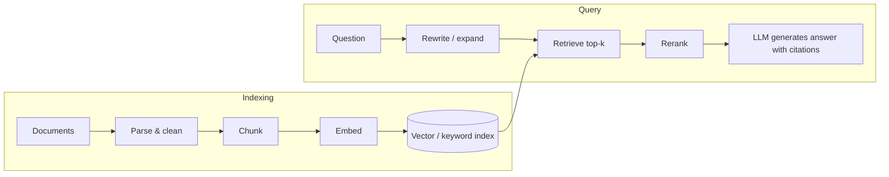

---
related:
- models/llm
- brain-mind/memory-learning
- applications/law
- engineering/evaluation
aliases:
  - RAG
  - 檢索增強
---

# Retrieval-Augmented Generation

**RAG** retrieves relevant documents at query time and gives them to an LLM to ground its answer (Lewis et al., 2020). It keeps knowledge fresh and private without retraining, and enables citations.

## Pipeline

## Design choices

| Stage | Options | Tips |
|---|---|---|
| Parsing | PDF, HTML, tables, slides, scans (OCR, layout models, VLMs) | Parsing quality is often the biggest bottleneck |
| Chunking | Fixed tokens with overlap, by section/heading, semantic chunking | Keep chunks self-contained; attach titles and metadata |
| Embeddings | Open (BGE, E5, GTE, Nomic, multilingual models) or API embeddings | Check the [MTEB leaderboard](https://huggingface.co/spaces/mteb/leaderboard) for your language and domain |
| Retrieval | Dense vectors, BM25 keyword search, **hybrid** (usually best) | Add metadata filters (date, source, permissions) |
| Reranking | Cross-encoder rerankers | Big quality gain for little cost |
| Generation | Instruct the model to answer only from sources and cite them | Allow "I don't know" |

## Advanced patterns

- **Query rewriting** and multi-query, HyDE (hypothetical document embeddings)
- **Contextual retrieval**: prepend chunk-specific context before embedding to reduce lost meaning
- **GraphRAG**: build a knowledge graph or community summaries for global questions
- **Agentic RAG**: the model decides when and what to search, iterating
- **Long-context models vs RAG**: long contexts reduce but do not remove the need for retrieval — cost, latency and precision still favour retrieval at scale

## Evaluation

| What | Metric |
|---|---|
| Retrieval | Recall@k, MRR, nDCG on labelled question–passage pairs |
| Faithfulness | Is every claim supported by retrieved text? |
| Answer relevance and correctness | Human or LLM-judge grading against references |
| Citation accuracy | Do citations point to supporting passages? |

Tools: RAGAS, TruLens, promptfoo, custom LLM-judge evals.

## Failure modes

- Relevant document not retrieved (most common)
- Retrieved but ignored or misread
- Conflicting or outdated sources
- Permission leaks across users
- Prompt injection inside retrieved documents

## Brain analogy

RAG resembles the hippocampus–neocortex division in [complementary learning systems](../../brain-mind/memory-learning/index.md): a fast, episodic, content-addressable store complements slowly learned knowledge in the weights.

## Resources

- Lewis et al. (2020), "Retrieval-Augmented Generation for Knowledge-Intensive NLP Tasks"
- Gao et al. (2024), "Retrieval-Augmented Generation for Large Language Models: A Survey"
- Anthropic (2024), "Introducing Contextual Retrieval"
- LlamaIndex and LangChain RAG tutorials

## References

### Seminal papers

- Lewis, P., et al. (2020). *Retrieval-Augmented Generation for Knowledge-Intensive NLP Tasks*. arXiv:2005.11401 — Introduces RAG as a generator conditioned on retrieved passages, the setup this page describes.
- Karpukhin, V., et al. (2020). *Dense Passage Retrieval for Open-Domain Question Answering*. arXiv:2004.04906 — Trains dual encoders for passage retrieval, the dense stage most RAG systems rely on.
- Izacard, G. & Grave, E. (2020). *Leveraging Passage Retrieval with Generative Models for Open Domain Question Answering*. arXiv:2007.01282 — Fusion-in-Decoder reads many retrieved passages together and improves answer quality.
- Asai, A., et al. (2023). *Self-RAG: Learning to Retrieve, Generate, and Critique through Self-Reflection*. arXiv:2310.11511 — Trains a model to decide when to retrieve and to critique its own answers.

### Surveys and textbooks

- Gao, Y., et al. (2023). *Retrieval-Augmented Generation for Large Language Models: A Survey*. arXiv:2312.10997 — Survey organising naive, advanced and modular RAG designs and how to evaluate them.

### Articles and documentation

- Es, S., et al. (2023). *RAGAS: Automated Evaluation of Retrieval Augmented Generation*. arXiv:2309.15217 — Reference-light metrics for faithfulness, answer relevance and context quality, used in the evaluation section.
