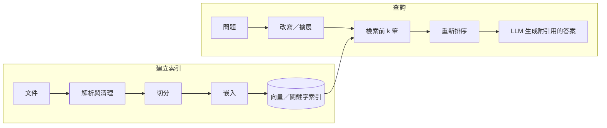

# 檢索增強生成（RAG）

**RAG** 在查詢時檢索相關文件，並把它們交給 LLM，讓其回答有所依據（Lewis et al., 2020）。它不需要重新訓練就能讓知識保持新穎與私密，也能提供引用來源。

## 流程

## 設計選擇

| 階段 | 選項 | 建議 |
|---|---|---|
| 解析 | PDF、HTML、表格、投影片、掃描件（OCR、版面模型、視覺語言模型） | 解析品質往往是最大的瓶頸 |
| 切分 | 固定 token 數加重疊、依章節／標題切分、語意切分 | 讓每個區塊自成一體；附上標題與中繼資料 |
| 嵌入 | 開源（BGE、E5、GTE、Nomic、多語言模型）或 API 嵌入 | 依你的語言與領域查看 [MTEB 排行榜](https://huggingface.co/spaces/mteb/leaderboard) |
| 檢索 | 稠密向量、BM25 關鍵字搜尋、**混合式**（通常最好） | 加上中繼資料篩選（日期、來源、權限） |
| 重新排序 | 交叉編碼器重新排序器 | 成本低、品質提升大 |
| 生成 | 指示模型只根據來源回答並附上引用 | 允許它回答「我不知道」 |

## 進階模式

- **查詢改寫**與多查詢、HyDE（假設文件嵌入）
- **脈絡式檢索**：在嵌入前為每個區塊加上特定的脈絡，減少語意流失
- **GraphRAG**：為全域性問題建立知識圖譜或社群摘要
- **代理式 RAG**：由模型決定何時、搜尋什麼，並反覆迭代
- **長脈絡模型 vs RAG**：長脈絡減少但不能消除檢索的需要——在規模化下，成本、延遲與精準度仍然有利於檢索

## 評估

| 評估對象 | 指標 |
|---|---|
| 檢索 | 在有標註的問題—段落配對上的 Recall@k、MRR、nDCG |
| 忠實度 | 每個主張是否都有檢索到的文字支持？ |
| 答案相關性與正確性 | 由人工或 LLM 評審依參考答案評分 |
| 引用準確度 | 引用是否指向支持的段落？ |

工具：RAGAS、TruLens、promptfoo，以及自製的 LLM 評審評估。

## 失敗模式

- 相關文件沒有被檢索到（最常見）
- 檢索到了，卻被忽略或誤解
- 來源互相矛盾或已過時
- 權限外洩，使用者之間的資料互相可見
- 檢索到的文件中夾帶提示注入

## 與大腦的類比

RAG 類似[互補學習系統](../../brain-mind/memory-learning/index.md)中海馬迴與新皮質的分工：快速、情節式、可依內容定址的儲存，補足權重中緩慢學習得來的知識。

## 學習資源

- Lewis et al. (2020), "Retrieval-Augmented Generation for Knowledge-Intensive NLP Tasks"
- Gao et al. (2024), "Retrieval-Augmented Generation for Large Language Models: A Survey"
- Anthropic (2024), "Introducing Contextual Retrieval"
- LlamaIndex 與 LangChain 的 RAG 教學
