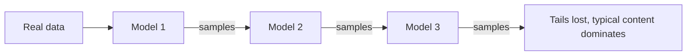

---
tags:
- engineering
- data
---

# Model Collapse

Model collapse is the loss of diversity and rare content that can occur when a model is trained on data produced by earlier models, and that training repeated over several generations. It is the main risk of building training data from model outputs.

## Overview

Each model learns an approximation of the data it sees. Sampling from that model produces data that is typically more concentrated than the original: common patterns are repeated and rare patterns become less likely. If the next model is trained on these samples, the concentration compounds. Over generations, the tails of the original distribution can disappear, so the model forgets rare facts, styles and events even while its typical outputs still look fluent.

## Key concepts

- **Distribution tails**: the rare events and uncommon content in the original data. These are the first to be lost.
- **Recursive training**: training on output from a previous model, then using the new model to generate data for the next one.
- **Estimation error**: the sampling and fitting error at each generation, which accumulates when it is not corrected by new real data.
- **Mixing**: combining generated data with fresh real data, which limits how far the distribution can drift.

## How it works

Consider a sequence of generations. Generation one is trained on real data. Generation two is trained on samples drawn from generation one, generation three on samples from generation two, and so on. Each step fits a model to finite samples, so rare content is under-represented in the sample, and the next model underweights it further. The loss compounds over generations.

## Key methods

The paper's central experiment trains successive generations on the outputs of the previous generation, then measures how the distribution changes. The authors analyse this as an accumulation of estimation error over generations.

## Results

The paper reports collapse across several model types, including language models, and shows that the loss of rare content happens early and speeds up over generations. Results depend on the number of generations, the sample size and whether real data is kept, so the paper's experimental settings matter when comparing.

## Limitations

- **Setting dependence**: the size of the effect depends on how data is sampled and how many generations pass.
- **Mitigation effects**: keeping real data, or accumulating data across generations rather than replacing it, reduces collapse in the paper's experiments. These mitigations have costs in data needs and storage.
- **Measurement**: loss of rare content is hard to see from average metrics, so evaluation needs tail-aware tests.

## Open questions

- How much real data must be kept at each generation to prevent collapse at the scale of web-sized training?
- Which evaluation methods detect tail loss in practice, given that average quality can stay high?

## References

### Seminal papers

- Shumailov, I. et al. (2024). *AI models collapse when trained on recursively generated data*. Nature, 631. https://doi.org/10.1038/s41586-024-07566-y — Shows that recursive training on model-generated data removes the rare content of the original distribution over generations.

### Related work

- Liu, Z. et al. (2024). *Best Practices and Lessons Learned on Synthetic Data*. https://arxiv.org/abs/2404.07503 — Reviews mixing and filtering choices that determine how much generated data can safely be used.
- Wang, Y. et al. (2023). *Self-Instruct: Aligning Language Models with Self-Generated Instructions*. https://arxiv.org/abs/2212.10560 — An example of a training loop that feeds model output back into training, where the collapse risk applies.
- Gunasekar, S. et al. (2023). *Textbooks Are All You Need*. https://arxiv.org/abs/2306.11644 — Relies on generated data chosen for quality, which is one way to limit the drift that causes collapse.
- Eldan, R. & Li, Y. (2023). *TinyStories: How Small Can Language Models Be and Still Speak Coherent English?* https://arxiv.org/abs/2305.07759 — A controlled generated corpus whose diversity depends on the generator's prompts, a case where collapse risk must be checked.
