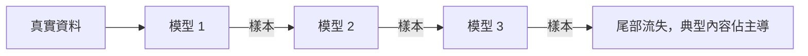

# 模型崩潰

模型崩潰是指：模型以前代模型產生的資料訓練，並且這個訓練跨越多代反覆進行時，出現的多樣性與罕見內容流失。它是以模型輸出建立訓練資料時，最主要的風險。

## 概述

每個模型都學習它所見資料的近似分布。從該模型取樣產生的資料，通常比原始資料更集中：常見的模式被重複，罕見的模式變得更不可能出現。若下一個模型以這些樣本訓練，集中的程度會逐代累積。經過多代之後，原始分布的尾部可能消失，模型會遺忘罕見的事實、風格與事件，而它的一般輸出看起來仍然流暢。

## 關鍵概念

- **分布尾部**：原始資料中罕見的事件與不常見的內容，最先流失。
- **遞迴訓練**：以前一代模型的輸出訓練，再用新模型為下一代生成資料。
- **估計誤差**：每一代取樣與擬合時的誤差，若沒有新的真實資料修正，就會累積。
- **混合**：把生成資料與新的真實資料合併，能限制分布漂移的幅度。

## 運作方式

考慮一連串的世代。第一代以真實資料訓練。第二代以第一代取出的樣本訓練，第三代以第二代的樣本訓練，依此類推。每一步都是以有限樣本擬合模型，因此罕見內容在樣本中的比例偏低，下一個模型又會更低估它。損失逐代累積。

## 關鍵方法

論文的核心實驗是：每一代以前一代的輸出訓練，然後量測分布如何改變。作者把這個過程分析為跨世代的估計誤差累積。

## 結果

論文指出，多種模型（包括語言模型）都出現崩潰，罕見內容的流失在早期就發生，並隨世代加速。結果取決於世代數、樣本大小，以及是否保留真實資料，因此比較時需要留意論文的實驗設定。

## 限制

- **設定依賴**：效應的大小取決於資料如何取樣，以及經過多少世代。
- **緩解效果**：在論文的實驗中，保留真實資料，或跨世代累積資料而非直接取代，能減少崩潰。這些緩解方法需要額外的資料量與儲存空間。
- **量測**：罕見內容的流失，從平均指標很難看出，因此評估需要能看見尾部的測試。

## 開放問題

- 在網路規模的訓練中，每一代至少要保留多少真實資料，才能防止崩潰？
- 考慮到平均品質可能仍然很高，哪些評估方法能實際偵測尾部流失？

## 參考文獻

### 奠基性論文

- Shumailov, I. et al. (2024). *AI models collapse when trained on recursively generated data*. Nature, 631. https://doi.org/10.1038/s41586-024-07566-y — 顯示以模型生成資料遞迴訓練，會在多代之後移除原始分布中罕見的內容。

### 相關研究

- Liu, Z. et al. (2024). *Best Practices and Lessons Learned on Synthetic Data*. https://arxiv.org/abs/2404.07503 — 回顧決定合成資料能安全使用多少的混合與過濾選擇。
- Wang, Y. et al. (2023). *Self-Instruct: Aligning Language Models with Self-Generated Instructions*. https://arxiv.org/abs/2212.10560 — 把模型輸出回饋進訓練的迴圈範例，崩潰風險也適用於此。
- Gunasekar, S. et al. (2023). *Textbooks Are All You Need*. https://arxiv.org/abs/2306.11644 — 依賴為品質而挑選的生成資料，是限制導致崩潰的漂移的一種方式。
- Eldan, R. & Li, Y. (2023). *TinyStories: How Small Can Language Models Be and Still Speak Coherent English?* https://arxiv.org/abs/2305.07759 — 受控生成的語料，其多樣性取決於生成提示，這是需要檢查崩潰風險的案例。
