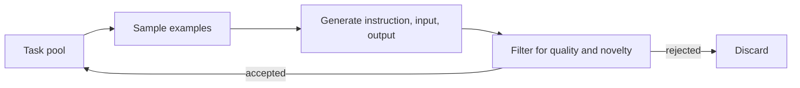

---
tags:
- engineering
- data
---

# Self-Instruct

Self-Instruct is a method for bootstrapping an instruction-tuning dataset from a small set of human-written examples. A language model writes new instructions, inputs and outputs, and a filter keeps the useful ones. It was one of the first demonstrations that a model's own generations could replace a large body of human-written instruction data.

## Overview

Instruction tuning teaches a model to follow requests, and it needs many diverse instruction-response pairs. Writing them by hand is slow and tends to cover only the topics that annotators think of. Self-Instruct starts from a seed set of tasks written by people, asks the model to extend the set, and then filters the results so that the new data is varied and correct enough to train on.

## Key concepts

- **Seed tasks**: a small set of human-written instructions, each with an input and an output where needed.
- **Task pool**: the growing collection of accepted instructions. New candidates are compared against it before they are added.
- **Task classification**: a prompt asks the model whether an instruction needs an input, which determines the format used for generation.
- **Similarity filter**: candidates whose wording is too close to an existing instruction are discarded, which keeps diversity high.

## How it works

Each iteration samples a few tasks from the pool, places them in a prompt as examples, and asks the model to write a new instruction. The model then decides whether the instruction needs an input and writes the input and the output. Candidates are filtered for quality, such as removing outputs that are too short or repeat the instruction, and for novelty, using a text-overlap score against the pool. Accepted tasks join the pool, so later rounds can draw on earlier generations.

## Key methods

The method itself is the loop above. The paper's central claim is that the generated data, once filtered, improves instruction following when used to fine-tune a base model, relative to that base model without tuning.

## Results

The paper reports that fine-tuning on the generated data gives a large improvement over the base model on held-out instruction tasks, with no large human-written instruction set. The exact figures depend on the benchmark and should be read from the paper.

## Limitations

- **Style inheritance**: the data carries the generator's wording, tone and mistakes, so a biased or weak generator produces biased or weak training data.
- **Shallow diversity**: lexical novelty checks do not guarantee that tasks differ in skill or difficulty.
- **Quality ceiling**: the filter catches obvious failures, but subtle errors in generated outputs pass through.

## Open questions

- How much of the gain comes from breadth of tasks, and how much from the quality of individual outputs?
- Later pipelines add verifiers, such as running code or checking answers, to catch errors that text filters miss. Which checks generalise beyond code and maths?

## References

### Seminal papers

- Wang, Y. et al. (2023). *Self-Instruct: Aligning Language Models with Self-Generated Instructions*. ACL 2023. https://arxiv.org/abs/2212.10560 — Introduces the bootstrapping loop, seed tasks, similarity filtering and fine-tuning on generated instructions.

### Related work

- Gunasekar, S. et al. (2023). *Textbooks Are All You Need*. https://arxiv.org/abs/2306.11644 — Shows a different route to synthetic training data: generated textbook-style material chosen for educational quality.
- Liu, R. et al. (2024). *Best Practices and Lessons Learned on Synthetic Data*. COLM 2024. https://arxiv.org/abs/2404.07503 — Surveys the generation, filtering and evaluation choices that determine whether self-generated data helps.
- Shumailov, I. et al. (2024). *AI models collapse when trained on recursively generated data*. Nature, 631. https://doi.org/10.1038/s41586-024-07566-y — Explains the risk of training repeatedly on model outputs, which applies to bootstrapping loops such as this one.
- Eldan, R. & Li, Y. (2023). *TinyStories: How Small Can Language Models Be and Still Speak Coherent English?* https://arxiv.org/abs/2305.07759 — Shows that carefully generated data can train capable models at small scale, a comparison point for bootstrapped data.
