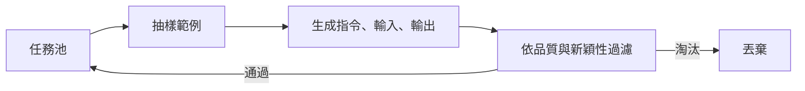

# Self-Instruct

Self-Instruct 是一種從一小組人工撰寫的範例，自動擴增指令微調資料集的方法。語言模型負責撰寫新的指令、輸入與輸出，再由過濾器保留有用的項目。它是最早展示「模型自己生成的內容，可以取代大量人工撰寫的指令資料」的研究之一。

## 概述

指令微調讓模型學會遵循請求，需要大量多樣的指令與回應配對。人工撰寫既慢，又往往只涵蓋標註者想得到的主題。Self-Instruct 從人工撰寫的種子任務出發，請模型擴充這個集合，再過濾結果，使新資料夠多樣、也夠正確，可以拿來訓練。

## 關鍵概念

- **種子任務**：一小組人工撰寫的指令，必要時附有輸入與輸出。
- **任務池**：逐漸增長的已接受指令集合。新候選在加入前會與它比對。
- **任務分類**：提示模型判斷指令是否需要輸入，這決定生成時採用的格式。
- **相似度過濾**：與既有指令用詞過於接近的候選會被丟棄，以維持多樣性。

## 運作方式

每一輪迭代會從任務池抽出幾個任務，當作範例放進提示，要求模型撰寫新的指令。接著模型判斷這個指令是否需要輸入，然後撰寫輸入與輸出。候選會依品質過濾，例如移除過短或重複指令本身的輸出；也會依新穎性過濾，以文字重疊分數與任務池比較。通過的任務加入任務池，因此後面幾輪可以參考前面生成的內容。

## 關鍵方法

方法本身就是上面的迴圈。論文的核心主張是：過濾後的生成資料，拿來微調基礎模型時，能改善指令遵循能力，優於未經微調的基礎模型。

## 結果

論文指出，用生成資料微調後，在保留的指令任務上相較於基礎模型有大幅改善，而且不需要大量人工撰寫的指令資料。確切數字取決於基準，應以論文為準。

## 限制

- **風格繼承**：資料會帶有生成者的措辭、語氣與錯誤，因此偏見或較弱的生成者，會產出有偏見或較弱的訓練資料。
- **多樣性表面化**：詞彙層級的新穎性檢查，不保證任務在技能或難度上真的不同。
- **品質上限**：過濾器能抓到明顯的失敗，但生成輸出中細微的錯誤會通過。

## 開放問題

- 增益有多少來自任務的廣度，又有多少來自單一輸出的品質？
- 後續的流程會加入驗證器，例如執行程式碼或檢查答案，以抓出文字過濾器漏掉的錯誤。哪些檢查能推廣到程式碼與數學之外？

## 參考文獻

### 奠基性論文

- Wang, Y. et al. (2023). *Self-Instruct: Aligning Language Models with Self-Generated Instructions*. ACL 2023. https://arxiv.org/abs/2212.10560 — 提出自我引導迴圈、種子任務、相似度過濾，以及用生成指令微調。

### 相關研究

- Gunasekar, S. et al. (2023). *Textbooks Are All You Need*. https://arxiv.org/abs/2306.11644 — 展示另一種合成訓練資料的路線：為教學品質而挑選的教科書式生成內容。
- Liu, Z. et al. (2024). *Best Practices and Lessons Learned on Synthetic Data*. https://arxiv.org/abs/2404.07503 — 綜述決定自我生成資料是否有幫助的生成、過濾與評估選擇。
- Shumailov, I. et al. (2024). *AI models collapse when trained on recursively generated data*. Nature, 631. https://doi.org/10.1038/s41586-024-07566-y — 說明反覆以模型輸出訓練的風險，這也適用於本方法這類自我引導迴圈。
- Eldan, R. & Li, Y. (2023). *TinyStories: How Small Can Language Models Be and Still Speak Coherent English?* https://arxiv.org/abs/2305.07759 — 顯示精心生成的資料能讓小模型發揮能力，可作為自我引導資料的比較基準。
