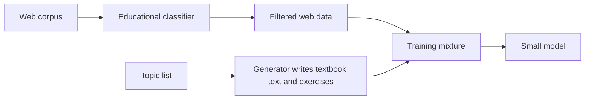

---
tags:
- engineering
- data
---

# Textbook-Quality Synthetic Data

Textbook-quality synthetic data is training material generated to be clear, well structured and educational, rather than large and varied. The approach was popularised by the phi-1 work, which trained a small code model on a mix of filtered web code and generated textbook-style text and exercises.

## Overview

Scaling data by volume brings in noise, repetition and low-value text. The idea behind textbook data is to select and create examples for their teaching value. A strong model writes explanations and exercises on chosen topics, a classifier filters the web data for educational content, and the small model learns from the combination. The bet is that a smaller, cleaner corpus can produce a more capable model than a larger, noisier one.

## Key concepts

- **Educational quality**: a score or classifier decision for whether a text explains a concept clearly and could serve as a lesson.
- **Topic coverage**: a list of concepts and skills that the generated material should cover, so that the data is not concentrated in one area.
- **Exercise generation**: problems paired with solutions, often with a short explanation, used to teach a skill directly.
- **Filtered web data**: existing web text kept only where a classifier judges it to be educational.

## How it works

The pipeline has three parts. A classifier, trained on labelled examples of educational text, scores web documents and keeps the high scorers. A generator, usually a larger model, writes textbook-style passages and exercises across a list of topics, with prompts that ask for clear explanations and varied problems. The two sources are combined, and a small model is trained on the mixture.

## Key methods

The key method is the data-selection pipeline. The paper argues that the composition of the training set, rather than the parameter count alone, drives performance on code tasks.

## Results

The paper reports that a 1.3-billion-parameter model trained on this mixture achieves strong code generation results for its size, competitive with much larger models on the benchmark it reports. Readers should check the paper for exact numbers and the benchmark conditions.

## Limitations

- **Benchmark overlap**: if the generated exercises resemble the evaluation tasks, results overstate general ability.
- **Teacher dependence**: the generated text reflects the generating model's knowledge and errors.
- **Narrow domain**: the paper focuses on code and simple reasoning, and its conclusions may not transfer to every domain.

## Open questions

- How much of the benefit comes from the classifier, and how much from the generated material?
- Can the approach give good results on domains where correctness is hard to check, such as history or medicine?

## References

### Seminal papers

- Gunasekar, S. et al. (2023). *Textbooks Are All You Need*. https://arxiv.org/abs/2306.11644 — Trains a small code model on filtered web data and generated textbook-style material, arguing that data quality can substitute for scale.

### Related work

- Eldan, R. & Li, Y. (2023). *TinyStories: How Small Can Language Models Be and Still Speak Coherent English?* https://arxiv.org/abs/2305.07759 — Uses controlled generated stories to show that carefully chosen data lets small models produce coherent text.
- Wang, Y. et al. (2023). *Self-Instruct: Aligning Language Models with Self-Generated Instructions*. https://arxiv.org/abs/2212.10560 — Uses model-generated instruction data without the educational selection step described here.
- Liu, Z. et al. (2024). *Best Practices and Lessons Learned on Synthetic Data*. https://arxiv.org/abs/2404.07503 — Reviews how filtering and generation choices affect the quality of synthetic training sets.
- Shumailov, I. et al. (2024). *AI models collapse when trained on recursively generated data*. Nature, 631. https://doi.org/10.1038/s41586-024-07566-y — Warns about the diversity loss that can follow when generated data dominates a training set.
