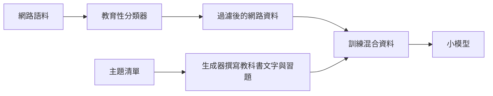

# 教科書品質的合成資料

教科書品質的合成資料，是為了清楚、結構完整與教學價值而生成的訓練材料，而不是為了數量與多樣性。這個做法由 phi-1 的工作推廣開來：該研究以經過過濾的網路程式碼，加上生成的教科書風格文字與習題，訓練一個小型程式碼模型。

## 概述

以數量擴大資料規模會引入雜訊、重複與低價值文字。教科書資料的想法，是依教學價值來挑選與建立範例。強模型針對選定的主題撰寫解說與習題，分類器過濾網路資料中的教育內容，小模型則從兩者的組合中學習。這個賭注是：較小、較乾淨的語料，可以訓練出比大型但雜亂語料更有能力的模型。

## 關鍵概念

- **教學品質**：判斷一段文字是否清楚解說概念、能否當作課程內容的分數或分類結果。
- **主題涵蓋**：生成材料應涵蓋的概念與技能清單，避免資料集中在某一領域。
- **習題生成**：配對解答的問題，通常附有簡短說明，用來直接教導某項技能。
- **過濾後的網路資料**：只保留分類器判斷為教育性的既有網路文字。

## 運作方式

流程分為三部分。分類器以標註過的教育文字範例訓練，為網路文件評分，保留高分的文件。生成器通常是較大的模型，依主題清單撰寫教科書式的段落與習題，提示中要求清楚解說與多樣的問題。兩個來源合併後，用這個混合資料訓練小模型。

## 關鍵方法

關鍵方法是資料挑選流程。論文主張，決定程式碼任務表現的是訓練集的組成，而不只是參數數量。

## 結果

論文指出，以這個混合資料訓練的 13 億參數模型，在程式碼生成上以其規模而言表現強勁，在其報告的基準上可與大得多的模型相比。確切數字與基準條件請以論文為準。

## 限制

- **基準重疊**：若生成的習題接近評估任務，結果會高估一般能力。
- **依賴生成者**：生成的文字反映生成模型的知識與錯誤。
- **領域狹窄**：論文聚焦於程式碼與簡單推理，結論未必能推廣到所有領域。

## 開放問題

- 增益有多少來自分類器，又有多少來自生成的材料？
- 在難以檢驗正確性的領域，例如歷史或醫學，這個方法能否得到好結果？

## 參考文獻

### 奠基性論文

- Gunasekar, S. et al. (2023). *Textbooks Are All You Need*. https://arxiv.org/abs/2306.11644 — 以經過過濾的網路資料與生成的教科書風格內容訓練小型程式碼模型，主張資料品質可以取代規模。

### 相關研究

- Eldan, R. & Li, Y. (2023). *TinyStories: How Small Can Language Models Be and Still Speak Coherent English?* https://arxiv.org/abs/2305.07759 — 以受控生成的簡單故事，顯示精心選擇的資料能讓小模型產生連貫的文字。
- Wang, Y. et al. (2023). *Self-Instruct: Aligning Language Models with Self-Generated Instructions*. https://arxiv.org/abs/2212.10560 — 使用模型生成的指令資料，但沒有這裡描述的教育性挑選步驟。
- Liu, Z. et al. (2024). *Best Practices and Lessons Learned on Synthetic Data*. https://arxiv.org/abs/2404.07503 — 回顧過濾與生成選擇如何影響合成訓練集的品質。
- Shumailov, I. et al. (2024). *AI models collapse when trained on recursively generated data*. Nature, 631. https://doi.org/10.1038/s41586-024-07566-y — 提醒當生成資料主導訓練集時，可能出現的多樣性損失。
