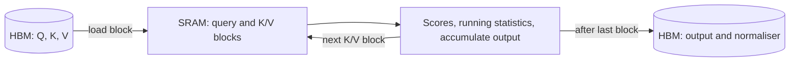

# FlashAttention and Fused Kernels

FlashAttention computes exact attention without writing the full matrix of attention scores to slow GPU memory. Fused kernels apply the same idea to neighbouring operations, so intermediate results stay on chip. Both work by reducing memory traffic, which often limits speed more than arithmetic does.

## Overview

Attention gives each token a weighted average over all other tokens, and its cost grows with the square of the sequence length. Approximations often did not run faster on real hardware. Dao et al. argued that attention algorithms should be *IO-aware*, counting reads and writes between levels of GPU memory as well as arithmetic.[^1]

FlashAttention applies that principle. It returns the same output as standard attention, up to rounding, and runs several times faster in the settings its authors report. The gain comes from fewer memory transfers, not fewer operations. The mathematics is in [Transformers & Attention](../../theory/models/transformer/index.md), and methods that change what is computed are in [Attention variants](../../theory/models/transformer/attention-variants/index.md).

## Key concepts

- **Memory hierarchy**: a GPU has large, slow high-bandwidth memory (HBM) and small, fast on-chip SRAM. Moving data between them can cost more than the arithmetic.
- **Tiling**: splitting inputs into blocks that fit in SRAM, and finishing all work on one block before the next.
- **Online softmax**: computing a softmax block by block, keeping a running maximum and sum, and rescaling earlier partial results when the maximum changes.
- **Arithmetic intensity**: floating-point operations per byte moved. The roofline model bounds performance by the lower of peak compute and intensity times bandwidth.[^2]
- **Fused kernel**: one GPU kernel performing several operations, so intermediates stay on chip.

## How it works

### Why memory limits attention

Standard attention computes

$$
S = \frac{QK^\top}{\sqrt{d}}, \qquad P = \operatorname{softmax}(S), \qquad O = PV
$$

for sequence length $N$ and head dimension $d$. Stored naively, the $N \times N$ matrices $S$ and $P$ are each written to HBM and read back, about $8N^2$ bytes of traffic under simple assumptions (two-byte values, masking and dropout ignored). The two matrix products need about $4N^2 d$ FLOPs. The intensity is therefore roughly $d/2$ FLOPs per byte, or about 64 for $d = 128$. Current accelerators can perform well over a hundred FLOPs per byte read from HBM, so the kernel is limited by data movement. This is the roofline argument applied to attention.[^2]

### Tiling and online softmax

FlashAttention splits $Q$ into row blocks and $K$, $V$ into column blocks. For each block of queries it streams over the key and value blocks:

1. Keep the query block in SRAM, with a running maximum and sum for each row and a zero output accumulator.
2. For each key and value block, compute the scores in SRAM, update the maximum and sum, rescale the accumulator to the new maximum, and add the weighted values.
3. After the last block, divide by the sum and write the output and one normaliser per row to HBM.

The rescaling is exact, since a partial sum taken against an old maximum converts to the new one by a single factor. Milakov and Gimelshein showed that this online normaliser computes softmax with fewer memory accesses.[^3]

The $N \times N$ matrix is never stored. The forward pass keeps only the output and one normaliser per row. The backward pass recomputes scores block by block, the same trade that [gradient checkpointing](mixed-precision-and-checkpointing.md) makes. Rabe and Staats had earlier shown that attention can be computed with memory that does not grow as $N^2$, although its runtime stays quadratic.[^4]

### Fused kernels beyond attention

Bias addition, activations, residual additions and normalisation each read and write whole tensors when run separately. Fused, the tensor is read and written once. Liger-Kernel is an open set of Triton kernels for LLM training that uses operation fusion and input chunking. Its authors report an average 20% gain in training throughput and 60% less GPU memory than Hugging Face implementations.[^5] For automatic fusion, see [ML Compilers and Kernel Languages](../frameworks/compilers-and-kernels.md).

## Key methods

| Method | Main change | Reported result |
|---|---|---|
| FlashAttention (Dao et al., 2022) | Tiling and online softmax; exact; recomputation in backward | 3× speed-up on GPT-2 at sequence length 1K |
| FlashAttention-2 (Dao, 2023) | Better parallelism and work split between thread blocks and warps | About 2× over FlashAttention; 50–73% of peak FLOPs/s on A100 |
| FlashAttention-3 (Shah et al., 2024) | Hopper asynchrony; FP8 with block quantisation | 1.5–2.0× over FlashAttention-2 on H100 in FP16; FP8 near 1.2 PFLOPs/s |
| Fused normalisation and MLP kernels (Liger-Kernel) | Fuse elementwise, normalisation and activation operations | Average 20% higher training throughput, 60% less memory |

FlashAttention-2 found that the original reached only 25–40% of peak FLOPs/s, because of how work was divided among thread blocks and warps. It parallelises over the sequence even for one head.[^6] FlashAttention-3 targets NVIDIA Hopper GPUs, where its authors state that FlashAttention-2 used only about 35% of an H100. It overlaps data movement with computation and interleaves matrix multiplication with softmax. Fused kernels cover the layers around attention instead.

## Connections

- **Approximation.** The [attention variants](../../theory/models/transformer/attention-variants/index.md) change the computation, while FlashAttention keeps it exact, so the two can be combined.
- **Inference.** Each decoding step reads the whole [KV cache](../../theory/models/transformer/kv-cache/index.md), so the kernel is even more memory-bound. [Grouped-query attention](../inference-optimization/grouped-query-attention.md) reduces that data, and [PagedAttention](../inference-optimization/paged-attention.md) changes its layout.
- **Training memory.** Recomputation is discussed in [mixed precision and checkpointing](mixed-precision-and-checkpointing.md), which also covers FP8. Hardware is in [AI Hardware](../hardware/index.md).
- **State-space models.** [Mamba-2](../../theory/models/ssm/selective-state-spaces/mamba-2/index.md) compares its kernel with FlashAttention-2 and finds FlashAttention-2 faster at short contexts.
- **Brain and mind.** Neuroscience uses "attention" for selecting information, which is covered in [Attention in brain and machine](../../brain-mind/attention-brain-machine/index.md). FlashAttention concerns how a fixed weighted average is computed. The contrast is instructive: in the brain, memory and computation are often described as sharing one substrate, whereas GPUs separate them. This is an analogy, not a mechanism.

## Applications

- **Long-context training.** Attention memory that grows linearly rather than quadratically makes long documents and code practical.[^6]
- **LLM training.** Fused kernel libraries such as Liger-Kernel plug into standard training loops.

## Open questions

- **Hardware specificity.** FlashAttention-3 relies on features of one GPU generation. Whether compilers can produce comparable kernels automatically is unresolved.
- **Low precision.** FP8 attention needs specific techniques to limit error, and long-run FP8 stability is still being studied.
- **Changing balance.** If memory bandwidth grows more slowly than compute, memory-aware algorithms will matter more. The rate is uncertain.
- **Reproducibility.** Tiled and fused kernels change the order of summation, so outputs can differ across block sizes and hardware.

## References

### Seminal papers

- Dao, T. et al. (2022). *FlashAttention: Fast and Memory-Efficient Exact Attention with IO-Awareness*. NeurIPS 2022. https://arxiv.org/abs/2205.14135 — Introduces tiled exact attention that reduces reads and writes between GPU high-bandwidth memory and on-chip SRAM.
- Dao, T. (2023). *FlashAttention-2: Faster Attention with Better Parallelism and Work Partitioning*. ICLR 2024. https://arxiv.org/abs/2307.08691 — Improves work partitioning across thread blocks and warps, so attention reaches a larger share of peak FLOPs/s.
- Shah, J. et al. (2024). *FlashAttention-3: Fast and Accurate Attention with Asynchrony and Low-precision*. NeurIPS 2024. https://arxiv.org/abs/2407.08608 — Uses Hopper asynchrony and FP8 block quantisation to speed up attention on H100 GPUs.
- Milakov, M. & Gimelshein, N. (2018). *Online normalizer calculation for softmax*. arXiv:1805.02867. https://arxiv.org/abs/1805.02867 — Computes softmax in fewer memory passes using running statistics.
- Rabe, M. N. & Staats, C. (2021). *Self-attention Does Not Need O(n²) Memory*. arXiv:2112.05682. https://arxiv.org/abs/2112.05682 — Shows attention can run in memory that does not grow with the square of sequence length.
- Williams, S., Waterman, A. & Patterson, D. (2009). *Roofline*. Communications of the ACM. https://doi.org/10.1145/1498765.1498785 — The roofline model, which relates performance to arithmetic intensity and memory bandwidth.

### Surveys and textbooks

- Tay, Y. et al. (2020). *Efficient Transformers: A Survey*. arXiv:2009.06732. https://arxiv.org/abs/2009.06732 — Surveys efficient Transformer variants that reduce the computation and memory of attention.

### Articles and documentation

- Hsu, P.-L. et al. (2024). *Liger Kernel: Efficient Triton Kernels for LLM Training*. arXiv:2410.10989. https://arxiv.org/abs/2410.10989 — Open-source Triton kernels for LLM training, built on operation fusion and input chunking.

[^1]: Dao et al. (2022) make this argument in their abstract.
[^2]: The bound is from Williams, Waterman and Patterson (2009). The traffic figures are this page's own estimate.
[^3]: Milakov and Gimelshein (2018) report up to 1.3 times faster softmax.
[^4]: Rabe and Staats (2021) report 59 times lower memory at sequence length 16,384.
[^5]: Hsu et al. (2024) report these averages across popular LLMs in their abstract.
[^6]: Dao (2023) reports these figures, including linear rather than quadratic attention memory, in the abstract.
