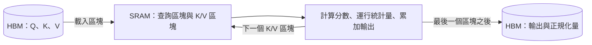

# 快閃注意力與融合核函式

快閃注意力（FlashAttention）在計算精確注意力時，不必把完整的注意力分數矩陣寫入速度較慢的 GPU 記憶體。融合核函式則把同一想法套用到相鄰的運算上，使中間結果留在晶片之上。兩者都是透過減少記憶體搬運來運作，而在許多現代加速器上，限制速度的往往是資料搬運而非算術運算。

## 概述

注意力讓每個 token 對所有其他 token 取加權平均，其成本隨序列長度的平方成長。近似方法常常在真實硬體上並不更快。Dao et al. 主張注意力演算法應當具備 *IO 感知*（IO-aware），除了計算量之外，也要計算 GPU 各層記憶體之間的讀寫次數。[^1]

快閃注意力應用了這項原則。它與標準注意力在捨入誤差範圍內得到相同的輸出，並在其作者所報告的設定中快上數倍。加速來自於減少記憶體傳輸，而非減少運算次數。數學推導見 [Transformer 與注意力](../../theory/models/transformer/index.md)，改變計算內容的方法見 [注意力變體](../../theory/models/transformer/attention-variants/index.zh-TW.md)。

## 關鍵概念

- **記憶體階層**：GPU 具有大而慢的高頻寬記憶體（HBM），以及小而快的晶片上 SRAM。兩者之間搬運資料的成本，可能超過算術運算本身。
- **分塊（tiling）**：把輸入切成能放入 SRAM 的區塊，並在處理下一個區塊之前，先完成目前區塊的全部運算。
- **線上 softmax（online softmax）**：逐塊計算 softmax，維護一個運行中的最大值與總和，並在最大值改變時重新縮放先前的部分結果。
- **算術強度（arithmetic intensity）**：每搬運一個位元組所對應的浮點運算數。屋頂線模型以峰值運算能力與「算術強度乘以頻寬」兩者中較低者，作為效能上限。[^2]
- **融合核函式（fused kernel）**：由單一 GPU 核函式執行多個運算，使中間值留在暫存器或 SRAM 中。

## 運作方式

### 為何記憶體限制了注意力

標準注意力的計算方式為

$$
S = \frac{QK^\top}{\sqrt{d}}, \qquad P = \operatorname{softmax}(S), \qquad O = PV
$$

其中序列長度為 $N$，注意力頭維度為 $d$。若直接實作，$N \times N$ 的矩陣 $S$ 與 $P$ 都會先寫入 HBM 再讀回，在簡化假設下（每個值兩個位元組，忽略遮罩與 dropout）約搬運 $8N^2$ 個位元組。兩次矩陣乘法則需要約 $4N^2 d$ 次浮點運算。因此算術強度約為每位元組 $d/2$ 次運算，當 $d = 128$ 時約為 64。現代加速器每從 HBM 讀取一個位元組，可執行的運算遠超過一百次，所以這個核函式受限於資料搬運。這就是把屋頂線論證套用到注意力上的結果。[^2]

### 分塊與線上 softmax

快閃注意力把 $Q$ 切成列區塊，把 $K$、$V$ 切成行區塊。對每一個查詢區塊，它依序串流處理所有的鍵與值區塊：

1. 把查詢區塊保留在 SRAM 中，為每一列初始化運行中的最大值與總和，並將輸出累加器設為零。
2. 對每個鍵值區塊，在 SRAM 中計算分數、更新最大值與總和，將累加器重新縮放到新的最大值，再加入此區塊的加權值。
3. 處理完最後一個區塊後，除以總和，並把輸出與每列一個的正規化量寫入 HBM。

這種重新縮放是精確的，因為以舊的最大值計算的部分總和，只需乘上一個因子即可轉換到新的最大值。Milakov 與 Gimelshein 指出，這種線上正規化量能以較少的記憶體存取計算 softmax。[^3]

$N \times N$ 的矩陣從不被儲存。前向傳播只保留輸出與每列一個的正規化量。反向傳播則以區塊為單位重新計算分數，這與[梯度檢查點](mixed-precision-and-checkpointing.zh-TW.md)所做的取捨相同。Rabe 與 Staats 更早已指出，注意力可以在不隨 $N^2$ 成長的記憶體中計算，但其運行時間仍為二次方。[^4]

### 注意力之外的融合核函式

偏置加法、激活函數、殘差加法與正規化，若各自獨立執行，每一步都要讀寫整個張量。融合之後，張量只需讀寫一次。Liger-Kernel 是一組開源的 Triton 核函式，用於 LLM 訓練，採用運算融合與輸入分塊。作者在多個常見 LLM 上報告，相較於 Hugging Face 的實作，平均訓練吞吐量提高 20%，GPU 記憶體用量減少 60%。[^5] 自動融合的部分，請見 [ML 編譯器與核函式語言](../frameworks/compilers-and-kernels.zh-TW.md)。

## 主要方法

| 方法 | 主要改變 | 報告的結果 |
|---|---|---|
| FlashAttention（Dao et al., 2022） | 分塊與線上 softmax；精確；反向傳播時重新計算 | 序列長度 1K 時，GPT-2 上快 3 倍 |
| FlashAttention-2（Dao, 2023） | 改善執行緒區塊與 warp 之間的平行化與工作分配 | 相較 FlashAttention 約快 2 倍；在 A100 上達峰值 FLOPs/s 的 50–73% |
| FlashAttention-3（Shah et al., 2024） | Hopper 非同步執行；FP8 搭配區塊量化 | 在 H100 上以 FP16 比 FlashAttention-2 快 1.5–2.0 倍；FP8 接近 1.2 PFLOPs/s |
| 融合正規化與 MLP 核函式（Liger-Kernel） | 融合逐元素、正規化與激活運算 | 訓練吞吐量平均提高 20%，記憶體減少 60% |

FlashAttention-2 發現，原始版本只達到峰值 FLOPs/s 的 25–40%，原因在於工作在執行緒區塊與 warp 之間的分配方式。它甚至在單一注意力頭的情況下，也會沿序列維度平行化。[^6] FlashAttention-3 以 NVIDIA Hopper GPU 為目標，其作者指出 FlashAttention-2 在 H100 上只用了約 35% 的效能。它讓資料搬運與運算重疊，並把分塊矩陣乘法與 softmax 交錯執行。融合核函式則處理注意力周圍的各層，而非注意力本身。

## 相關連結

- **近似。**[注意力變體](../../theory/models/transformer/attention-variants/index.zh-TW.md)改變了計算內容，而快閃注意力保持計算的精確性，因此兩者可以結合。
- **推論。**每個解碼步驟都要讀取整個 [KV 快取](../../theory/models/transformer/kv-cache/index.zh-TW.md)，使核函式更受記憶體限制。[分組查詢注意力](../inference-optimization/grouped-query-attention.zh-TW.md)減少讀取的資料量，[PagedAttention](../inference-optimization/paged-attention.zh-TW.md)則改變其記憶體佈局。
- **訓練記憶體。**重新計算的取捨在[混合精度與梯度檢查點](mixed-precision-and-checkpointing.zh-TW.md)中討論，該頁也涵蓋 FP8。硬體見 [AI 硬體](../hardware/index.zh-TW.md)。
- **狀態空間模型。**[Mamba-2](../../theory/models/ssm/selective-state-spaces/mamba-2/index.zh-TW.md)將其核函式與 FlashAttention-2 比較，並發現在較短的上下文中 FlashAttention-2 較快。
- **腦與心智。**神經科學以「注意力」指選擇資訊，相關內容見[腦與機器中的注意力](../../brain-mind/attention-brain-machine/index.zh-TW.md)。快閃注意力處理的則是如何計算一個固定的加權平均。兩者的對照頗具啟發性：在大腦中，記憶與運算常被描述為共用同一個基質，而 GPU 則將兩者分開，使資料搬運變得昂貴。這只是類比，而非機制。

## 應用

- **長上下文訓練。**注意力所需的記憶體隨序列長度線性成長，而非二次方成長，使長文件與程式碼的訓練變得可行。[^6]
- **LLM 訓練。**Liger-Kernel 等融合核函式函式庫，可直接接入標準訓練迴圈。

## 開放問題

- **硬體特定性。**FlashAttention-3 依賴某一代 GPU 的特性。編譯器能否自動產生同等的核函式，尚無定論。
- **低精度。**FP8 注意力需要特定技術來限制誤差，而 FP8 在長時間訓練中的穩定性仍在研究中。
- **運算與頻寬比例的變化。**若記憶體頻寬的成長慢於運算能力，重視記憶體的演算法將更加重要。變化速度並不確定。
- **可重現性。**分塊與融合核函式會改變加總的順序，因此在不同區塊大小與硬體上，輸出可能不同。

## 參考文獻

### 開創性論文

- Dao, T. et al. (2022). *FlashAttention: Fast and Memory-Efficient Exact Attention with IO-Awareness*. NeurIPS 2022. https://arxiv.org/abs/2205.14135 — 提出分塊的精確注意力，減少 GPU 高頻寬記憶體與晶片上 SRAM 之間的讀寫。
- Dao, T. (2023). *FlashAttention-2: Faster Attention with Better Parallelism and Work Partitioning*. ICLR 2024. https://arxiv.org/abs/2307.08691 — 改善執行緒區塊與 warp 之間的工作分配，使注意力達到更大比例的峰值 FLOPs/s。
- Shah, J. et al. (2024). *FlashAttention-3: Fast and Accurate Attention with Asynchrony and Low-precision*. NeurIPS 2024. https://arxiv.org/abs/2407.08608 — 利用 Hopper 的非同步執行與 FP8 區塊量化，加速 H100 GPU 上的注意力。
- Milakov, M. & Gimelshein, N. (2018). *Online normalizer calculation for softmax*. arXiv:1805.02867. https://arxiv.org/abs/1805.02867 — 以運行統計量在較少的記憶體遍歷中計算 softmax。
- Rabe, M. N. & Staats, C. (2021). *Self-attention Does Not Need O(n²) Memory*. arXiv:2112.05682. https://arxiv.org/abs/2112.05682 — 說明注意力可以在不隨序列長度平方成長的記憶體中執行。
- Williams, S., Waterman, A. & Patterson, D. (2009). *Roofline*. Communications of the ACM. https://doi.org/10.1145/1498765.1498785 — 屋頂線模型，將效能與算術強度及記憶體頻寬相連。

### 綜述與教科書

- Tay, Y. et al. (2020). *Efficient Transformers: A Survey*. arXiv:2009.06732. https://arxiv.org/abs/2009.06732 — 綜述降低注意力計算量與記憶體用量的高效 Transformer 變體。

### 文章與文件

- Hsu, P.-L. et al. (2024). *Liger Kernel: Efficient Triton Kernels for LLM Training*. arXiv:2410.10989. https://arxiv.org/abs/2410.10989 — 用於 LLM 訓練的開源 Triton 核函式，以運算融合與輸入分塊為基礎，並報告吞吐量與記憶體的改善。

[^1]: Dao et al. (2022) 在摘要中提出此論點。
[^2]: 此上限出自 Williams、Waterman 與 Patterson（2009）。記憶體搬運量為本頁作者自行估算。
[^3]: Milakov 與 Gimelshein（2018）報告 softmax 最多快 1.3 倍。
[^4]: Rabe 與 Staats（2021）報告在序列長度 16,384 時，記憶體減少為 59 分之一。
[^5]: Hsu et al.（2024）在摘要中報告這些在多個常見 LLM 上的平均值。
[^6]: Dao（2023）在摘要中報告這些數字，包括注意力記憶體是線性而非二次方成長。
