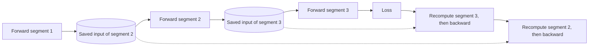

# Mixed-Precision Training and Gradient Checkpointing

Mixed-precision training runs most of a network's arithmetic in 16-bit or 8-bit floating-point formats, keeping a full-precision copy of the weights where accuracy depends on it. Gradient checkpointing reduces activation memory by discarding intermediate results in the forward pass and recomputing them in the backward pass.

## Overview

Training is limited by the speed of arithmetic units and by the memory on each accelerator. Mixed precision shrinks each number, so arithmetic is faster and stored tensors are smaller. Checkpointing stores less and computes more. Large runs usually combine the two. Neither is the "checkpointing" of the [training overview](index.md), which means saving model state to disk so a run can resume after a failure.

## Key concepts

- **Floating-point format**: a sign, an exponent and a mantissa. The exponent sets the range of magnitudes and the mantissa the precision. FP32 has 8 exponent and 23 mantissa bits, FP16 has 5 and 10, and BF16 has 8 and 7.
- **Master weights**: a full-precision copy of the parameters, updated by the optimiser. The low-precision copy used in computation is rounded from it.
- **Loss scaling**: the loss is multiplied by a constant before the backward pass so small gradients do not underflow, and the gradients are divided by it before the update.
- **Activations**: the intermediate outputs of each layer, which the backward pass needs. For large batches and long sequences they are often the biggest memory cost.
- **Recomputation**: running part of the forward pass again to rebuild activations that were not stored.

## How it works

### Mixed precision

In a typical scheme, matrix multiplications take low-precision inputs and accumulate in FP32. The optimiser updates FP32 master weights, which are cast back to low precision for the next forward pass. Micikevicius et al. introduced this recipe for FP16 in 2017, adding the master copy and loss scaling.[^1]

Loss scaling is needed because FP16's narrow exponent range turns small gradients into zeros. BF16 keeps the exponent range of FP32 and gives up mantissa bits, so it rarely needs loss scaling. Kalamkar et al. found that BF16 matched FP32 results across several domains without hyperparameter changes.

FP8 uses 8 bits per value, in two encodings: E4M3 (4 exponent, 3 mantissa bits) and E5M2 (5 and 2). Its range is so small that each tensor is multiplied by a scale $s$ chosen so its largest value fits the format:

$$
s = \frac{x^{\max}_{\text{FP8}}}{\max_i |x_i|}
$$

Later work extended FP8 to optimiser states and to whole LLM training runs, and reported that instabilities can appear only after long training.[^4]

### Memory accounting

Mixed precision does not shrink everything. For a parameter trained with Adam, the static state in the mixed-precision recipe is:

| Item | Format | Bytes per parameter |
|---|---|---|
| Weights used in computation | FP16 or BF16 | 2 |
| Gradients | FP16 or BF16 | 2 |
| Master weights | FP32 | 4 |
| Adam first and second moments | FP32 | 8 |
| **Total, before activations** | | **16** |

Pure FP32 Adam also needs 16 bytes per parameter. The saving therefore comes mainly from activations, which are stored in low precision, and from faster arithmetic. Shrinking the static state is a separate problem, solved by sharding it across devices, as [ZeRO](../distributed-training/zero.md) does.

### Gradient checkpointing

A standard backward pass stores every layer's activations, so memory grows with depth $n$. Checkpointing keeps only the inputs of selected segments. In the backward pass, each segment is run forward again from its saved input and then backpropagated.

Placing checkpoints about $\sqrt{n}$ layers apart stores on the order of $\sqrt{n}$ activations, for one extra forward pass per mini-batch.[^5] Griewank and Walther had earlier derived schedules for reverse-mode differentiation that are provably optimal under stated criteria.

Recomputing whole layers repeats costly matrix multiplications. Korthikanti et al. recompute only the cheaper parts of each Transformer layer, combined with sequence parallelism, which cut activation memory fivefold and most of the recomputation overhead in their setting.[^7]

## Key methods

| Method | What it saves | What it costs | Source |
|---|---|---|---|
| FP16 mixed precision with loss scaling | Activation and gradient memory; faster matrix multiplication | Loss scaling; narrow exponent range | Micikevicius et al. (2017) |
| BF16 mixed precision | As FP16, usually without loss scaling | Fewer mantissa bits than FP16 | Kalamkar et al. (2019) |
| FP8 training | Further storage and bandwidth savings | Per-tensor scaling; long-run instabilities | Micikevicius et al. (2022); Peng et al. (2023); Fishman et al. (2024) |
| Gradient checkpointing | Activation memory, to about $\sqrt{n}$ | One extra forward pass | Chen et al. (2016) |
| Selective recomputation | Activation memory, about fivefold in their setting | Choosing which operations to recompute | Korthikanti et al. (2022) |

## Connections

[LoRA](peft-lora.md) freezes most weights, so gradients and optimiser state are needed only for the small adapters. For precision after training, see [post-training quantisation](../../theory/model-compression/quantisation/post-training/index.md); the [mixed-precision quantisation](../../theory/model-compression/quantisation/mixed-precision/index.md) page uses the same words for choosing bit widths per layer, a different problem. The formats a chip supports are covered in [AI hardware](../hardware/index.md). Dao et al.'s FlashAttention applies the same memory-traffic logic inside an attention kernel, by tiling.

The brain link is loose. Biological neurons do not compute with 16-bit floats, and their signalling is sparse and event-driven, an idea that [spiking networks](../../brain-mind/snn-neuromorphic/index.md) use for energy efficiency. A spike is a binary event in time, not a number in a format. Whether the brain keeps anything like a full activation history for learning is unknown, and many biologically motivated learning rules avoid needing one.

## Applications

- Large language models are commonly pre-trained in BF16 mixed precision, and some recent runs use FP8.[^4]
- Long-sequence training, where activations dominate memory, relies on checkpointing and selective recomputation.

## Open questions

- **Long-run stability.** Fishman et al. traced FP8 instability to SwiGLU and proposed Smooth-SwiGLU to address it. Whether such fixes generalise to other architectures is unclear.
- **Optimal checkpoint placement.** Jain et al. solve rematerialisation with off-the-shelf MILP solvers and report inputs up to 5.1 times larger.[^8] Whether optimal schedules are worth their planning cost in everyday practice is an engineering judgement.
- **Lower precision for optimiser state.** Peng et al. and Fishman et al. quantise gradients and Adam moments to FP8 in specific settings. How far this extends across scales and tasks is open.

[^1]: Micikevicius et al. (2017) report memory reductions of nearly 2x.
[^4]: Peng et al. (2023) report 39% lower memory and 75% higher speed than BF16 for GPT-175B, as measured by the authors.
[^5]: Chen et al. (2016) report memory falling from 48 GB to 7 GB for a 1,000-layer network.
[^7]: Korthikanti et al. (2022) report 5x less activation memory and over 90% less recomputation overhead.
[^8]: Jain et al. (2019) report inputs up to 5.1 times larger.

## References

### Seminal papers

- Micikevicius, P. et al. (2017). *Mixed Precision Training*. arXiv:1710.03740. https://arxiv.org/abs/1710.03740 — Introduces FP32 master weights and loss scaling for half-precision training.
- Kalamkar, D. et al. (2019). *A Study of BFLOAT16 for Deep Learning Training*. arXiv:1905.12322. https://arxiv.org/abs/1905.12322 — Shows BF16 training matches FP32 results across several domains.
- Micikevicius, P. et al. (2022). *FP8 Formats for Deep Learning*. arXiv:2209.05433. https://arxiv.org/abs/2209.05433 — Defines the E4M3 and E5M2 FP8 formats and tests them on training tasks.
- Chen, T. et al. (2016). *Training Deep Nets with Sublinear Memory Cost*. arXiv:1604.06174. https://arxiv.org/abs/1604.06174 — Trades recomputed activations for sublinear memory in network depth.
- Griewank, A. & Walther, A. (2000). *Algorithm 799: revolve*. ACM Transactions on Mathematical Software. https://doi.org/10.1145/347837.347846 — Presents provably optimal checkpointing schedules for reverse-mode differentiation.
- Rajbhandari, S. et al. (2019). *ZeRO: Memory Optimizations Toward Training Trillion Parameter Models*. arXiv:1910.02054. https://arxiv.org/abs/1910.02054 — Partitions optimiser state, gradients and parameters across devices.
- Korthikanti, V. et al. (2022). *Reducing Activation Recomputation in Large Transformer Models*. arXiv:2205.05198. https://arxiv.org/abs/2205.05198 — Introduces selective recomputation for large Transformer training.
- Jain, P. et al. (2019). *Checkmate: Breaking the Memory Wall with Optimal Tensor Rematerialization*. arXiv:1910.02653. https://arxiv.org/abs/1910.02653 — Solves rematerialisation as an optimisation problem with MILP solvers.
- Peng, H. et al. (2023). *FP8-LM: Training FP8 Large Language Models*. arXiv:2310.18313. https://arxiv.org/abs/2310.18313 — Extends FP8 to gradients and optimiser states for LLM training.
- Fishman, M. et al. (2024). *Scaling FP8 training to trillion-token LLMs*. arXiv:2409.12517. https://arxiv.org/abs/2409.12517 — Trains LLMs in FP8 on up to two trillion tokens.
- Dao, T. et al. (2022). *FlashAttention: Fast and Memory-Efficient Exact Attention with IO-Awareness*. arXiv:2205.14135. https://arxiv.org/abs/2205.14135 — Tiled exact attention that reduces GPU memory traffic.

### Surveys and textbooks

- Griewank, A. & Walther, A. (2008). *Evaluating Derivatives*. SIAM. https://doi.org/10.1137/1.9780898717761 — Standard reference on automatic differentiation and reverse-mode storage costs.
