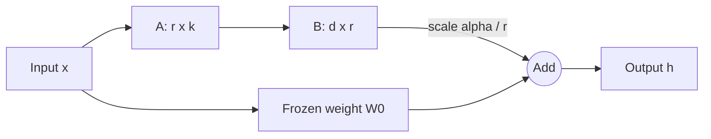

# LoRA, QLoRA and Parameter-Efficient Fine-Tuning

Parameter-efficient fine-tuning (PEFT) adapts a large pre-trained model to a new task by training a small number of parameters while the original weights stay frozen. LoRA, its quantised variant QLoRA and their relatives are now the usual way to customise large language models on modest hardware.

## Overview

Full fine-tuning updates every weight, needing optimiser memory for all of them and a full model copy per task. The [general approach to fine-tuning](../../theory/paradigms/transfer/fine-tuning-and-adaptation/index.md) is covered elsewhere. PEFT methods keep the base model fixed and place a small set of trainable parameters elsewhere: in bottleneck modules (adapters), in extra vectors the model attends to (prefix and prompt tuning), or in low-rank changes to existing weight matrices (LoRA). The shared bet is that the change a new task needs is small.

## Key concepts

- **Frozen base model**: the pre-trained weights \(W_0\) receive no updates.
- **Low-rank update**: a change \(\Delta W\) of size \(d \times k\) is written as \(BA\), with \(B\) of size \(d \times r\) and \(A\) of size \(r \times k\). This has \(r(d+k)\) parameters instead of \(dk\) when \(r\) is small.
- **Rank and scale**: \(r\) sets the capacity of the update, which is multiplied by \(\alpha / r\). Changing \(r\) while keeping \(\alpha\) fixed also changes the size of the update.
- **Soft prompt**: learned continuous vectors that the model processes like tokens, though they are not words.

## How it works

### LoRA

For a linear layer with weight \(W_0\), LoRA computes

$$
h = W_0 x + \frac{\alpha}{r}\, B A x
$$

with \(A\) initialised randomly and \(B\) initialised to zero. The zero start makes the update vanish at the beginning, so training begins from the pre-trained model. The original paper adapted the query and value projections of attention and reported large savings against full fine-tuning of GPT-3.[^1] Later practice often adapts every projection, including the feed-forward layers of a [Transformer](../../theory/models/transformer/index.md).

After training, \(BA\) can be added to \(W_0\) once, so inference costs the same as the original model. Adapters, by contrast, add layers that run at every step.

### QLoRA

QLoRA runs the frozen base model in 4 bits and backpropagates through it into LoRA adapters kept at higher precision. It adds a 4-bit NormalFloat data type, double quantisation of the quantisation constants, and paged optimisers that absorb memory spikes.[^2] [Post-training quantisation](../../theory/model-compression/quantisation/post-training/index.md) quantises a model once and leaves it fixed; QLoRA keeps the quantised base fixed but still trains adapters through it.

### Variants

- **DoRA** splits each weight into a magnitude and a direction, applies LoRA only to the direction, and trains the magnitude directly.
- **rsLoRA** replaces the scale \(\alpha / r\) with \(\alpha / \sqrt{r}\), arguing that the original scale slows learning at high rank.
- **LoRA+** uses different learning rates for \(A\) and \(B\), to improve feature learning.

### Merging adapters

A LoRA update can be merged into the base weights, or kept separate and loaded on demand. Merging several task-specific models is a related problem: task arithmetic adds or negates task vectors, and TIES-Merging resolves the sign conflicts that cause interference between them.

## Key methods

| Method | What is trained | Inference cost | Notes |
|---|---|---|---|
| Adapters (Houlsby et al., 2019) | Bottleneck modules in each layer | Extra layers at every step | Close to full fine-tuning on GLUE |
| Prefix tuning (Li and Liang, 2021) | Continuous keys and values at every layer | Longer attention context | Outperforms fine-tuning with little data |
| Prompt tuning (Lester et al., 2021) | Soft tokens at the input | Slightly longer input | Competitive only at large scale |
| LoRA (Hu et al., 2021) | Low-rank update to weight matrices | None once merged | Default for most LLM adaptation |
| QLoRA (Dettmers et al., 2023) | LoRA on a 4-bit frozen base | None once merged | Fine-tunes large models on one GPU |
| DoRA (Liu et al., 2024) | Magnitude plus low-rank direction | None once merged | Improves on LoRA on several benchmarks |

Adapters came within 0.4% of full fine-tuning on GLUE, adding 3.6% of the parameters per task.[^3] Prefix tuning trains about 0.1% of the parameters and matches fine-tuning when data is plentiful.[^4]

## Connections

PEFT responds to [continual learning](../../theory/paradigms/continual/index.md), where training on a new task overwrites weights that served an old one. Kirkpatrick et al. protect the weights that matter for earlier tasks, an idea inspired by synaptic consolidation. PEFT takes a blunter route by leaving the original weights untouched. The biology is in [memory and learning in the brain](../../brain-mind/memory-learning/index.md); the analogy is loose, and nothing shows that the brain learns through low-rank updates.

PEFT is common in [LLM post-training](../../theory/models/llm/instructgpt-rlhf/index.md). [Distillation](../../theory/model-compression/knowledge-distillation/llm-distillation/index.md) trains a new network, whereas PEFT changes a frozen one. Serving many adapters is an [inference](../inference-optimization/index.md) problem.

## Applications

- Per-customer or per-language adapters sharing one base model.
- Fine-tuning large open-weight models on one GPU with QLoRA.

## Open questions

- **When does PEFT match full fine-tuning?** Low intrinsic dimensionality suggests small updates can be enough (Aghajanyan et al., 2020). Yet LoRA substantially underperformed full fine-tuning for code and mathematics with large training sets (Biderman et al., 2024), and methods that beat LoRA often lose their edge under limited tuning (Lialin et al., 2023).
- **Scale and learning rates.** rsLoRA and LoRA+ suggest the default settings are not optimal, and the best combination is not settled.
- **Many adapters at once.** TIES reduces interference between merged models; whether it scales to many adapters is not settled.

[^1]: Hu et al. (2021) report that, against fine-tuning GPT-3 175B with Adam, LoRA cuts trainable parameters by 10,000 times and GPU memory requirement by three times.
[^2]: Dettmers et al. (2023) report fine-tuning a 65B-parameter model on a single 48 GB GPU, with performance the authors state matches 16-bit fine-tuning.
[^3]: Houlsby et al. (2019) report that, on the GLUE benchmark, their adapters attain within 0.4% of the performance of full fine-tuning while adding only 3.6% parameters per task.
[^4]: Li and Liang (2021) report that learning only 0.1% of the parameters gives performance comparable to fine-tuning when the full dataset is used.

## References

### Seminal papers

- Hu, E. J. et al. (2021). *LoRA: Low-Rank Adaptation of Large Language Models*. arXiv:2106.09685. https://arxiv.org/abs/2106.09685 — Introduces the frozen-weight low-rank update used throughout this page.
- Dettmers, T. et al. (2023). *QLoRA: Efficient Finetuning of Quantized LLMs*. arXiv:2305.14314. https://arxiv.org/abs/2305.14314 — Trains LoRA adapters on a 4-bit frozen base model.
- Houlsby, N. et al. (2019). *Parameter-Efficient Transfer Learning for NLP*. arXiv:1902.00751. https://arxiv.org/abs/1902.00751 — Introduces bottleneck adapter modules, tested on 26 BERT tasks.
- Li, X. L. & Liang, P. (2021). *Prefix-Tuning: Optimizing Continuous Prompts for Generation*. arXiv:2101.00190. https://arxiv.org/abs/2101.00190 — Learns prefix vectors while the language model stays frozen.
- Lester, B., Al-Rfou, R. & Constant, N. (2021). *The Power of Scale for Parameter-Efficient Prompt Tuning*. arXiv:2104.08691. https://arxiv.org/abs/2104.08691 — Shows soft-prompt tuning matching model tuning as models grow.
- Liu, S.-Y. et al. (2024). *DoRA: Weight-Decomposed Low-Rank Adaptation*. arXiv:2402.09353. https://arxiv.org/abs/2402.09353 — Splits weights into magnitude and direction, applying LoRA to the direction.
- Kalajdzievski, D. (2023). *A Rank Stabilization Scaling Factor for Fine-Tuning with LoRA*. arXiv:2312.03732. https://arxiv.org/abs/2312.03732 — Argues that LoRA should be scaled by the square root of the rank.
- Hayou, S., Ghosh, N. & Yu, B. (2024). *LoRA+: Efficient Low Rank Adaptation of Large Models*. arXiv:2402.12354. https://arxiv.org/abs/2402.12354 — Uses different learning rates for the two LoRA matrices to improve training.
- Kirkpatrick, J. et al. (2016). *Overcoming catastrophic forgetting in neural networks*. arXiv:1612.00796. https://arxiv.org/abs/1612.00796 — Slows learning on weights important for earlier tasks, inspired by synaptic consolidation.
- Aghajanyan, A., Zettlemoyer, L. & Gupta, S. (2020). *Intrinsic Dimensionality Explains the Effectiveness of Language Model Fine-Tuning*. arXiv:2012.13255. https://arxiv.org/abs/2012.13255 — Shows fine-tuning succeeds in a low-dimensional reparameterisation.
- Ilharco, G. et al. (2022). *Editing Models with Task Arithmetic*. arXiv:2212.04089. https://arxiv.org/abs/2212.04089 — Defines task vectors from weight differences that can be added or negated.
- Yadav, P. et al. (2023). *TIES-Merging: Resolving Interference When Merging Models*. arXiv:2306.01708. https://arxiv.org/abs/2306.01708 — Reduces parameter interference when several fine-tuned models are merged.

### Surveys and textbooks

- Lialin, V. et al. (2023). *Scaling Down to Scale Up: A Guide to Parameter-Efficient Fine-Tuning*. arXiv:2303.15647. https://arxiv.org/abs/2303.15647 — Taxonomy and head-to-head comparison of PEFT methods with a cost analysis.

### Lectures and videos

(none checked for this page)

### Articles and documentation

- Biderman, D. et al. (2024). *LoRA Learns Less and Forgets Less*. arXiv:2405.09673. https://arxiv.org/abs/2405.09673 — Empirical comparison of LoRA and full fine-tuning on code and mathematics.
