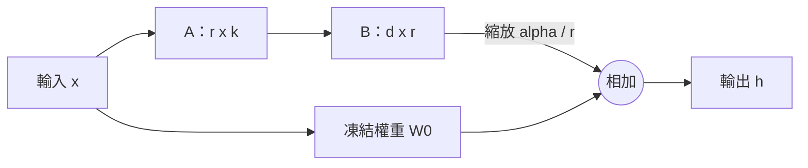

# LoRA、QLoRA 與參數高效微調

參數高效微調（PEFT）讓大型預訓練模型適應新任務的方式，是在原始權重保持凍結的同時，只訓練少量參數。LoRA、其量化版本 QLoRA，以及它們的相關方法，如今已是在一般硬體上客製化大型語言模型的常見做法。

## 概述

全參數微調會更新每一個權重，因此需要為所有權重保存最佳化器的記憶體，而且每個任務都要有一份完整的模型副本。[微調與適應](../../theory/paradigms/transfer/fine-tuning-and-adaptation/index.md)的一般做法已在其他頁面說明。PEFT 方法則讓基底模型保持固定，把少量可訓練參數放在別處：放在瓶頸模組（適配器）中、放在模型會注意的額外向量中（前綴與提示微調），或放在既有權重矩陣的低秩變化中（LoRA）。這些方法共同的假設是，新任務所需的改變很小。

## 關鍵概念

- **凍結的基底模型**：預訓練權重 \(W_0\) 不會被更新。
- **低秩更新**：大小為 \(d \times k\) 的變化 \(\Delta W\) 寫成 \(BA\)，其中 \(B\) 為 \(d \times r\)，\(A\) 為 \(r \times k\)。當 \(r\) 很小時，參數數量為 \(r(d+k)\)，而非 \(dk\)。
- **秩與縮放**：\(r\) 決定更新的容量，更新會乘上 \(\alpha / r\)。若保持 \(\alpha\) 不變而改變 \(r\)，更新的大小也會隨之改變。
- **軟提示**：學習得到的連續向量。模型像處理詞元一樣處理它們，但它們並不是文字。

## 運作方式

### LoRA

對於權重為 \(W_0\) 的線性層，LoRA 計算

$$
h = W_0 x + \frac{\alpha}{r}\, B A x
$$

其中 \(A\) 以隨機方式初始化，\(B\) 初始化為零。零初始化使更新在一開始為零，因此訓練從預訓練模型出發。原論文調整的是注意力的查詢與數值投影，並報告相較於以全參數微調 GPT-3 的大幅節省。[^1]後來的實務常會調整每一個投影，包括 [Transformer](../../theory/models/transformer/index.md) 的前饋層。

訓練後，\(BA\) 可以一次加回 \(W_0\)，因此推論成本與原模型相同。適配器則不同，它會增加在每個步驟都要執行的層。

### QLoRA

QLoRA 以 4 位元執行凍結的基底模型，並將梯度反向傳播穿過它，回到以較高精度保存的 LoRA 適配器。它加入了 4 位元的 NormalFloat 資料型別、對量化常數再做量化的雙重量化，以及可吸收記憶體尖峰的分頁式最佳化器。[^2][訓練後量化](../../theory/model-compression/quantisation/post-training/index.md)是把模型量化一次後就固定不動；QLoRA 同樣讓量化後的基底保持固定，但仍會透過它訓練適配器。

### 變體

- **DoRA** 把每個權重拆成大小與方向兩部分，只把 LoRA 套用在方向上，並直接訓練大小。
- **rsLoRA** 把縮放 \(\alpha / r\) 換成 \(\alpha / \sqrt{r}\)，其論點是原本的縮放會在高秩時減慢學習。
- **LoRA+** 對 \(A\) 與 \(B\) 使用不同的學習率，以改善特徵學習。

### 合併適配器

LoRA 更新可以合併進基底權重，也可以另外保存，需要時再載入。合併多個任務專用的模型是相關問題：任務算術會對任務向量做加法或減法，而 TIES-Merging 會解決它們之間造成干擾的符號衝突。

## 主要方法

| 方法 | 訓練的部分 | 推論成本 | 說明 |
|---|---|---|---|
| 適配器（Houlsby et al., 2019） | 每一層中的瓶頸模組 | 每個步驟都要多執行幾層 | 在 GLUE 上接近全參數微調 |
| 前綴微調（Li and Liang, 2021） | 每一層的連續鍵與值 | 注意力的脈絡變長 | 資料很少時優於微調 |
| 提示微調（Lester et al., 2021） | 輸入端的軟詞元 | 輸入略為變長 | 只有在大規模時才有競爭力 |
| LoRA（Hu et al., 2021） | 權重矩陣的低秩更新 | 合併後無額外成本 | 多數 LLM 適應的預設選擇 |
| QLoRA（Dettmers et al., 2023） | 4 位元凍結基底上的 LoRA | 合併後無額外成本 | 在單一 GPU 上微調大型模型 |
| DoRA（Liu et al., 2024） | 大小加上低秩方向 | 合併後無額外成本 | 在多項基準上優於 LoRA |

適配器在 GLUE 上達到與全參數微調相差 0.4% 以內的表現，每個任務只增加 3.6% 的參數。[^3]前綴微調只訓練約 0.1% 的參數，在資料充足時可與微調相當。[^4]

## 相關連結

PEFT 回應的是[持續學習](../../theory/paradigms/continual/index.md)中的問題：在新任務上訓練，會覆寫服務舊任務的權重。Kirkpatrick et al. 保護對早先任務重要的權重，其靈感來自突觸鞏固。PEFT 則採取更粗略的做法，直接不去改動原始權重。生物學面向見[大腦中的記憶與學習](../../brain-mind/memory-learning/index.md)；兩者的類比很粗略，目前也沒有證據顯示大腦是透過低秩更新學習。

PEFT 常見於 [LLM 後訓練](../../theory/models/llm/instructgpt-rlhf/index.md)。[知識蒸餾](../../theory/model-compression/knowledge-distillation/llm-distillation/index.md)是訓練一個新的網路，而 PEFT 則是改動一個凍結的網路。同時服務許多適配器則是[推論](../inference-optimization/index.md)的問題。

## 應用

- 多位客戶或多種語言各自使用適配器，共享同一個基底模型。
- 以 QLoRA 在單一 GPU 上微調大型開放權重模型。

## 開放問題

- **PEFT 何時能與全參數微調相當？** Aghajanyan et al. 指出，微調可在低維子空間中成功，這顯示小幅更新有時已足夠（Aghajanyan et al., 2020）。然而，在大量訓練資料的程式碼與數學任務上，LoRA 仍明顯落後於全參數微調（Biderman et al., 2024）；而在調參有限時，超越 LoRA 的方法往往失去優勢（Lialin et al., 2023）。
- **縮放與學習率。** rsLoRA 與 LoRA+ 顯示預設設定並非最佳，而最佳組合仍未定論。
- **同時使用許多適配器。** TIES 能減少合併模型之間的干擾；它是否能擴展到大量適配器，目前仍未確定。

## 參考文獻

### 開創性論文

- Hu, E. J. 等人 (2021). *LoRA: Low-Rank Adaptation of Large Language Models*. arXiv:2106.09685. https://arxiv.org/abs/2106.09685 — 提出本頁各方法所依據的凍結權重低秩更新。
- Dettmers, T. 等人 (2023). *QLoRA: Efficient Finetuning of Quantized LLMs*. arXiv:2305.14314. https://arxiv.org/abs/2305.14314 — 在 4 位元凍結基底模型上訓練 LoRA 適配器。
- Houlsby, N. 等人 (2019). *Parameter-Efficient Transfer Learning for NLP*. arXiv:1902.00751. https://arxiv.org/abs/1902.00751 — 提出瓶頸式適配器模組，並在 BERT 的 26 項任務上測試。
- Li, X. L. & Liang, P. (2021). *Prefix-Tuning: Optimizing Continuous Prompts for Generation*. arXiv:2101.00190. https://arxiv.org/abs/2101.00190 — 在語言模型保持凍結時學習前綴向量。
- Lester, B., Al-Rfou, R. & Constant, N. (2021). *The Power of Scale for Parameter-Efficient Prompt Tuning*. arXiv:2104.08691. https://arxiv.org/abs/2104.08691 — 顯示隨模型變大，軟提示微調會逼近模型微調的表現。
- Liu, S.-Y. 等人 (2024). *DoRA: Weight-Decomposed Low-Rank Adaptation*. arXiv:2402.09353. https://arxiv.org/abs/2402.09353 — 把權重拆成大小與方向，並只把 LoRA 套用在方向上。
- Kalajdzievski, D. (2023). *A Rank Stabilization Scaling Factor for Fine-Tuning with LoRA*. arXiv:2312.03732. https://arxiv.org/abs/2312.03732 — 主張 LoRA 應以秩的平方根進行縮放。
- Hayou, S., Ghosh, N. & Yu, B. (2024). *LoRA+: Efficient Low Rank Adaptation of Large Models*. arXiv:2402.12354. https://arxiv.org/abs/2402.12354 — 對兩個 LoRA 矩陣使用不同學習率，以改善訓練。
- Kirkpatrick, J. 等人 (2016). *Overcoming catastrophic forgetting in neural networks*. arXiv:1612.00796. https://arxiv.org/abs/1612.00796 — 減緩對早先任務重要權重的學習，其靈感來自突觸鞏固。
- Aghajanyan, A., Zettlemoyer, L. & Gupta, S. (2020). *Intrinsic Dimensionality Explains the Effectiveness of Language Model Fine-Tuning*. arXiv:2012.13255. https://arxiv.org/abs/2012.13255 — 顯示微調可在低維的權重重參數化中成功。
- Ilharco, G. 等人 (2022). *Editing Models with Task Arithmetic*. arXiv:2212.04089. https://arxiv.org/abs/2212.04089 — 由權重差異定義任務向量，且可進行加法或減法。
- Yadav, P. 等人 (2023). *TIES-Merging: Resolving Interference When Merging Models*. arXiv:2306.01708. https://arxiv.org/abs/2306.01708 — 在合併多個微調模型時，減少參數之間的干擾。

### 綜述與教科書

- Lialin, V. 等人 (2023). *Scaling Down to Scale Up: A Guide to Parameter-Efficient Fine-Tuning*. arXiv:2303.15647. https://arxiv.org/abs/2303.15647 — PEFT 方法的分類法，並附上成本分析的正面比較。

### 講座與影片

（本頁尚未查核任何項目）

### 文章與文件

- Biderman, D. 等人 (2024). *LoRA Learns Less and Forgets Less*. arXiv:2405.09673. https://arxiv.org/abs/2405.09673 — 在程式碼與數學任務上，對 LoRA 與全參數微調進行的實證比較。

[^1]: Hu et al. (2021) 報告，相較於以 Adam 微調 GPT-3 175B，LoRA 將可訓練參數減少為 1/10,000，GPU 記憶體需求減少為三分之一。
[^2]: Dettmers et al. (2023) 報告，可在單一 48 GB GPU 上微調 650 億參數的模型，且作者表示其表現與 16 位元微調相當。
[^3]: Houlsby et al. (2019) 報告，在 GLUE 基準上，其適配器與全參數微調的表現相差在 0.4% 以內，且每個任務只增加 3.6% 的參數。
[^4]: Li and Liang (2021) 報告，僅學習 0.1% 的參數，在使用完整資料集時即可達到與微調相當的表現。
