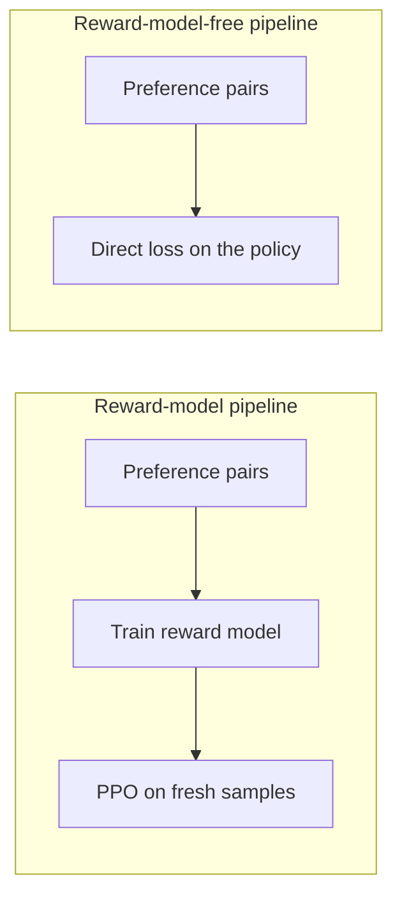

# Preference Optimisation: DPO and Its Successors

Preference optimisation trains a language model on pairs of responses, one preferred and one not, instead of on absolute scores. Direct Preference Optimization (DPO) showed that the reward-model-and-reinforcement-learning pipeline can be replaced by a single loss on the policy, and successors such as IPO, KTO, ORPO and SimPO have since changed that loss and the data it needs.

## Overview

Reinforcement learning from human feedback (RLHF) trains a reward model on human comparisons, then optimises the model against it with a reinforcement learning loop, usually [PPO](../../theory/paradigms/reinforcement-learning/proximal-policy-optimisation/index.md), while a penalty keeps it near its starting point. The [RLHF pipeline](../../theory/paradigms/reinforcement-learning/learning-from-human-feedback/index.md) and its use in [InstructGPT](../../theory/models/llm/instructgpt-rlhf/index.md) are covered elsewhere. This page covers the practitioner's choices of objective, data and reward model.

## Key concepts

- **Preference pair**: a prompt \(x\) with a preferred response \(y_w\) and a dispreferred response \(y_l\).
- **Bradley–Terry model**: the probability that \(y_w\) beats \(y_l\) is \(\sigma(r(x,y_w) - r(x,y_l))\), where \(\sigma\) is the logistic function.
- **Reference policy** \(\pi_{ref}\): usually the supervised fine-tuned model, to which a KL penalty keeps the trained policy close.
- **Implicit reward**: \(\beta\log(\pi_\theta/\pi_{ref})\), the reward a DPO-trained model implies for each response.

## How it works

### From the RLHF objective to DPO

RLHF maximises expected reward minus a KL penalty:

$$
\max_{\pi} \; \mathbb{E}_{x,\,y\sim\pi}\big[r(x,y)\big] - \beta\, \mathbb{D}_{KL}\big[\pi(y\mid x)\,\|\,\pi_{ref}(y\mid x)\big]
$$

This objective has a closed-form optimum, \(\pi^*(y\mid x) \propto \pi_{ref}(y\mid x)\exp(r(x,y)/\beta)\). Rearranged, the reward becomes \(r(x,y) = \beta\log\frac{\pi^*(y\mid x)}{\pi_{ref}(y\mid x)} + \beta\log Z(x)\), where \(Z(x)\) depends only on the prompt. Substitute this into the Bradley–Terry likelihood and \(Z(x)\) cancels, because both responses share the prompt. What remains is a loss on the policy alone:

$$
\mathcal{L}_{\text{DPO}} = -\,\mathbb{E}\left[\log\sigma\!\left(\beta\log\frac{\pi_\theta(y_w\mid x)}{\pi_{ref}(y_w\mid x)} - \beta\log\frac{\pi_\theta(y_l\mid x)}{\pi_{ref}(y_l\mid x)}\right)\right]
$$

The derivation assumes the optimum is reached over all possible responses, so training on a finite dataset is an approximation, and that gap underlies several failure modes below.

The gradient raises the preferred response's log-ratio and lowers the dispreferred one's, weighted by how wrongly the implicit reward ranks the pair.

### Two pipelines

The reward-model pipeline samples and scores new responses, which allows exploration, but it needs a second network, reinforcement learning infrastructure and many hyperparameters. The reward-model-free pipeline trains on a fixed set of pairs. It is simpler and more stable, but it gains little from responses outside its data unless the data are refreshed.

## Key methods

| Method | Data needed | Reference model | What changes from DPO |
|---|---|---|---|
| DPO (Rafailov et al., 2023) | Preference pairs | Yes | Log-sigmoid loss on the log-ratio margin |
| IPO (Azar et al., 2023) | Preference pairs | Yes | Squared loss that aims the margin at a finite target |
| KTO (Ethayarajh et al., 2024) | Single responses marked desirable or not | Yes | Prospect-theory utility; no pairs needed |
| ORPO (Hong et al., 2024) | Preference pairs | No | Odds-ratio penalty added to the SFT loss, in one stage |
| SimPO (Meng et al., 2024) | Preference pairs | No | Length-averaged log-probability as implicit reward, plus a target margin |

IPO comes from a general framework, \(\Psi\)PO, that avoids two approximations in RLHF: pointwise rewards standing in for pairwise preferences, and reward models generalising to the policy's own samples. The authors argue that the DPO log-sigmoid keeps rewarding larger margins when preferences are near-deterministic, which invites overfitting. KTO draws on prospect theory, in which losses weigh more than gains, and its authors argue that no single loss is best in every setting.

## Online and offline data

DPO is usually trained offline: pairs are collected once, often from a different model, and reused. This is cheap and reproducible, but the pairs describe responses the current model may no longer produce, so the training is off-policy.

Online methods sample from the current model, label the samples and repeat. Guo et al. sample two responses per step and have an LLM annotator choose between them, and they report outperforming offline DPO-style methods and RLHF in human evaluation. Tajwar et al. find that on-policy sampling, and methods that push down some responses' likelihood, generally outperform offline objectives. Online training needs a judge and generation capacity, so the choice is partly a budget question. Xu et al. report that tuned PPO surpassed the other methods they tested.[^1]

## Connections

Preference data are a form of [learning from human feedback](../../theory/paradigms/reinforcement-learning/learning-from-human-feedback/index.md). Offline DPO is closely related to [offline reinforcement learning](../../theory/paradigms/reinforcement-learning/offline-rl/index.md): it learns from a fixed dataset while the policy moves away from it, which is the distribution-shift problem offline RL studies. Pairs can also come from AI feedback, as in [Constitutional AI and RLAIF](../../society/safety-alignment/constitutional-ai.md), and the loss can be trained with the adapters in [parameter-efficient fine-tuning](peft-lora.md).

The brain connection is suggestive, not established. Preference data are people's choices, and the implicit reward, a log-ratio against a reference, loosely resembles the prediction error in [dopamine reward prediction error](../../brain-mind/neuroscience/dopamine-reward-prediction-error/index.md). Nothing shows that brains learn through a preference loss of this kind.

## Applications

- **Assistant post-training**, where preference tuning follows supervised fine-tuning.

## Open questions

- **Length exploitation.** Park et al. show that DPO can favour longer responses that are not better.
- **Likelihood displacement.** The likelihood of preferred responses can fall during DPO training. Razin et al. link it to pairs with similar embeddings.[^2]
- **Over-optimisation.** Optimising against a proxy reward model can lower true quality once optimisation goes too far.[^3] The IPO authors argue that reward-free methods can still overfit a fixed set of pairs.

## References

### Seminal papers

- Bradley, R. A. & Terry, M. E. (1952). *Rank Analysis of Incomplete Block Designs: I. The Method of Paired Comparisons*. Biometrika. https://doi.org/10.2307/2334029 — Introduces the paired-comparison model behind the preference loss.
- Rafailov, R. et al. (2023). *Direct Preference Optimization: Your Language Model is Secretly a Reward Model*. arXiv. https://arxiv.org/abs/2305.18290 — Derives the DPO loss from the RLHF objective, dropping the reward model.
- Azar, M. G. et al. (2023). *A General Theoretical Paradigm to Understand Learning from Human Preferences*. arXiv. https://arxiv.org/abs/2310.12036 — Introduces the ΨPO framework and the IPO objective.
- Ethayarajh, K. et al. (2024). *KTO: Model Alignment as Prospect Theoretic Optimization*. arXiv. https://arxiv.org/abs/2402.01306 — Aligns models from single desirable or undesirable labels.
- Hong, J., Lee, N. & Thorne, J. (2024). *ORPO: Monolithic Preference Optimization without Reference Model*. arXiv. https://arxiv.org/abs/2403.07691 — Merges supervised fine-tuning and preference alignment, with no reference model.
- Meng, Y., Xia, M. & Chen, D. (2024). *SimPO: Simple Preference Optimization with a Reference-Free Reward*. arXiv. https://arxiv.org/abs/2405.14734 — Uses length-averaged log-probability as the implicit reward.

### Surveys and textbooks

- Kaufmann, T. et al. (2023). *A Survey of Reinforcement Learning from Human Feedback*. arXiv. https://arxiv.org/abs/2312.14925 — Surveys reinforcement learning from human feedback, including reward models.

### Articles and documentation

- Xu, S. et al. (2024). *Is DPO Superior to PPO for LLM Alignment? A Comprehensive Study*. arXiv. https://arxiv.org/abs/2404.10719 — Compares DPO with PPO on RLHF testbeds, from dialogue to code.
- Tajwar, F. et al. (2024). *Preference Fine-Tuning of LLMs Should Leverage Suboptimal, On-Policy Data*. arXiv. https://arxiv.org/abs/2404.14367 — Finds that on-policy sampling helps preference fine-tuning.
- Guo, S. et al. (2024). *Direct Language Model Alignment from Online AI Feedback*. arXiv. https://arxiv.org/abs/2402.04792 — Uses an LLM annotator to give online feedback on the model's own samples.
- Park, R. et al. (2024). *Disentangling Length from Quality in Direct Preference Optimization*. arXiv. https://arxiv.org/abs/2403.19159 — Shows DPO exploits verbosity and proposes a regulariser.
- Razin, N. et al. (2024). *Unintentional Unalignment: Likelihood Displacement in Direct Preference Optimization*. arXiv. https://arxiv.org/abs/2410.08847 — Explains how the likelihood of preferred responses can fall in DPO.
- Gao, L., Schulman, J. & Hilton, J. (2022). *Scaling Laws for Reward Model Overoptimization*. arXiv. https://arxiv.org/abs/2210.10760 — Measures true quality as a policy is optimised against a proxy reward.

[^1]: Xu et al. (2024) report that PPO surpassed the other methods in all their cases, and argue that DPO has fundamental limitations.
[^2]: Razin et al. (2024) report that filtering out the samples a centred embedding-similarity score flags reduced the problem.
[^3]: Gao et al. (2022) use a synthetic gold-standard reward model in place of human labels, so their results may not transfer directly.
