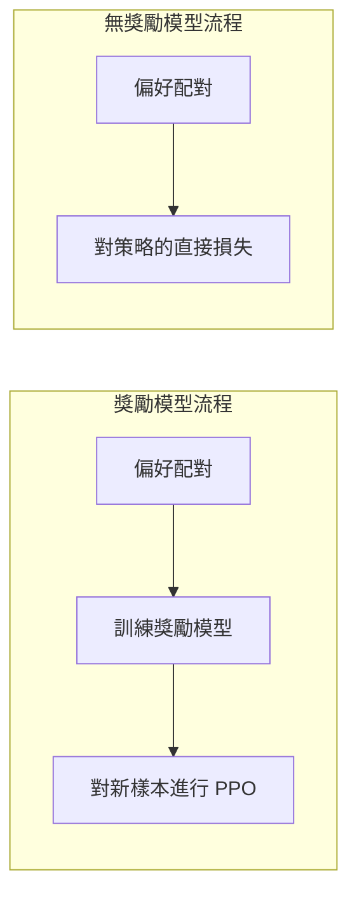

# 偏好最佳化：DPO 及其後續方法

偏好最佳化讓語言模型學習成對的回應（一個較受偏好、一個較不受偏好），而不是學習絕對分數。直接偏好最佳化（Direct Preference Optimization，DPO）顯示，獎勵模型加上強化學習的流程，可以被策略上的單一損失函數取代；此後，IPO、KTO、ORPO 與 SimPO 等後續方法改變了這個損失函數，以及它所需的資料。

## 概述

基於人類回饋的強化學習（RLHF）先以人類的比較訓練獎勵模型，再通常以 [PPO](../../theory/paradigms/reinforcement-learning/proximal-policy-optimisation/index.zh-TW.md) 這類強化學習迴圈讓模型最大化該獎勵，同時以一個懲罰項讓模型保持接近其起點。[RLHF 流程](../../theory/paradigms/reinforcement-learning/learning-from-human-feedback/index.md)與它在 [InstructGPT](../../theory/models/llm/instructgpt-rlhf/index.zh-TW.md) 中的應用已在其他頁面說明。本頁討論實務上在目標函數、資料與獎勵模型之間的取捨。

## 關鍵概念

- **偏好配對**：一個提示 \(x\)，加上較受偏好的回應 \(y_w\) 與較不受偏好的回應 \(y_l\)。
- **Bradley–Terry 模型**：\(y_w\) 勝過 \(y_l\) 的機率為 \(\sigma(r(x,y_w) - r(x,y_l))\)，其中 \(\sigma\) 為邏輯函數。
- **參考策略** \(\pi_{ref}\)：通常是監督式微調後的模型，KL 懲罰項使訓練後的策略保持接近它。
- **隱含獎勵**：\(\beta\log(\pi_\theta/\pi_{ref})\)，即經 DPO 訓練的模型對每個回應所隱含的獎勵。

## 運作方式

### 從 RLHF 目標到 DPO

RLHF 最大化期望獎勵減去 KL 懲罰：

$$
\max_{\pi} \; \mathbb{E}_{x,\,y\sim\pi}\big[r(x,y)\big] - \beta\, \mathbb{D}_{KL}\big[\pi(y\mid x)\,\|\,\pi_{ref}(y\mid x)\big]
$$

這個目標有封閉形式的最優解 \(\pi^*(y\mid x) \propto \pi_{ref}(y\mid x)\exp(r(x,y)/\beta)\)。經過整理，獎勵可以用策略表示為 \(r(x,y) = \beta\log\frac{\pi^*(y\mid x)}{\pi_{ref}(y\mid x)} + \beta\log Z(x)\)，其中正規化項 \(Z(x)\) 只依賴於提示。代入 Bradley–Terry 似然後，\(Z(x)\) 會消去，因為兩個回應共享同一個提示。剩下的是只針對策略的損失函數：

$$
\mathcal{L}_{\text{DPO}} = -\,\mathbb{E}\left[\log\sigma\!\left(\beta\log\frac{\pi_\theta(y_w\mid x)}{\pi_{ref}(y_w\mid x)} - \beta\log\frac{\pi_\theta(y_l\mid x)}{\pi_{ref}(y_l\mid x)}\right)\right]
$$

推導假設最優解是在所有可能的回應上達成的。實際上，損失函數是套用在有限的資料集上，這個差距是下文多種失效模式的根源之一。

梯度會提高較受偏好回應的對數比、降低較不受偏好回應的對數比，其權重取決於隱含獎勵對該配對排序的錯誤程度。

### 兩種流程

獎勵模型流程在訓練時會取樣並為新的回應評分，因此能夠探索超出資料範圍的解，但它需要第二個網路、強化學習的基礎設施，以及許多相互影響的超參數。無獎勵模型流程則在一組固定的配對上訓練，它較為簡單且穩定，但除非資料被更新，否則難以從資料之外的回應中獲益。

## 關鍵方法

後續方法在所需資料、是否保留參考模型，以及損失函數如何處理兩個回應之間的間隔等方面各有不同。

| 方法 | 所需資料 | 參考模型 | 相對 DPO 的改變 |
|---|---|---|---|
| DPO（Rafailov et al., 2023） | 偏好配對 | 是 | 對數比間隔上的 log-sigmoid 損失 |
| IPO（Azar et al., 2023） | 偏好配對 | 是 | 平方損失，將間隔導向一個有限的目標值 |
| KTO（Ethayarajh et al., 2024） | 標記為期望或不期望的單一回應 | 是 | 採用展望理論的效用；不需要配對 |
| ORPO（Hong et al., 2024） | 偏好配對 | 否 | 在 SFT 損失上加入勝算比懲罰，單一階段完成 |
| SimPO（Meng et al., 2024） | 偏好配對 | 否 | 以長度平均的對數機率作為隱含獎勵，並加上目標間隔 |

IPO 來自一個一般化框架 \(\Psi\)PO，該框架避免了 RLHF 中的兩個近似：以逐點獎勵取代成對偏好，以及假設獎勵模型能推廣到策略自身取樣的回應。作者認為，當訓練偏好接近確定性時，DPO 的 log-sigmoid 會持續獎勵更大的間隔，因而容易引發過擬合。KTO 則借用展望理論，即損失的權重大於收益；其作者認為，沒有任何單一損失函數在所有情境下都最佳。

## 線上與離線資料

DPO 通常以離線方式訓練：配對一次蒐集（常來自另一個模型），之後重複使用。這種做法成本低且可重現，但這些配對描述的是當前模型可能已不再產生的回應，因此訓練屬於離策略（off-policy）。

線上方法則從當前模型取樣、加上標籤，然後重複。Guo et al. 每一步取樣兩個回應，由 LLM 標註者選出較佳者，並在人類評估中報告其優於離線的 DPO 類方法與 RLHF。Tajwar et al. 發現，採用同策略（on-policy）取樣，以及會壓低部分回應似然的方法，通常優於離線目標。線上訓練需要評判者與生成算力，因此選擇在一定程度上是預算問題。Xu et al. 報告，經調校的 PPO 在他們測試的所有情況中都超越其他方法。[^1]

## 相關連結

偏好資料是[基於人類回饋的學習](../../theory/paradigms/reinforcement-learning/learning-from-human-feedback/index.md)的一種形式。離線 DPO 與[離線強化學習](../../theory/paradigms/reinforcement-learning/offline-rl/index.md)密切相關：它從固定資料集學習，而策略會逐漸偏離該資料集，這正是離線強化學習所研究的分布偏移問題。偏好配對也可以來自 AI 回饋，例如[憲法式 AI 與 RLAIF](../../society/safety-alignment/constitutional-ai.zh-TW.md)；此損失也可以搭配[參數高效微調](peft-lora.zh-TW.md)中的適配器來訓練。

腦科學的連結是有所啟發，但尚未確立。偏好資料來自人們的選擇；而隱含獎勵是相對於參考的對數比，它與[多巴胺獎勵預測誤差](../../brain-mind/neuroscience/dopamine-reward-prediction-error/index.zh-TW.md)中所描述的預測誤差有鬆散的相似之處。目前沒有證據顯示大腦以這類偏好損失進行學習。

## 應用

- **助理模型的後訓練**，偏好調校接在監督式微調之後。

## 開放問題

- **長度利用**：Park et al. 顯示 DPO 可能偏好較長但並不更好的回應。
- **似然位移**：偏好回應的似然在 DPO 訓練中可能下降。Razin et al. 將其與回應嵌入相似的配對相連。[^2]
- **過度最佳化**：當針對代理獎勵模型的最佳化走得太遠，真實品質可能下降。[^3] IPO 的作者認為，無獎勵模型的方法仍可能過擬合一組固定的配對。

## 參考文獻

### 開創性論文

- Bradley, R. A. & Terry, M. E. (1952). *Rank Analysis of Incomplete Block Designs: I. The Method of Paired Comparisons*. Biometrika. https://doi.org/10.2307/2334029 — 介紹偏好損失背後的配對比較模型。
- Rafailov, R. et al. (2023). *Direct Preference Optimization: Your Language Model is Secretly a Reward Model*. arXiv. https://arxiv.org/abs/2305.18290 — 從 RLHF 目標推導出 DPO 損失，去掉了獎勵模型。
- Azar, M. G. et al. (2023). *A General Theoretical Paradigm to Understand Learning from Human Preferences*. arXiv. https://arxiv.org/abs/2310.12036 — 提出 ΨPO 框架與 IPO 目標函數。
- Ethayarajh, K. et al. (2024). *KTO: Model Alignment as Prospect Theoretic Optimization*. arXiv. https://arxiv.org/abs/2402.01306 — 從單一的期望或不期望標籤進行模型對齊。
- Hong, J., Lee, N. & Thorne, J. (2024). *ORPO: Monolithic Preference Optimization without Reference Model*. arXiv. https://arxiv.org/abs/2403.07691 — 在單一階段中合併監督式微調與偏好對齊，且不需要參考模型。
- Meng, Y., Xia, M. & Chen, D. (2024). *SimPO: Simple Preference Optimization with a Reference-Free Reward*. arXiv. https://arxiv.org/abs/2405.14734 — 以長度平均的對數機率作為隱含獎勵，且不需要參考模型。

### 綜述與教科書

- Kaufmann, T. et al. (2023). *A Survey of Reinforcement Learning from Human Feedback*. arXiv. https://arxiv.org/abs/2312.14925 — 綜述基於人類回饋的強化學習，包括獎勵模型。

### 文章與文件

- Xu, S. et al. (2024). *Is DPO Superior to PPO for LLM Alignment? A Comprehensive Study*. arXiv. https://arxiv.org/abs/2404.10719 — 在從對話到程式碼的 RLHF 測試集上比較 DPO 與 PPO。
- Tajwar, F. et al. (2024). *Preference Fine-Tuning of LLMs Should Leverage Suboptimal, On-Policy Data*. arXiv. https://arxiv.org/abs/2404.14367 — 發現同策略取樣有助於偏好微調。
- Guo, S. et al. (2024). *Direct Language Model Alignment from Online AI Feedback*. arXiv. https://arxiv.org/abs/2402.04792 — 使用 LLM 標註者，對模型自身的樣本提供線上回饋。
- Park, R. et al. (2024). *Disentangling Length from Quality in Direct Preference Optimization*. arXiv. https://arxiv.org/abs/2403.19159 — 顯示 DPO 會利用冗長的回應，並提出正則化方法。
- Razin, N. et al. (2024). *Unintentional Unalignment: Likelihood Displacement in Direct Preference Optimization*. arXiv. https://arxiv.org/abs/2410.08847 — 說明 DPO 中偏好回應的似然為何可能下降。
- Gao, L., Schulman, J. & Hilton, J. (2022). *Scaling Laws for Reward Model Overoptimization*. arXiv. https://arxiv.org/abs/2210.10760 — 衡量在針對代理獎勵進行最佳化時，真實品質如何變化。

[^1]: Xu 等人（2024）報告，PPO 在他們的所有情況中都超越了其他方法，並認為 DPO 存在根本限制。
[^2]: Razin 等人（2024）報告，過濾掉以中心化嵌入相似度分數標記出的樣本，減輕了此問題。
[^3]: Gao 等人（2022）以合成的黃金標準獎勵模型取代人類標籤，因此其結果未必能直接套用於真實資料。
